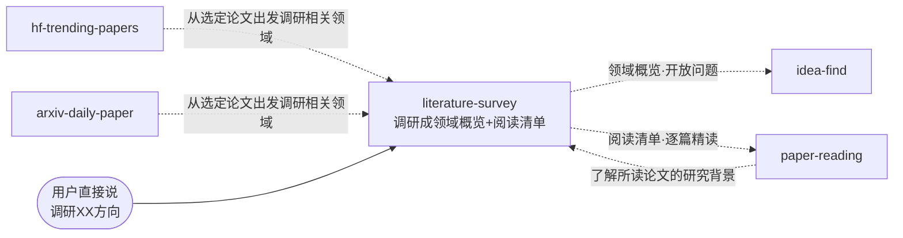
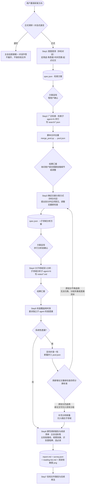

# 文献调研助手

围绕用户给出的研究方向检索文献，说明主要技术路线及其发展过程，留下可复查的调研记录和入门阅读清单。

正式调研提供三份主要文件。

- `report.md` 说明研究领域在解决什么问题、历经哪些变化、各技术路线如何选择。
- `survey.json` 保存分类、论文清单和开放问题，供其他技能读取。
- `reading-list.md` 提供入门阅读清单、阅读依赖图和逐篇导读。用户可按清单顺序用 `paper-reading` 逐篇精读。

---

## 与其他技能的关系

用户可以直接提出调研方向，也可以从 `hf-trending-papers`、`arxiv-daily-paper` 或 `paper-reading` 选定论文后了解相关领域。用户可用阅读清单逐篇精读，`idea-find` 可参考领域分类和开放问题。产出供用户理解领域，参见 `dl-assistant` 的全局流程图。



> 完整的技能关系见 `dl-assistant` 的「全局 skill 流向图」；本 skill 只画与自己相关的 skill。

---

## 调研范围

搜集文献，归纳分类、发展过程和里程碑，记录开放问题，并撰写调研报告和阅读清单。

其他任务按下表交接。

| 场景                                         | 用                |
| -------------------------------------------- | ----------------- |
| 判断某 gap 值不值得做 / 是否 novel / 找 idea | `idea-find`       |
| 带人逐篇精读、讲懂某一篇论文                 | `paper-reading`   |
| 选哪个 baseline repo / 核查权重数据集        | `baseline-survey` |
| 写论文里正式的 Related Work 章节 + 正式 bib  | `writing-paper`   |

记录文献中可核查的开放问题，研究缺口的价值和新颖性由 `idea-find` 评估。阅读清单说明该读哪些论文和阅读顺序，逐篇精读由用户和 `paper-reading` 完成。

在本地机器运行。产出供用户和 `idea-find` 查阅，其他机器需要这些文件时请用户提供。文件交接见 `dl-assistant`「所有技能共用的规则」。调研时才会确定候选论文和子领域，因此不使用预先定义的 workflow。

---

## 选择正式调研或对话式速览

```
用户想正式调研一个方向（要保存到文件产物）   → 从 Step 1 起走完整流程
快速了解 / "给我讲讲 XX"（不要产物）  → 对话式速览：主会话直接搜、对话里答，
                                        不并行展开、不保存到文件
拿不准                              → 问一句："要正式调研出产物，还是快速了解一下就行？"
```

用户拿着已有调研产物来提问的，直接读那份 `report.md` 对话回答，不算本 skill 的新一轮运行。

---

## 核心思想

先广泛检索，再根据实际找到的论文确定分类方式，按子领域深入分析，最后撰写报告和阅读清单。

```
广泛检索 ──→ 确定分类方式 ──→ 分子领域深入分析 ──→ 撰写报告
 Step 2       Step 3             Step 4                 Step 6
```

三条原则：

1. **先检索，再分类**。尽量覆盖各主要路线，再选择一个主要分类维度，把论文分成 3–5 个子领域。分类会影响后续分析和报告结构。
2. **分工**。主会话澄清需求、确定分类、比较子领域并撰写报告。子 agent 并行检索和分析各子领域。需要和用户讨论的判断由主会话负责。
3. **保存完整记录**。子 agent 将完整结果保存到文件，只向主会话返回简要结论。检索结果写成 JSON，由 `scripts/merge_pool.py` 合并去重，统计以脚本输出为准。

委派前向用户说明方案，由用户确认后执行。任务完成后汇报结果，主动邀请用户提出疑问或调整。把确认的方案逐步写入 `spec.json`。Step 1 明确的用途和熟悉度用于确定检索重点、分类、报告内容和必读论文。

---

## 各步骤通用的规则

以下规则适用于整个调研流程。

### 语言规范

- **agent 与用户对话：全中文**。结构概念也用中文——说「子领域」不说 bucket，说「调研方案」不说 spec。
- **子 agent 产出的文件：全中文（值用中文，键名英文）**——用户会读它们。
- **只有专有名词保留英文**：具体的论文名、方法名、数据集名、评测指标名等，保留其英文原文，不强译。
- **符号展示**：会话公式用 Unicode——见 `dl-assistant` 的「所有技能共用的规则」。

### 子 agent 类型

Step 2 的检索任务和 Step 4 的子领域分析需要写文件，子 agent 必须使用有写权限的 `general-purpose`。Step 5 的独立检查只返回清单，子 agent 类型不限。

### TaskList 跟踪流程

确定调研方式后建立任务，依次跟踪需求澄清、检索、确定分类、子领域分析、覆盖检查、撰写和交付。补充检索或重新分类时更新任务状态。

### 输出结构

每次正式调研使用固定目录 `<项目>/docs/literature-survey/<日期>-<topic-slug>/`，在任务简报中把完整路径提供给需要保存文件的子 agent。

```
<项目>/docs/literature-survey/
└── <日期>-<topic-slug>/
    ├── spec.json        调研方案（机读，会动态增长）：Step1 写检索方案，Step3 写子领域分析方案
    ├── pool.json        文献候选论文清单（merge_pool.py 合并去重的产物）
    ├── report.md        最终领域概览（纯人读散文）
    ├── survey.json      机读数据：taxonomy + 候选论文清单 + gap（下游契约）
    ├── reading-list.md  入门阅读清单（阅读依赖图 + 逐篇导读）
    ├── reading-list-tree.mmd / .png   阅读依赖图源文件与导出图
    ├── search/          检索子 agent 各自的检索结果（json）
    │   └── <query组-slug>.json
    └── notes/           负责子领域分析的子 agent 各自的子领域笔记（中文 md：逐篇笔记 + 方法对比和可引用依据）
        └── <子领域-slug>.md
```

Step 1 将检索方案写入 `spec.json`，Step 3 补充子领域分析方案。Step 2 由检索子 agent 写入 `search/`，主会话用脚本合并成 `pool.json`。Step 4 由负责子领域分析的子 agent 写入 `notes/`。Step 6 由主会话根据笔记生成 `report.md`、`survey.json`、`reading-list.md` 和阅读依赖图。

`report.md` 应能独立阅读。`survey.json` 供程序读取，`reading-list.md` 供用户选择阅读顺序。需要复查过程或了解细节时，可以查阅 spec、pool、search 和 notes。

**产物模板索引**（一产物一模板，写到哪个读哪个；都在 `references/templates/`）：

| 产物                    | 模板                       | 哪一步用                        |
| ----------------------- | -------------------------- | ------------------------------- |
| `spec.json`             | `spec-template.md`         | Step1 / Step3 主会话写方案      |
| `search/<query组>.json` | `search-template.md`       | Step2 写进检索子 agent 任务简报 |
| `notes/<子领域>.md`     | `notes-template.md`        | Step4 写进负责子领域分析的子 agent 任务简报 |
| `report.md`             | `report-template.md`       | Step6 主会话执笔前必读          |
| `survey.json`           | `survey-template.json`     | Step6 主会话写机读数据          |
| `reading-list.md`       | `reading-list-template.md` | Step6 主会话写阅读清单          |

用 Write 工具直接保存文件，避免经由 Python 字符串转写长内容，以免截断或转义出错。`search/` 中的 JSON 写完后，必须运行 `scripts/merge_pool.py` 合并去重。

**对话式速览例外**：不并行展开、不保存到文件，直接对话回答；用户要存才保存单个 `report.md`（落到同一写死目录，模板可从简）

---

## 调研流程

整体编排：



### Step 1：意图澄清（多轮对话 → 产出检索方案）

用户的需求往往是一句模糊的话。**agent 需要像带学生的导师那样引导用户澄清意图：顺着用户的话往下挖，先把"到底要调研什么、为什么调研"聊清楚，而不是甩一张表让用户填。**

**对话纪律**：

- **一次只问一个问题**，宁可多轮，不一口气问全；后一个问题由前一个回答塑造。
- **先开放、后收敛**：先用开放式问题引导用户思考，而后逐步缩小，直至收敛
- 前文已有依据或存在合理默认值时，直接提出建议，由用户确认。
- 收集到足够信息后，开始拟定检索方案。

讨论时确认两项因素和两项参数。

- **用途**。确认这份调研要帮助用户做什么。对话中已明确时，复述后请用户确认。用途分为以下四类。
    ```
    学习理解        —— 要读懂这个领域本身（在干嘛、怎么演化、代表作）
    找研究方向      —— 接下来去 idea-find 找可做的点，要地图 + 开放问题清单
    定位自己的工作  —— 已有/将有工作，要知道跟谁比、差异在哪
    选技术方案      —— 有具体问题，要收集并比较可行解法，从中选择
    ```
- **熟悉度**。确认用户对该方向的了解程度：基本陌生 / 有点了解 / 就在其中做。熟悉度与用途分别确认。
- **参数① 时间范围**：按两个变量给默认（基本陌生不限——要含奠基作；找研究方向/定位/选型近 3-5 年 + 近期检索时间窗），建议 + 让用户确认即可，不当正经问题问。**不问篇数**——深入分析多少篇是成本决策，在 Step3 决定。
- **参数② 起点论文**：是否有辅助调研的相关起点论文（标题 / arXiv ID / 本地 PDF）；在自然的地方询问用户。

用途与熟悉度分别影响以下安排。

- **熟悉度**决定是否说明术语、报告从哪些基础讲起、逐篇导读写多细，以及是否按时间梳理以便入门。
- **用途**决定近期检索力度、分类要突出什么、开放问题是否重点查看论文局限，以及代表作的分析数量。寻找研究方向或定位自己的工作时加大近期检索力度。

呈现方案时告知固定目录 `docs/literature-survey/<日期>-<topic-slug>/`。

信息齐备后，向用户呈现检索方案，说明用途、熟悉度、时间范围、目录、覆盖范围和近期检索力度，以及查询分组数量和各组的设计理由。检索力度见 `references/source-strategy.md`，查询设计见 `references/search-strategy.md`。用户确认或修改后，将方案写入 `spec.json` 的检索方案段，再进入 Step 2。

### Step 2：广泛检索

根据检索方案广泛获取候选论文，尽量覆盖各主要路线。每组查询由一个子 agent 执行，并行检索。使用前文规定的子 agent 类型。

**用哪个来源**（细节见 `references/source-strategy.md`）：

- 第一轮都使用 Semantic Scholar、Google Scholar、arXiv 与 hf-papers。Semantic Scholar 和 Google Scholar 补足相关研究，arXiv 查找指定日期范围内的新投稿，hf-papers 补充关键词未覆盖的论文和近期工作。所有调研用途都要用 arXiv 与 hf-papers 检索近期论文，重点随用途调整。
- 委派前读 `references/source-strategy.md` 和 `references/hf-papers.md`，将 hf 命令要点写进任务简报。hf-papers 通过 CLI 单独运行，与 paper-search MCP 分别调用。

每个检索子 agent：

- **写** `search/<query组-slug>.json`（结构见 `references/templates/search-template.md`，写进任务简报）：命中论文（含 摘要 要点）+ 纳入/排除理由，被排除的也留痕。**`arxiv` / `doi` / `title` 三个去重键至少填准一个，`published`（YYYY-MM）有就填**——脚本合并和检索近期论文统计都靠它们。
- **返回**紧凑清单——标题 + arXiv ID/DOI/URL + 年份 + venue + 引用数 + **一句话"采用什么技术路线"**，**不带 摘要 全文**。

全部检索子 agent 回来后，主会话**跑脚本合并去重**：

```
python3 <本 skill 目录>/scripts/merge_pool.py <调研目录>
```

脚本生成 `pool.json` 和统计。向用户报告各组检索数量、合并前后数量和主要技术路线，同时报告 arXiv 近期覆盖到哪一月、各有多少篇 arXiv 和 hf-papers 结果。未执行近期检索时明确报告 0。询问用户是否要查看具体检索结果，再继续确定分类。

> 检索 操作手册（沿引用关系检索、survey 优先、时间配比补奠基作、去重、检索子 agent 完整产出契约）见 `references/search-strategy.md`；来源选择与用途加权见 `references/source-strategy.md`。对话式速览不 并行展开，主会话直接搜。

### Step 3：确定文献分类方式

分类方式应能解释已找到的论文怎样分组。由主会话根据检索结果提出建议，并与用户讨论。

1. 根据 `pool.json` 提出分类维度和子领域划分。检查每篇是否能归到一个子领域、组间是否均衡、候选论文是否得到覆盖、分类是否服务调研用途。
2. 向用户说明建议的分类、子领域和理由，并问是否希望侧重或拆分某些部分。
3. 用户提出调整后，按上述四项重查。划分成立时更新方案并确认，有问题时说明原因并提出可行的替代划分。

确认分类后，将分类维度、子领域、各领域分析重点和建议分析规模写入 `spec.json`。这是并行开展子领域分析前的第二次方案确认。

根据候选论文数量、分组和用途，建议每个子领域分析多少代表作及总量，附理由，由用户确认。规模不设固定档位，寻找研究方向时建议覆盖更多代表作。近期检索范围内的新工作全部纳入候选清单与 `survey.json`，代表作数量只决定详细分析哪些论文。

> 分类依据、何时查阅代表论文摘要、何时补充检索、分类层级和任务简报示例见 `references/organizing-axis.md`。四项检查用于提出和调整分类，无需作为独立步骤向用户汇报。
>
> **对话式速览**直接列出代表作和阅读顺序，跳过子领域划分和 Step 4。

### Step 4：分子领域深入分析

按 `spec.json` 中确认的方案，为每个子领域委派一个子 agent。各自保存笔记，并返回简要结论。

- **写** `notes/<子领域-slug>.md`（**中文**）：逐篇笔记 + **方法对比和可引用依据**（供 Step6 执笔用）+ 里程碑标注 + 本类开放问题——结构见 `references/templates/notes-template.md`（写进任务简报）。
- **返回主会话**：精简摘要（子领域名 / 篇数 / 2-3 条主路线 / 里程碑 / 开放问题）+ 文件路径。
- 任务简报来自 `spec.json`，说明论文清单、按分类维度确定的分析重点和调研用途。

完成后告知用户已分析的子领域和保存笔记的位置，说明下一步是撰写报告，并询问用户要不要先查看某个子领域的细节。

> `notes/` 保存逐篇笔记、方法对比和可引用的依据。保留足够细节供主会话比较方法机制。Step 6 的报告由主会话撰写，避免直接拼接子 agent 的段落。任务简报见 `references/organizing-axis.md`。

### Step 5：独立检查文献覆盖和时效

撰写报告前，委派一个独立的子 agent 检查系统性遗漏，避免沿用主会话已经形成的判断。

- 只提供 `pool.json`、分类维度和子领域划分，省略主会话选择分类时的推理过程。
- 子 agent 检查两项内容：
    1. **检查系统性遗漏**。查是否漏掉技术流派、别名、时间段或研究社区，查询是否偏向主流术语，以及某个子领域是否因检索不足而论文较少。
    2. **核查发表时间**。将论文按时间排序，检查近期工作覆盖到哪一月、最近 3 个月有无明显空档，并对照 Step 2 近期检索统计。若历史上有明显空档，用 arXiv 和 Hugging Face 对该时间段补查一次。找到论文则补入候选清单。仍未找到则记录定向查询及其结果。
- 子 agent 返回遗漏清单（遗漏内容、估计影响、建议查询）和时效检查结果（近期缺口及各空档补查结果）。只向主会话返回结果，无需写文件。

主会话拿到清单后判断：

- 找到系统性遗漏或发表空档中查到新论文时，进行一轮针对性补查，将新论文并入 `pool.json`，再按四项标准检查分类。原分类仍适用时，将新论文归入对应子领域，补充分析后进入 Step 6。分类不再满足标准时，例如新论文无法归类、分组失衡或新发现一个需要单列的流派，回到 Step 3 提出新划分，由用户确认后重新安排 Step 4。见 `references/organizing-axis.md`。
- 在发表空档内进行定向查询后仍未发现相关工作时，结束补查，在 `survey.json` 的 `coverage_notes` 记录时间范围及结果。这一信息可供寻找研究方向的用户参考。
- 没有系统性遗漏、只有局部覆盖不足时，保留现有结果。在 `survey.json` 的 `coverage_notes` 记录尚未覆盖或未充分分析的范围。

### Step 6：撰写报告、结构化记录和阅读清单

主会话阅读各 `notes/<子领域>.md`，比较不同子领域、梳理发展过程、确定里程碑并选择必读论文，再亲自撰写三份文件。摘要不够时查阅 `notes/` 或 `search/` 的详细记录。

1. **`report.md`**。写前读 `references/templates/report-template.md` 的五节结构、写作要求和检查清单。由主会话根据笔记撰写连贯的报告，避免拼接不同子 agent 的段落。阅读顺序由 `reading-list.md` 说明。
2. **`survey.json`**——机读数据：metadata（`purpose`/`familiarity`/`axis`/`taxonomy`/`coverage_notes`）+ `papers`（结构化论文清单，arXiv key + 分类 + 里程碑，一篇不漏）+ `gaps`（开放问题 / gap 线索，标来源）。schema 见 `references/templates/survey-template.json`。
3. **`reading-list.md`**。写前读 `references/templates/reading-list-template.md`。选 8–15 篇必读论文，包括奠基作、全局里程碑、每个子领域 1–2 篇代表作和关键近期工作。将阅读依赖编入 `reading-list-tree.mmd`，箭头表示应先读前一篇，再读后一篇。用 `mmdc -i reading-list-tree.mmd -o reading-list-tree.png -b white -w 3840 -H 2160` 导出并嵌入图片。若提示缺少 Chrome，则用 `PUPPETEER_EXECUTABLE_PATH` 指向系统 Chrome，仍无法导出时使用 Mermaid 代码块并告知用户。按依赖关系给论文编号，逐篇说明先读什么、接着可读什么、为何值得读以及阅读重点。发展过程和里程碑应与 `report.md` 第 2 节一致。

**按用途选 report 格式**：

- **学习理解 / 对话式速览** → **自然语言回答**：这方向在解决什么、主流方法/代表作（附标题+年份）、当前状态、建议先读哪几篇。无需严格章节。
- **其余用途的正式调研** → **结构化报告**，按 `report-template.md` 的五节结构（问题定义 → 发展脉络与里程碑 → 技术路线分述 → 比较不同技术路线 → 挑战与开放问题）。

### Step 7：交付文件并说明用途

正式调研结束时，告知 `report.md`、`survey.json`、`reading-list.md` 及 spec、pool、search、notes 的路径，并报告论文总数。对话式速览未保存时，问用户是否希望保存，使用同一固定目录。

用一句话说明后续怎么使用这些文件，例如：

> 「想了解这个领域，可以按 `reading-list.md` 的编号顺序用 paper-reading 逐篇精读。想找研究方向，可以参考这份报告，用 idea-find 继续。」

给出文件和使用说明后结束。

---

## paper-search 工具注意事项

- **禁止编造**：论文信息必须来自工具返回的真实数据。查不到的标"未知"，不拿猜测填。
- **论文 key 用 arXiv ID / DOI / URL，不用 `paper_id`**——见 `dl-assistant` 的「所有技能共用的规则」。
- **翻页优先**：同一查询先翻页（免费），`fetched_total == max_results` 且不足时再增大 `max_results`。
- **来源失败**：检查 `sources_failed`，记录后切其他来源继续，不中断流程；全失败才提示用户调关键词。
- **全文按需读**：首选 tex-mcp——`tex_open` 打开固定版本 → `tex_outline` 定位 + `tex_read` 按节读，别一次性读全文；源码不可用时降级 pdf-mcp：`download_paper_asset` 取路径，用 `pdf_open` 打开后再用 `pdf_read` 按页读。

---

## 交付与后续使用

文件保存后完成交付。其他技能需要参考时，各自从 `docs/literature-survey/` 查找相关报告。

- `report.md`：人读领域概览，自给自足。
- `survey.json`：机读契约（`taxonomy` + `papers` 候选论文清单 + `gaps` 开放问题），供其他技能读取；`gaps` 只是待验证候选，不是结论。
- `reading-list.md`：入门阅读清单，供用户拿去做 paper-reading 逐篇精读。
- `spec.json` / `pool.json` / `search/` / `notes/`：追溯与深入分析时的后备。

> 跨机器无需状态文件——`<日期>-<topic-slug>/` 文件夹（含三件套）是跨机器交接的文件——见 `dl-assistant` 的「所有技能共用的规则」。
