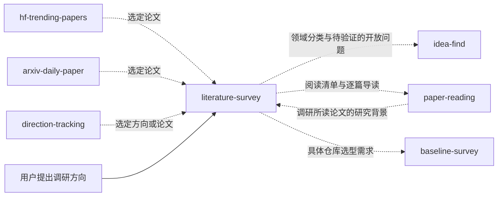
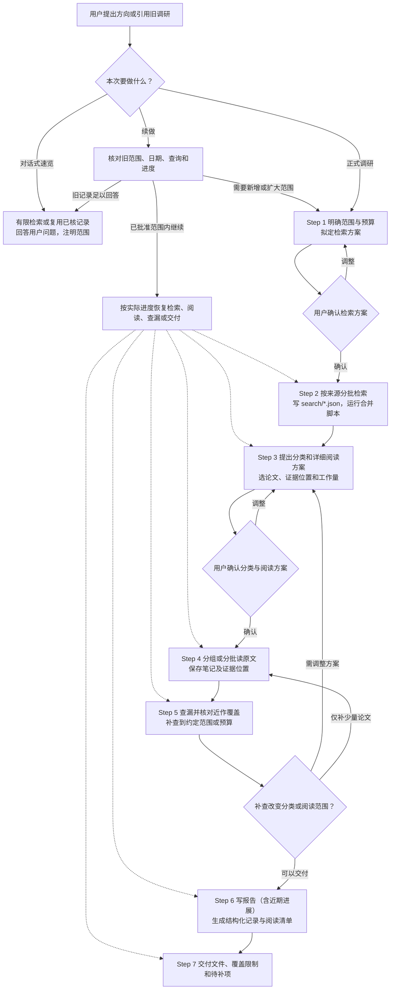

# 文献调研助手

围绕用户的问题检索文献，说明领域在解决什么、有哪些技术路线、它们在什么条件下各有优势，并给出可查证的报告和阅读建议。

## SKILL 交接关系

全局关系和跨机器交接见 `dl-assistant`。报告可供写作参考，正式引用前核对原文、版本和论点。后续任务由用户选择。

## 产出与保存

正式调研默认保存在 `<项目>/docs/literature-survey/<日期>-<topic-slug>/`，也可用用户指定目录。不同调研使用各自目录；续做使用原目录，保留既有检索批次和修订依据。

| 文件 | 用途 |
| --- | --- |
| `report.md` | 领域概览、发展过程、各路线的比较、证据限制与开放问题。 |
| `survey.json` | 供程序读取的分类、论文记录和待验证问题。 |
| `reading-list.md` | 按学习目标分层的阅读清单、逐篇导读和适用时的阅读依赖图。图的源码和渲染图可单独保存。 |
| `spec.json`、`search/*.json`、`pool.json`、`notes/*.md` | 经确认的方案、查询结果及来源、合并候选池和详细阅读笔记。 |
| `coverage-review.md` | 检索覆盖、失败或截断的查询、定向补查结果、待补范围和停止理由。 |

对话式速览直接回答并交代范围，用户要求保存时可只写一份简短报告，附来源和限制。

## 运行流程图

## 参考资料列表

| 参考资料 | 使用时机 |
| --- | --- |
| [运行步骤](references/workflow.md) | 正式调研、速览、续做及七步操作 |
| [来源选择](references/source-strategy.md)、[检索策略](references/search-strategy.md)、[HF 补充检索](references/hf-papers.md) | 设计查询、选择来源和补查 |
| [调研方案模板](references/templates/spec-template.md)、[检索结果模板](references/templates/search-template.md) | 保存批准的计划与各查询批次，按运行步骤补齐 v2 记录 |
| [分类与分析分工](references/organizing-axis.md)、[详细阅读笔记模板](references/templates/notes-template.md) | 初分类、明确详细阅读范围并核查原文 |
| [报告模板](references/templates/report-template.md)、[结构化结果模板](references/templates/survey-template.json)、[阅读清单模板](references/templates/reading-list-template.md) | 编写和核对交付物 |

## 调研原则

### 1. 范围与确认

复用用户已提供的信息，只确认会改变检索或报告的未知项。检索方案和分类及详细阅读方案是正式调研的两个确认点。查漏纳入已批准的计划。预算或范围需要扩大时，再向用户确认。按规模和环境选择分批执行或委派，保留每批独立记录。

### 2. 分类服务于用户的问题

先检索再分类。主分类维度应解释论文之间有用的区别，允许交叉标签、类别规模不均和暂待分类。熟悉度决定从哪里讲起，用户用途决定覆盖重点和阅读建议。

### 3. 证据与覆盖

分别记录发现论文、读过摘要和核查过正文或图表。跨论文比较注明模型、数据、指标等条件及来源位置。把「未执行」「来源失败」「查过但未命中」分开。补查结束时交代实际范围与剩余缺口，开放问题保留原文依据或明确归纳和推测。会话语言和符号遵循 `dl-assistant` 的「所有技能共用的规则」。
