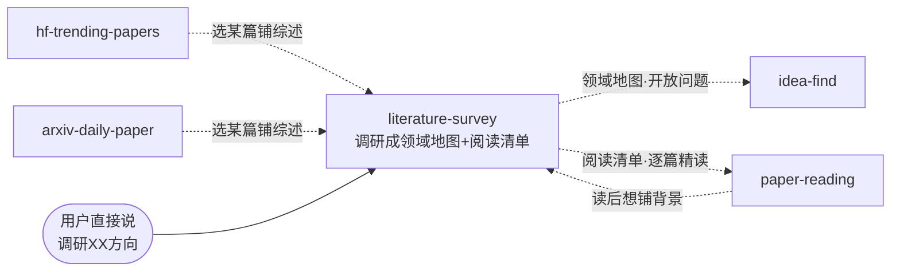
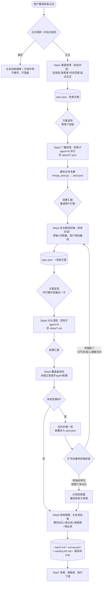

# 文献调研助手

把一个模糊的研究方向，**调研成一张领域地图 + 一份入门阅读清单**——既留下可追溯的调研产物，也把「入门该精读哪几篇、按什么脉络读」说透。

一次调研产出三件套：

- `report.md`——领域地图（纯人读散文），讲清这个领域在干嘛、怎么演化、几条路线怎么选。
- `survey.json`——机读数据（taxonomy + 论文池 + gap），下游契约。
- `reading-list.md`——入门阅读清单（依赖谱系树 + 逐篇导读）。**入门一个领域的正路是拿这份清单用 `paper-reading` 逐篇精读**——听人讲几句入不了门，逐篇读才入门。本 skill 把「读什么、按什么脉络读」说透，「读」这件事交给 paper-reading。

---

## 在系统里的位置（局部）

本 skill 是 `dl-assistant`（深度学习科研智能体）配套 skill 之一，角色是前期的**领域调研 / 综述**——把一个模糊方向调研成领域地图。上游是散点入口（HTP/AD/PR 读到某篇想铺开背景，或用户直接说"调研 XX"），没有固定上游主线；下游两个，都可选：领域地图 + 开放问题给 idea-find 当输入，阅读清单给用户拿去用 paper-reading 逐篇精读。产出是给**人**理解领域用的，不喂写作线（设计原则见 `dl-assistant` SKILL.md「全局 skill 流向图」图例）。



> 整体架构、全局怎么连，看 `dl-assistant` 的「全局 skill 流向图」；本 skill 只画与自己相关的 skill。

---

## SKILL能力边界：做什么、不做什么

**做**：搜文献、归纳分类、画领域地图、识别里程碑、客观记录开放问题、组织成报告、筛必读论文出阅读清单。

**不做**（交给相邻 skill）：

| 场景                                         | 用                |
| -------------------------------------------- | ----------------- |
| 判断某 gap 值不值得做 / 是否 novel / 找 idea | `idea-find`       |
| 带人逐篇精读、讲懂某一篇论文                 | `paper-reading`   |
| 选哪个 baseline repo / 核查权重数据集        | `baseline-survey` |
| 写论文里正式的 Related Work 章节 + 正式 bib  | `writing-paper`   |

**核心纪律：只调研 + 组织，不做判断、不替人读。** 报告会记录"领域里有哪些开放问题"（客观事实），但**"哪个 gap 值得做"是 idea-find 的活**；阅读清单筛出必读后，**逐篇精读是用户 + paper-reading 的活**——把事实和路径交出去，不替用户拍板、不替用户读。

**在哪跑**：本地机器（科研前期）。产出留在本地供用户本人和 idea-find 消费；需要跨机器时找用户搬运（跨机器交接横切规范见 `dl-assistant` SKILL.md「横切规范」）。**不用 workflow**——候选论文和子领域是调研当场才浮现的，不是预定义 DAG。

---

## 入口路由

```
用户想正式调研一个方向（要落盘产物）   → 从 Step 1 起走完整流程
快速了解 / "给我讲讲 XX"（不要产物）  → 对话式速览：主会话直接搜、对话里答，
                                        不并行展开、不落盘
拿不准                              → 问一句："要正式调研出产物，还是快速了解一下就行？"
```

用户拿着已有调研产物来提问的，直接读那份 `report.md` 对话回答，不算本 skill 的新一轮运行。

---

## 核心思想

**主会话掌舵、子 agent 划桨的发散—收敛式信息收集漏斗**：把模糊方向收敛成领域地图 + 阅读清单。

```
广撒求全 ──→ 定一根轴 ──→ 沿轴分头深挖 ──→ 收拢成图
 (发散)      (收敛支点)     (受控发散)        (收敛)
 Step2        Step3          Step4           Step6
```

三条原则：

1. **漏斗式设计**：先广撒保证不漏，再用**一根文献组织轴**把文献分成 3-5 个子领域——轴是发散转收敛的支点，轴选错全乱。
2. **交互留主会话，体力活给子 agent**：意图澄清、定轴、横切对比、执笔留主会话；检索、深挖派子 agent 并行。每一步先想"是否必须与用户交互"。
3. **落盘—摘要双层 + 机读中间产物**：子 agent **完整结果落盘、精简摘要回传**——主会话不爆上下文，信息不丢。检索结果落 json、**合并去重跑脚本**（`scripts/merge_pool.py`）——合并这种机械活不凭主会话记性，脚本跑出来的候选池才准，统计数字才有据。

**交互纪律**（前期 skill：陪用户探索，不自动化交付）：派子 agent 前**方案呈现、等用户拍板**；回来后**结果汇报、显式邀请打断**。拍板的方案用动态增长的 `spec.json` 承载；Step1 澄清的**用途与熟悉度**贯穿全程（检索往哪撒、轴选哪根、报告怎么写、必读怎么筛）。

---

## 契约区（贯穿全程的约定，集中定义一次）

下面几个约定贯穿SKILL全流程，集中在这里说清；后面的步骤只引用、不重复。

### 语言规范

- **agent 与用户对话：全中文**。结构概念也用中文——说「子领域」不说 bucket，说「调研方案」不说 spec。
- **子 agent 产出的文件：全中文（值用中文，键名英文）**——用户会读它们。
- **只有专有名词保留英文**：具体的论文名、方法名、数据集名、评测指标名等，保留其英文原文，不强译。
- **符号展示**：会话公式用 Unicode——横切规范见 `dl-assistant` SKILL.md「横切规范」。

### 子 agent 类型

凡要往盘上写文件的子 agent（Step2 检索、Step4 深挖），**必须派 general-purpose**——只读型子 agent（Explore）落盘会静默失败：文件根本没写上，主会话还以为写上了（idea-find 踩过的坑）。Step5 的独立查漏子 agent 只回传清单、不落盘，类型不限。

### TaskList 跟踪流程

入口路由后建流程任务（意图澄清 / 广撒检索 / 定轴 / 深挖 / 覆盖度自检 / 收拢成图 / 收尾）。查漏回踢重定轴时更新任务状态——长管线 + 多个拍板节点，防跳步。

### 输出结构

一次调研 = 一个文件夹，**写死 `<项目>/docs/literature-survey/<日期>-<topic-slug>/`**（子 agent 要往里写，任务简报里给全路径）：

```
<项目>/docs/literature-survey/
└── <日期>-<topic-slug>/
    ├── spec.json        调研方案（机读，会动态增长）：Step1 写检索方案，Step3 写深挖方案
    ├── pool.json        文献候选池（merge_pool.py 合并去重的产物）
    ├── report.md        最终领域地图（纯人读散文）
    ├── survey.json      机读数据：taxonomy + 论文池 + gap（下游契约）
    ├── reading-list.md  入门阅读清单（依赖谱系树 + 逐篇导读）
    ├── reading-list-tree.mmd / .png   谱系树源文件与导出图
    ├── search/          检索子 agent 各自的检索结果（json）
    │   └── <query组-slug>.json
    └── notes/           深挖子 agent 各自的子领域笔记（中文 md：逐篇笔记 + 写作素材包）
        └── <子领域-slug>.md
```

**谁在哪一步写什么**：Step1 写 `spec.json` 检索方案段；Step3 追加深挖方案段；Step2 检索子 agent 写 `search/`，随后主会话跑脚本合并成 `pool.json`；Step4 深挖子 agent 写 `notes/`；Step6 主会话读 `notes/` **执笔写** `report.md`（人读散文）+ `survey.json`（机读数据）+ `reading-list.md`（含谱系树导出）。

`report.md` **自给自足，是完整的调研报告**；机读数据在 `survey.json`（下游 skill 解析）；阅读路径在 `reading-list.md`——三件套边界清晰，内容互不重复。`spec/pool/search/notes` 是想未来用户追溯/深挖时才翻的后备。

**产物模板索引**（一产物一模板，写到哪个读哪个；都在 `references/templates/`）：

| 产物                    | 模板                       | 哪一步用                        |
| ----------------------- | -------------------------- | ------------------------------- |
| `spec.json`             | `spec-template.md`         | Step1 / Step3 主会话写方案      |
| `search/<query组>.json` | `search-template.md`       | Step2 写进检索子 agent 任务简报 |
| `notes/<子领域>.md`     | `notes-template.md`        | Step4 写进深挖子 agent 任务简报 |
| `report.md`             | `report-template.md`       | Step6 主会话执笔前必读          |
| `survey.json`           | `survey-template.json`     | Step6 主会话写机读数据          |
| `reading-list.md`       | `reading-list-template.md` | Step6 主会话写阅读清单          |

**落盘纪律**：全程用 Write 工具直接落盘，绝不把内容贴进 Python 字符串再复述写出（烧 token 且易截断转义）。`search/` 的 json 落盘后，合并去重**必须跑脚本**（`scripts/merge_pool.py`），不手工合并。

**对话式速览例外**：不并行展开、不落盘，直接对话回答；用户要存才保存单个 `report.md`（落到同一写死目录，模板可从简）

---

## 调研流程

整体编排：



### Step 1：意图澄清（多轮对话 → 产出检索方案）

用户的需求往往是一句模糊的话。**agent 需要像带学生的导师那样引导用户澄清意图：顺着用户的话往下挖，先把"到底要调研什么、为什么调研"聊清楚，而不是甩一张表让用户填。**

**对话纪律**：

- **一次只问一个问题**，宁可多轮，不一口气问全；后一个问题由前一个回答塑造。
- **先开放、后收敛**：先用开放式问题引导用户思考，而后逐步缩小，直至收敛
- **能推断就别硬问**：硬参数能从前文推断或给合理默认的，就建议 + 让用户确认，不逐项审问。
- **有界**：目标是攒够信息写出检索方案，不要无限制的聊下去。

**聊的过程中要摸清两个变量 + 两个参数**：

- **变量① 用途——这份调研喂什么决策？** 常在对话中自然浮现，浮现了就复述确认；没浮现再引导。四种典型：
    ```
    学习理解        —— 要读懂这个领域本身（在干嘛、怎么演化、代表作）
    找研究方向      —— 接下来去 idea-find 找可做的点，要地图 + 开放问题清单
    定位自己的工作  —— 已有/将有工作，要知道跟谁比、差异在哪
    选技术方案      —— 有具体问题，要把解法空间铺开、对比、挑一个
    ```
- **变量② 熟悉度——用户现在对这个领域熟到什么程度？** 基本陌生（名词没听过几个）/ 有点了解（读过几篇、知道大概）/ 就在其中做（熟悉主流工作，要的是更新和全景）。**这是独立于用途的变量**——可以又陌生又想找研究方向，也可以身在领域中只想更新全景，别把两者混成一问。
- **参数① 时间范围**：按两个变量给默认（基本陌生不限——要含奠基作；找研究方向/定位/选型近 3-5 年 + 扫新窗口），建议 + 让用户确认即可，不当正经问题问。**不问篇数**——深挖多少篇是成本决策，在 Step3 决定。
- **参数② 起点论文**：是否有辅助调研的相关起点论文（标题 / arXiv ID / 本地 PDF）；在自然的地方询问用户。

两个变量各管一摊下游开关：

- **熟悉度**驱动：术语块嵌不嵌、report 从多基础写起、阅读清单导读的深度、要不要时间线入门轴；
- **用途**驱动：扫新力度（找研究方向/定位就重）、定轴第四查的偏向、gaps 挖不挖 limitation、深挖规模。

保存目录**不问**——写死 `docs/literature-survey/<日期>-<topic-slug>/`，方案呈现时一并告知即可。

**攒够信息后，呈现检索方案，交给用户拍板，用户确认后写入 `spec.json` 检索方案段**（第一次方案呈现）：列出用途/熟悉度/时间范围/目录/**全·新定级**（规则见 `references/source-strategy.md` 用途×熟悉度加权），以及分成几组 query、每组的设计理由。用户确认/修改后才进入 Step 2。query 设计细则见 `references/search-strategy.md`。

### Step 2：广撒检索（发散式检索 · 信息收集筛选与组织漏斗第一步）

目标是**求全**——宁可多召回再筛，不漏一整块。按 spec 检索方案，**一组 query 派一个检索子 agent** 并行搜（agent 类型见契约区）。

**用哪个来源**（细节见 `references/source-strategy.md`）：

- **SS + scholar** 语义查全、**arxiv** 近期精确扫新、**hf-papers** 语义召回 + 近期兜底——第一轮并肩；**扫新（arxiv + hf）是全用途硬要求**，力度随用途加权。
- **派发前必读 `references/source-strategy.md` + `references/hf-papers.md`，hf 命令要点写进检索子 agent 任务简报**——hf 是 CLI、不是 paper-search MCP 的源，简报不写子 agent 就不会跑（扫新最常见的死法 = hf 静默缺席）。

每个检索子 agent：

- **写** `search/<query组-slug>.json`（结构见 `references/templates/search-template.md`，写进任务简报）：命中论文（含 摘要 要点）+ 纳入/排除理由，被排除的也留痕。**`arxiv` / `doi` / `title` 三个去重键至少填准一个，`published`（YYYY-MM）有就填**——脚本合并和扫新统计都靠它们。
- **返回**紧凑清单——标题 + arXiv ID/DOI/URL + 年份 + venue + 引用数 + **一句话"走什么路子"**，**不带 摘要 全文**。

全部检索子 agent 回来后，主会话**跑脚本合并去重**：

```
python3 <本 skill 目录>/scripts/merge_pool.py <调研目录>
```

产出 `pool.json`（文献候选池）+ 统计。完成后**汇报检索结果（结果汇报）**，数字念脚本输出：各组搜到多少、合并前 N 篇去重后 M 篇、覆盖了哪些主要路线，**并报扫新覆盖行**——"arxiv 扫新覆盖到 YYYY-MM、命中 N 篇；hf-papers 命中 N 篇"（扫新没跑就如实报 0，不许略过），并一句"没问题我就开始定组织轴了，想看哪组检索细节随时说"。

> 检索 操作手册（滚雪球引文链、survey 优先、时间配比补奠基作、去重、检索子 agent 完整产出契约）见 `references/search-strategy.md`；来源选择与用途加权见 `references/source-strategy.md`。对话式速览不 并行展开，主会话直接搜。

### Step 3：确定文献组织轴（收敛支点 · 信息收集筛选与组织漏斗第二步）

**文献组织轴的核心原则是"这批论文实际上沿哪个维度分得最干净", 不是从菜单挑一个的选择问题，而是经验问题。** 这一步需要和用户交互，留主会话，且是一场**多轮对话**：

1. agent 内部用定轴四查（不重叠 / 均衡 / 完备 / 服务用途）从 `pool.json` 候选池中选出推荐轴 + 子领域划分。
2. **给用户推荐 + 理由 + 征求侧重**：建议按某轴分成哪几个子领域、为什么这样最贴合用途，并问有没有想侧重或拆分的。
3. **用户给出调整后**：agent 拿新划分**重过定轴四查**，诚实反馈——站得住就更新划分确认冻结；有问题就如实说、不硬从，给替代方案，来回收敛到站得住的划分。

收敛后写入 `spec.json` 深挖方案段（轴 + 子领域划分 + 每个子领域按轴的梳理重心 + **深挖规模推荐**）——第二次方案呈现（并行展开前最后一次拍板）。

**深挖规模由 agent 推荐、用户拍板**（不设固定数字档）：按候选池实际大小、子领域划分和用途，推荐"每子领域选多少代表作深挖 + 总量"，并附推荐理由。找研究方向用途建议偏多；且**扫新窗口内的近期新工作全部进池、全部进 survey.json，不受深挖规模限制**——深挖选代表只影响"讲多细"，不影响"知不知道存在"。

> 定轴全套（定轴四查细则、摘要 探针、回踢补搜的反馈边、粒度与二级轴、按轴的子领域定义 + 深挖 任务简报 模板）见 `references/organizing-axis.md`。**评轴是定轴的内功，不是单独步骤**——用户每调一次，agent 就拿定轴四查重测一次、给诚实反馈。
>
> **平铺特例**：对话式速览 → 不分子领域，主会话直接列代表作 + 阅读顺序，跳过 Step 4。

### Step 4：分头深挖（信息收集筛选与组织漏斗第三步 · 受控发散）

按 spec 深挖方案，每个子领域派一个深挖子 agent（和检索子 agent 同一个模式：写报告 + 返摘要；agent 类型见契约区）：

- **写** `notes/<子领域-slug>.md`（**中文**）：逐篇笔记 + **写作素材包**（供 Step6 执笔用）+ 里程碑标注 + 本类开放问题——结构见 `references/templates/notes-template.md`（写进任务简报）。
- **返回主会话**：精简摘要（子领域名 / 篇数 / 2-3 条主路线 / 里程碑 / 开放问题）+ 落盘路径。
- **任务简报 来自 spec.json**：该子领域论文清单 + 按轴的梳理重心 + 服务的用途。

完成后**汇报（结果汇报）**：各子领域深挖完、已落盘 notes/，一句"没问题我就收拢成报告了，想看哪个子领域细节随时说"。

> 纪律：`notes/` 里交的是**结构化素材（逐篇笔记 + 写作素材包），不是写好的报告段落**——Step6 由主会话亲自执笔，不拼接子 agent 文本；但也别把论文嚼成一句话，细节要够主会话做机制层面的归纳。按轴的任务简报模板见 `references/organizing-axis.md`。

### Step 5：覆盖度自检（派独立查漏子 agent 挑漏）

出报告**之前**，文献调研最危险的失败是**沉默地漏掉一整块**，不是查错——而主会话刚组织完轴、有路径依赖，自己反思有盲区。所以**派一个独立查漏子 agent 挑漏**：

- **只给查漏 agent**：`pool.json` 文献候选池 + 组织轴 + 各子领域划分。**不给**它主会话的推理过程——要的就是不受路径依赖影响的独立视角。
- **查漏的任务两件**：
    1. **系统性挑漏**——漏了哪个技术流派 / 别名叫法 / 时间段 / 社区？query 是否有系统性偏向（只搜了主流叫法）？某个子领域是不是因为没搜够而单薄？
    2. **时效诊断**——把候选池按时间排序查两件事：**近期缺口**（最新工作覆盖到几月？近 3 个月有无明显空档？对照 Step2 的扫新覆盖行，扫新真跑了不该有空档）+ **时间轴断点**（中间有无明显发表断档？有就对断点区间**定向补搜一轮**（arxiv + hf）做判别：补到货 = 漏文献，补进池子；补不到 = 方向真沉寂，不是漏检）。
- **查漏 agent 吐回**结构化的「漏块清单」（每条：漏的是什么 / 估计影响 / 建议补搜 query）+「时效诊断结论」（近期缺口 / 各断点的判别结果）。只回传，不落盘。

主会话拿到清单后判断：

- **挑出系统性漏块 / 时效补到货** → 回踢一轮针对性补搜（补搜的反馈边见 `references/organizing-axis.md`），新篇并入 `pool.json`，**补完拿扩充池子重测定轴四查**：老轴站得住（新论文干净归位）→ 塞进现有子领域、补深挖新篇、继续 Step6；老轴裂了（归不进 / 孤儿失衡 / 漏一整个流派）→ **回 Step3 重新定轴**（主会话重推 + 用户再确认）、重排 Step4。
- **时效判别为真沉寂** → 不补搜，但记进 `survey.json` 的 `coverage_notes`："自 YYYY 起该方向发表沉寂（已定向验证，非漏检）"——"这方向不火了"对用户（尤其找研究方向用途）本身是重要信号。
- **挑不出大漏 / 只是边角** → 不强行补搜，但在 `survey.json` 的 `coverage_notes` 里**诚实记录覆盖边界**（查不到/没深挖的、查漏点到的薄弱处），不假装全覆盖。

### Step 6：收拢成图 + 出产物（信息收集筛选与组织漏斗第四步 · 收敛）

主会话**读各 `notes/<子领域>.md`**，做只有它能做的判断——**横切对比 + 串主线 + 全局里程碑认定 + 筛必读**——然后**亲自执笔写三件产物**。摘要不够时回头读 `notes/`（或 `search/`）取细节。

1. **`report.md`**——执笔前必读 `references/templates/report-template.md`（五节结构 + 每节写作指导 + 风格规约 + 反模式清单 + 完稿 checklist）。核心纪律：**不拼接子 agent 文本**——`notes/` 里是写作素材包，报告由主会话一个声音写成；写完对照模板末尾的 checklist 自查再交付。**不写推荐阅读顺序**——阅读路径是 reading-list.md 的地盘，两产物边界清晰。
2. **`survey.json`**——机读数据：metadata（`purpose`/`familiarity`/`axis`/`taxonomy`/`coverage_notes`）+ `papers`（结构化论文清单，arXiv key + 分类 + 里程碑，一篇不漏）+ `gaps`（开放问题 / gap 线索，标来源）。schema 见 `references/templates/survey-template.json`。
3. **`reading-list.md`**——执笔前必读 `references/templates/reading-list-template.md`。筛必读（奠基作 + 全局里程碑 + 每子领域代表作 1-2 篇 + 近期关键新工作，8-15 篇）→ 画**谱系树**（边 = 阅读依赖：先读 → 后读；写 `reading-list-tree.mmd`，用 mermaid-cli 导出 png 嵌入：`mmdc -i reading-list-tree.mmd -o reading-list-tree.png -b white -w 3840 -H 2160`；mmdc 报 Chrome 缺失时用 `PUPPETEER_EXECUTABLE_PATH` 指到系统 Chrome 兜底，仍不可用就退 mermaid 代码块并如实告知）→ 逐篇写「先读谁 + 解锁谁 + 为什么必读 + 读的时候抓什么」，编号按依赖拓扑序排定读序。**脉络与里程碑认定必须和 report.md 第 2 节一致**——同一次判断的两个呈现。

**按用途选 report 格式**：

- **学习理解 / 对话式速览** → **自然语言回答**：这方向在解决什么、主流方法/代表作（附标题+年份）、当前状态、建议先读哪几篇。无需严格章节。
- **其余用途的正式调研** → **结构化报告**，按 `report-template.md` 的五节结构（问题定义 → 发展脉络与里程碑 → 技术路线分述 → 横切对比 → 挑战与开放问题）。

### Step 7：收尾 + 指引下游

**正式调研**：产物已全部落盘，告知：三件套路径（report.md / survey.json / reading-list.md）+ spec/pool/search/notes 各文件 + 论文总数。**对话式速览**：没目录就问一句要不要存（存到同一写死目录）。

然后给一句**下游指引**，结束：

> "产物齐了。想入门这个领域，建议拿 `reading-list.md` 用 paper-reading 逐篇精读——按清单编号顺序读；想找 idea，可以把这份调研喂给 idea-find。"

不附带讲解、不主动展开内容——产物即交付。

---

## paper-search 工具注意事项

- **禁止编造**：论文信息必须来自工具返回的真实数据。查不到的标"未知"，不拿猜测填。
- **论文 key 用 arXiv ID / DOI / URL，不用 `paper_id`**——横切规范见 `dl-assistant` SKILL.md「横切规范」。
- **翻页优先**：同一查询先翻页（免费），`fetched_total == max_results` 且不足时再增大 `max_results`。
- **来源失败**：检查 `sources_failed`，记录后切其他来源继续，不中断流程；全失败才提示用户调关键词。
- **全文按需读**：首选 tex-mcp——`tex_open` 打开固定版本 → `tex_outline` 定位 + `tex_read` 按节读，别一次性读全文；源码不可用时降级 pdf-mcp：`download_paper_asset` 取路径，用 `pdf_open` 打开后再用 `pdf_read` 按页读。

---

## 产物即交付

调研产物落盘即完成交付，本 skill 到此为止——**谁消费、怎么消费是下游 skill 自己的事**，本 skill 不做显式交接（下游会自己扫 `docs/literature-survey/` 找相关报告）：

- `report.md`：人读领域地图，自给自足。
- `survey.json`：机读契约（`taxonomy` + `papers` 论文池 + `gaps` 开放问题），供下游解析；`gaps` 只是待验证候选，不是结论。
- `reading-list.md`：入门阅读清单，供用户拿去做 paper-reading 逐篇精读。
- `spec.json` / `pool.json` / `search/` / `notes/`：追溯与深挖时的后备。

> 跨机器无需状态文件——`<日期>-<topic-slug>/` 文件夹（含三件套）是跨机器交接物——横切规范见 `dl-assistant` SKILL.md「横切规范」。
