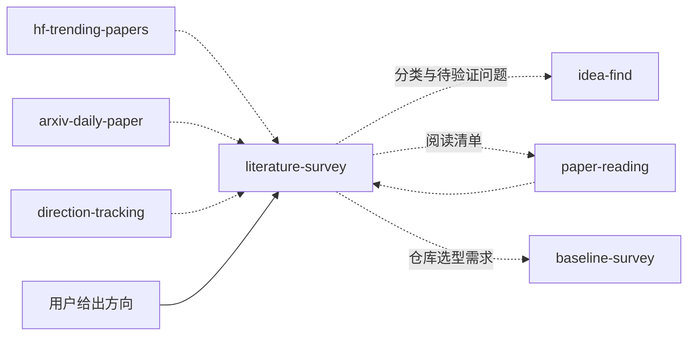

# 文献调研

将用户的研究问题整理为有来源的领域概览、跨论文比较和阅读建议。允许有依据的分类、重要性评价和路线取舍建议，但不将有限检索说成全面覆盖，也不替用户确认某研究课题的创新性与可行性。

## 在系统中的位置



全局关系见 `dl-assistant`。报告可以供写作参考，实际引用前核实原文、版本和具体论点；正式论文内容交 `writing-paper`。后续任务由用户选择，不自动启动。

## 模式与用户确认

- **正式调研**：确认范围、检索方案和预算，再执行检索、分类、详细阅读、覆盖检查及报告。
- **快速了解**：按用户问题做有限检索并直接说明结论与范围，不强制并行或建立完整目录；用户要保存时保留来源与限制。
- **继续已有调研**：先核对旧报告日期、范围、原始记录与未完成任务；新问题超出旧范围或涉及新进展时补查，不仅凭旧报告回答。

只补问影响执行的未知信息：用途、已知背景、包含/排除范围、时间范围、语言或来源限制、起点论文。使用用户本次会话已提供的信息；可以合并相关问题，不强迫一次只问一个。

**检索方案先经用户确认，分类与详细阅读方案也先经用户确认**。派子 agent 时给出任务、输入与独立输出路径；补搜、重分类或扩大工作量超出已批准范围时再次确认。独立查漏包含在所呈现的方案内，不单独擅自扩大范围。

## 保存与恢复

默认 `<项目>/docs/literature-survey/<日期>-<topic-slug>/`，尊重用户指定位置。同日新调研发生冲突时加运行标识；用户要求续做时使用已有目录并保留变更记录，不覆盖已有原始结果。

```text
spec.json                         范围、批准的计划、预算、进度和未完成任务
search/<独立查询批次>.json        查询、结果与执行状态
pool.json                         脚本合并结果、来源、身份与纳排冲突
notes/<独立阅读批次>.md           逐篇核查与跨篇归纳
coverage-review.md                独立查漏、补查结果与剩余范围
report.md                         调研概览、比较与限制
survey.json                       结构化分类、论文、证据与待验证问题
reading-list.md                   分层阅读建议
reading-list-tree.mmd / .png       可选阅读依赖图
```

主 agent 是 spec、pool 和最终文件的唯一写入者；子 agent 写各自独立批次。按当前环境选择读写能力，不绑定固定 agent 类型或写入工具。原始信息、完整记录和简短汇报分开保存，记录可复查不代表信息绝无损失。

执行前核查已有文件；中断时保存每批状态，恢复只补未完成工作。配置变更、正文版本变化或旧判断修订都记入 spec。已读摘要、部分正文、详细核查分别记录，不把发现论文等同于读过论文。

## 参考资料

| 资料 | 使用时机 |
| --- | --- |
| [references/search-strategy.md](references/search-strategy.md) | 设计查询、补查、记录覆盖与停止条件 |
| [references/source-strategy.md](references/source-strategy.md) | 按领域与用途选择实际可用来源 |
| [references/hf-papers.md](references/hf-papers.md) | HF 补充检索及其限制 |
| [references/organizing-axis.md](references/organizing-axis.md) | 文献分类与详细阅读分工 |
| [references/templates/spec-template.md](references/templates/spec-template.md) | 写计划和进度 |
| [references/templates/search-template.md](references/templates/search-template.md) | 保存查询与逐篇纳排记录 |
| [references/templates/notes-template.md](references/templates/notes-template.md) | 逐篇核查和跨篇比较 |
| [references/templates/report-template.md](references/templates/report-template.md) | 写最终报告 |
| [references/templates/survey-template.json](references/templates/survey-template.json) | 写结构化数据 |
| [references/templates/reading-list-template.md](references/templates/reading-list-template.md) | 分层清单与学习依赖 |

## 工作流程

### 1. 明确范围并确认检索计划

根据用途选择学习基础、近期进展、工作定位或方案比较的侧重点；熟悉度只影响讲解深度，不决定要不要检索。计划包含来源选择理由、查询组、日期口径、纳排标准、预算、停止条件及已知限制。确认后保存 spec，参考论文可为空。

### 2. 检索与合并

按批准的计划并行或分批检索。每次调用记录实际查询、来源、时间范围及日期语义、排序、limit、分页与截断、获取时间、错误及结果位置。来源失败与合法空结果区分，不能以“0 篇”代替没有执行。

按纳排标准保留纳入、排除及待判断记录，标题相同或被其他组搜过不直接当排除理由。子 agent 完成后运行：

```bash
python3 <skill目录>/scripts/merge_pool.py <调研目录>
```

脚本按共享稳定标识关联记录，标题只提示可能重复；保留原始观测及字段冲突，不取跨来源引用数最大值。检查 `pending`、`identity_conflicts`、`possible_duplicates` 和字段冲突。人工核实后修正输入并保留更正依据，再重建 pool，不无说明手改消除冲突。

报告实际获取和去重数量、失败/部分结果与最新命中日期；最新命中文献不代表该时段覆盖完整。

### 3. 分类与确认详细阅读范围

依据论文内容和用户用途选择分类维度，允许多标签、交叉和不均衡，不固定类别数。标题与短摘要足以做初分但不足以确认机制，代表性、边界和新近论文都需适当核对，而非只看高引论文。

展示分类理由、交叉项和不确定项，用户确认后写详细阅读计划：选哪些论文、读哪些内容、每项要回答什么、预算与未读范围。分类数不与 agent 数绑定；小领域可不分组。

### 4. 逐篇核查与跨论文比较

按实际需要读取原文、图表、证明和附录，记录版本与位置。先区分作者声明、证据和推断，再按相关研究问题对比方法、假设、数据、评测、成本与限制。不同设置的指标不能直接排序；缺资料标未知，不填推测数字。

子 agent 的笔记提供可追溯依据，不禁止主 agent 回查原文。关键比较、疑问和有冲突的内容须补读。正文获取失败的保留待核查，不把摘要当作详细阅读结果。

### 5. 覆盖检查与停止判断

经批准的独立查漏任务至少收到用途、范围/纳排标准、实际查询记录、pool 与分类，不提供主 agent 的预期结论。将查漏和补搜结论保存 `coverage-review.md`，不能只在会话中返回。

检查别名、相关社区、时间段、代表性工作和未执行来源。补搜无结果只说明在该范围未发现，不能断言方向沉寂或问题无人解决。补进论文后重新检查分类及比较是否需调整；重大变更先与用户确认。

停止依据是已批准任务完成情况、主要类别的代表证据、补搜的实质新增及预算，不是“搜全了”。到预算但仍有缺口时交付部分结果与剩余任务，扩大工作须用户确认。

### 6. 生成三份输出

- `report.md`：问题范围、发展与分类、可追查的跨论文比较、证据支持范围及待验证问题。不强制将时间顺序写成因果发展。
- `survey.json`：与报告一致的论文身份、分类、阅读深度、来源位置、比较和问题记录。开放问题区分作者声明、跨篇归纳与推测，不自动认定当前未解决。
- `reading-list.md`：核心入门、按问题选择的专题、可后读补充，每篇写推荐理由、必要前置和具体阅读问题。不固定 8–15 篇或要求每篇都不可替代。

可选依赖图只表示学习顺序，不等于引用、历史继承或技术替代。渲染失败保留 Mermaid 源码并说明，不因图片缺失阻止交付。报告、结构化数据与清单应相互引用，必要事实可重复，不为形式分工牺牲独立可读性。

### 7. 交付

给出主要发现、文件路径、数量和阅读建议，明确覆盖限制与未完成项，结束当前任务。不自动带用户逐篇阅读或寻找课题。跨机器提供下游所需的原始证据、报告和索引，遵循 `dl-assistant` 的“横切规范”。中文说明，标题、方法名、稳定标识等保留原文；未知信息不得编造。
