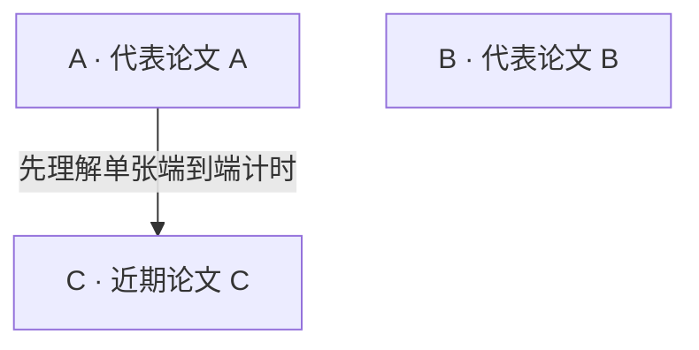

# 阅读清单模板

本文件说明怎样按读者的目标和已有知识选择阅读入口，为每篇论文给出可直接使用的导读，并用阅读依赖图说明哪些内容适合先读。

主会话在 [工作流 Step 6](../workflow.md#step-6撰写报告结构化记录和阅读清单) 撰写 `reading-list.md`。从已确认的调研用途和熟悉度出发，用 `report.md` 核对路线与边界，用 `survey.json` 核对论文身份，用 `notes/` 核对版本、实际读到的位置与待查项。读者选中一篇后，可把来源、版本、拟读范围和具体问题一并交给 `paper-reading`。

## 先定入口，再选论文

1. **把读者的目标写成可回答的问题。** 例如「如何判断端到端延迟的测量是否贴近单张请求？」或「这两个组件的效果是否分别验证过？」每个入口给出起读论文、章节或图表、读完应能回答的问题，以及可选下一步。已有必要知识的读者可以直接进入对应专题。
2. **用三层组织清单。** 核心入门帮助建立问题、概念或主要方法；专题选择按用户想回答的问题给分支；补充与后读用于深入条件、了解边界、参考替代方案或补跟近作。近作和里程碑都按阅读价值安排。哪个层次暂无合适论文，可说明缺口或省略该层。
3. **按用途、已有知识和阅读预算定数量。** 入门通常从少数代表作开始；选型优先挑测量条件最接近目标的论文；定位自己的工作优先看机制相近的论文。每篇说明能补上的内容、适合哪类读者、什么情况下可以跳过。发表早晚只在确实有助于理解时影响顺序。
4. **把导读写到可以打开原文直接读。** 给可打开的稳定来源和版本，区分已核查范围、建议读的部分和仍待取得的材料。先指到章节或图表，再给一个能在原文里寻找依据的问题。前置可以是概念、方法或另一篇论文，后续阅读应说明适合继续解决什么。只有摘要时可以推荐它作线索，说明具体原文位置待核。

## 可复制模板

````markdown
# {主题}阅读清单

> 阅读目标与读者背景 · 调研日期 · [调研报告](report.md)

## 阅读入口

| 你想弄清什么 | 从哪篇哪一节开始 | 读完应能回答什么 | 接下来可读什么 |
| --- | --- | --- | --- |
| {具体目标} | {逐篇导读链接、章节或图表} | {一个可检查的问题} | {对应下一篇、另一分支或可以到此结束} |

## 阅读依赖图（适用时）


箭头 A → B 表示先读 A 有助于理解 B。可按逐篇导读里的前置说明跳过已掌握的内容。[Mermaid 源码](reading-list-tree.mmd)

## 逐篇导读

### 核心入门

#### {编号或简称} {论文标题}

- 来源与版本 | {arXiv ID、DOI 或正式论文链接，所读版本}
- 已核查范围 | {摘要或已核查的正文位置、材料缺口}
- 推荐理由与适读对象 | {它能帮谁解决什么，什么情况下可以跳过}
- 必要前置 | {概念或论文、需要它的理由。无前置时写可直接读}
- 建议阅读位置 | {章节、图表、证明或附录及建议顺序}
- 读完应能回答 | {用原文证据核查的问题}
- 后续可选阅读 | {下一篇及目的，或可在本篇结束}

### 专题选择

{按问题列分支，沿用上面的逐篇格式。}

### 补充与后读

{按需列读，用同一逐篇格式说明在什么情况下值得深入。}
````

## 阅读依赖图与导出

- 先为每个入口找必要前置，再决定是否画图。每条边都要能说出「先读哪部分，能帮助理解后一篇的什么」。图可以有多个起点、分支和独立节点。如果两篇只是互相补充，可在导读的后续可选阅读里互相引用。遇到环时检查前置理由，必要时把共同前置写成概念。
- 标签用导读里的简称或编号。编号可用于定位条目。单条推荐路径的先后应符合它的前置关系，各分支可以独立开始。图的边只用来表达建议读序，引用、技术承接和发展过程在报告正文交代。清单足够短、路径直接时，入口表即可说明读序。
- 将确认后的 Mermaid 源码保存到调研目录的 `reading-list-tree.mmd`。需要图片时在该目录运行。

  ```sh
  mmdc -i reading-list-tree.mmd -o reading-list-tree.png -b white -w 3840 -H 2160
  ```

- 渲染后核对中文标签、边和分支是否清楚，再把图片嵌入清单。如果因找不到浏览器或工具不可用而无法渲染，保留 `.mmd`，将同一份源码内嵌为 Mermaid，并注明当前交付形式。图、导读和入口表中的简称保持一致。

## 完整填写示例

以下沿用[报告示例](report-template.md#完整填写示例)和[逐篇阅读笔记](notes-template.md#填写示例)的 A、B、C。论文身份和链接均为虚构，与结构化模板中的条目对应。

````markdown
# 边缘设备上的视觉模型加速阅读清单

> 目标为单张图像请求的加速选型。读者已有基础推理部署经验。调研日期为 2025-07-01。[调研报告](report.md)

## 阅读入口

| 你想弄清什么 | 从哪篇哪一节开始 | 读完应能回答什么 | 接下来可读什么 |
| --- | --- | --- | --- |
| 怎样判断延迟改善是否来自换模型 | [A 的逐篇导读](#a-代表论文-a)，§4.1 和 §4.2 表 2 | 对照换了什么，保留了哪些条件，实际测的是哪一段 | 想判断两类优化能否一起使用，再读 C |
| 怎样定位运行时的算子瓶颈 | [B 的逐篇导读](#b-代表论文-b)，§4.2 表 1 | 子图吞吐量覆盖什么范围，对整次推理有什么参考价值 | 想了解整次推理的测量口径，补读 A |
| 怎样查清组合部署的收益来自哪里 | [C 的逐篇导读](#c-近期论文-c)，§3 和 §4.3 表 3 | 对照同时改了哪两项，还需哪些分项证据 | 需要补单张计时概念时先读 A；掌握后可直接读 C |

## 阅读依赖图

箭头表示建议读序。已经熟悉单张端到端计时的读者可直接读 C。B 可从运行时专题直接进入。



## 逐篇导读

### 核心入门

#### A 代表论文 A

- 来源与版本 | [代表论文 A](https://example.org/papers/edge-vision-a)，v2；调研内编号 p00001。
- 已核查范围 | §3、§4.1、§4.2 表 2、§5。训练附录未读。
- 推荐理由与适读对象 | 首次根据论文选边缘部署方案时，用这篇练习核对批大小、计时范围和对照。已掌握单张端到端测量、只关心运行时的读者可直接读 B。
- 必要前置 | 理解分类推理与批大小即可直接读。遇到「整通道裁剪」先看 §3 的结构说明。
- 建议阅读位置 | 先读 §4.1 的计时设置，再对照 §4.2 表 2。需要确认模型改了什么时回看 §3。
- 读完应能回答 | 表 2 的两组是否用了同一设备、运行时和批大小？能否仅凭这张表说明哪一阶段的通道裁剪贡献最大？
- 后续可选阅读 | 读 C 的表 3，看看一次切换两项改动会怎样改变结论。

### 专题选择

#### B 代表论文 B

- 来源与版本 | [代表论文 B](https://example.org/papers/edge-vision-b)，v1；调研内编号 p00002。
- 已核查范围 | §4.2 表 1 的子图设置和吞吐结果。指定算子库的跨设备支持范围未核。
- 推荐理由与适读对象 | 已定位运行时瓶颈、想了解算子融合测量的读者可从这里开始。只关心单张响应时间时，可先读 A。
- 必要前置 | 知道吞吐量和单次延迟各自表示什么。对算子库实现的细节可在选型时再核。
- 建议阅读位置 | 读 §4.2 表 1 及其计时说明，圈出批大小、计时起止位置和算子库条件。
- 读完应能回答 | 表 1 的收益测的是融合子图还是完整推理？想评估单张请求时应补什么测量？
- 后续可选阅读 | 想对比整次推理的测量方式时读 A；想了解融合和压缩的联合部署时读 C。

### 补充与后读

#### C 近期论文 C

- 来源与版本 | [近期论文 C](https://example.org/papers/edge-vision-c)，v1；调研内编号 p00003，2025-05-20 首次提交。
- 已核查范围 | §3、§4.1、§4.3 表 3 和附录 B 设备清单。分项消融的补充材料未取得。
- 推荐理由与适读对象 | 需要同时修改模型和运行时的读者可以用它了解设备 C 上的组合验证。当前只测试单一组件时可后读。
- 必要前置 | 了解单张端到端计时。若还不熟悉，先用 A 的 §4.1 和表 2 核对计时定义。
- 建议阅读位置 | 先读 §3 识别两项改动，再读 §4.3 表 3 确认对照如何设置，用附录 B 核对设备。
- 读完应能回答 | 表 3 的对照是否分别开关压缩和融合？它支持怎样的组合结论，还缺哪组对照才能分别归因？
- 后续可选阅读 | 若要分别归因，从 §4.3 的入口查找同版本补充材料。取得材料后再核对分项结果是否沿用了表 3 的设备和计时设置。
````

该示例中的 C 可以这样交给 `paper-reading`。

> 请读[近期论文 C](https://example.org/papers/edge-vision-c) 的 v1，先看 §3、§4.3 表 3 和附录 B。我要确认压缩与融合是否分别验证过，并判断缺少分项消融时能得出什么结论。

## 完稿检查

- [ ] 每个入口都给了起读位置、要解决的问题和可选下一步。数量、层次和篇幅符合读者背景及目标。
- [ ] 每篇来源可定位，已核查内容、建议读的范围和待取得材料写清楚。读者能直接带着问题打开原文。
- [ ] 每条前置关系都有理由。图与导读一致，独立入口可直接开始。
- [ ] 分类、论文身份、版本和证据位置与报告、笔记及结构化结果对得上。
- [ ] 图已核对可读性，或在清单中保留源码与可读的入口表。
