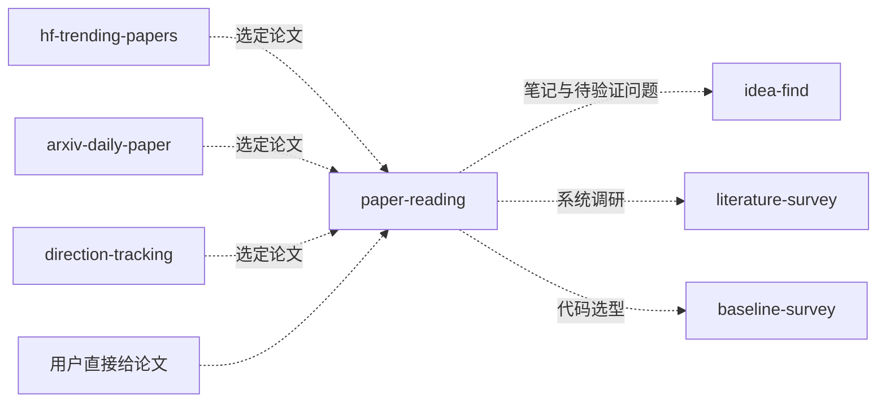

# 论文深度阅读

目标是帮助用户亲自理解论文，能解释核心内容并判断证据的适用范围。按主要论点组织讲解，区分作者声明、实际证据与读者推断；不预设论文必须具有标准章节结构或单条推导链。

## 在系统中的位置

全局流程见 `dl-assistant`。笔记可供写作参考，引用前核对原文、版本与论证相关性。用户要复现时，先核对选定仓库和环境准备情况，再按前置要求使用 `code-project-setup` / `code-paper-reproduction`，不因读过论文就跳过准备。

## 选择阅读方式

以用户明确要求的深度为准，研究方向只调整重点，不自动改为快速阅读：

- **完整深读**：最小提要 → 必要前置知识 → 本篇方法/论证 → 证据与评价；按需讨论后续研究，保存笔记。先让用户知道论文研究什么，再补知识，不在背景阶段提前展开本篇新方法。
- **快速判断**：基于实际读到的摘要或正文，概述问题、方法、结果及阅读价值，注明范围，用户选择后再深入。
- **针对方向或具体问题阅读**：围绕用户问题选章节和证据；用户要求详细解读时仍按深读执行。
- **继续已读论文**：先检查保存记录的论文身份、版本、已读范围和未决问题，必要时回查原文，不能只凭旧笔记确认新判断。

用户只给论文但深度不明确时，简短询问想快速判断还是逐步深读。用户指定先讲方法、跳过背景或结束时按其要求调整，不强迫走完顺序。

## 参考资料

| 文件 | 何时使用 |
| --- | --- |
| [references/reading-mechanics.md](references/reading-mechanics.md) | 获取身份、版本、正文、图表及定位来源 |
| [references/argument-playbook.md](references/argument-playbook.md) | 识别论点、证据与依赖关系，逐项检查 |
| [references/teaching.md](references/teaching.md) | 背景、公式、实验讲解与理解练习 |
| [references/paper-card.md](references/paper-card.md) | 更新判断卡与阅读进度 |
| [references/deep-reading-template.md](references/deep-reading-template.md) | 保存概览、论点证据对应表、评价与讨论 |
| [references/connections-template.md](references/connections-template.md) | 记录可选的后续研究建议 |
| [references/knowledge-log-template.md](references/knowledge-log-template.md) | 保存已讨论的概念说明与疑问 |

## 问答与判断原则

- 一次讲清一个连贯主题，在主题结束时停下来让用户提问或选择继续。沉默不代表理解；“好的”“嗯”是否表示继续取决于上下文，例如回答“是否继续”时可以表示同意，不能机械拒绝。不能从未提问推断已经掌握。
- 使用用户本次会话已明确提供的背景与偏好，不重复摸底；历史记录可以用于定位旧笔记，不能仅因曾读过某概念就断定已掌握。背景不明确且影响讲解时再问。
- 用具体定义、数值例子、推导与图表解释，技术术语首次出现时说明。以直接说明为主，不用抽象比喻替代机制或证明。
- 可用简短练习帮助理解，按内容选择，不每节考试。用户要求直接继续时尊重选择，并记录该部分未作理解检查，不记为理解失败。
- 阅读建议取决于用户目标，和创新性、证据强度分开。增量或非主方向论文仍可能有学习价值。agent 不推荐深读时给出理由，用户仍可要求继续。
- 评价给具体来源和影响，不猜测作者意图，也不要求每篇都有批评。缺少一个实验意味着某解释尚未排除，不自动推导为结论错误。
- 阅读过程中为理解或核实所必需的外部比较可随时进行。全面综述交给 `literature-survey`，课题是否可做交给 `idea-find`；有限检索不能确认不存在已有工作。
- 对话与笔记都区分已读、未读、未知、不适用；不把作者报告当成独立复现。论文标识、公式展示遵循 `dl-assistant` 的“横切规范”。

## 工作流程

### 1. 获取论文与建立记录

核对标题、作者、稳定标识与用户指定版本，标题有歧义时先确认。arXiv 首选 `tex-mcp` v2，以 tex_open 固定实际版本，tex_read 同取本节及直接引用的图表、公式和文献并读完续页；核诊断后再讲解，源码处理受限时先检查是否有同版本结构化 HTML/XML；需核原排版或只有 PDF 时，用 pdf-mcp v2 打开固定快照，按需读取/渲染或对选定页做结构识别。具体步骤见阅读操作参考。仅有摘要时允许讨论，但不能讲成已核实全文。

默认保存到 `<项目>/docs/paper-reading/<日期>-<paper-slug>/`，尊重用户指定位置。按身份查找已有目录，避免同篇仅因日期不同重复建库；不同版本保留独立来源与修订记录，不覆盖旧判断。目录冲突时加标识。取得可确认的论文信息后即可建立 card，不能等全文获取成功才记录失败与待办。

### 2. 先给最小提要

完整深读先用普通话说明：研究对象与任务（适用时含输入输出）、已有做法遇到的具体问题、作者试图解决什么及主要思路的一句话概括。只用用户已知或当场能简短定义的概念，不展开新模块、本文专用符号、损失函数、推导或详细结果。概括如果必须先学一整套方法才能懂，就改写成更基础的问题说明。

最小提要用于让用户知道“接下来为什么要学这些知识”，不是浓缩Method或提前替实验下结论。指出基于摘要、哪些正文或作者声明，未读不伪装已核查。初步阅读建议可在此简述，但不能代替用户已要求的深读。

本次已讲清或用户明确要求跳过时不重复；快速判断可以按其目的概括方法和结果，用户直接追问公式/方法则围绕该问题讲，不强制补全流程。agent可提前阅读正文以准备讲解；这里约束向用户呈现的顺序，不限制原文核查。

### 3. 再补必要前置知识，安排阅读顺序

使用本次会话已知背景，只询问会影响讲解的未知前提。前置知识是理解本篇所需的已有概念：解释定义、用途与条件，用独立的简单例子，再说明为什么读当前问题需要它。不能用本篇尚未介绍的新模块、专用符号或最终公式解释基础知识；本文新定义/新假设留到方法或论证部分，明确是作者提出的内容。

先补当前所需部分，不一次讲完整领域。用户熟悉的可略过，不将讲过当作已掌握。按主要问题列阅读顺序，分别标必要背景和本篇内容，附已核实的章节/图表位置及讲解深度。并列贡献不强行串成单链，用户已指定顺序则采用。

**讲前置知识前自查**：是否已给最小提要、用户能否知道当前概念与问题的关系？这是已有概念还是本文新内容？去掉本篇新模块名和专用符号后，解释是否仍能独立成立？若不能，先改用独立例子，或把该内容移到方法部分；不让用户靠未讲方法理解背景。

### 4. 逐项理解与核查

每个新主题开始前做短自查：当前是在补基础还是讲本文？所用概念/符号是否已介绍或用户明确熟悉？解释是否又依赖尚未讲过的后续方法？发现循环依赖先拆开或调整顺序，不继续叠加定义。自查用于调整讲法，不每次展示检查表或要求用户确认。

进入方法/论证时连接已有基础，明确作者改了哪一步、为什么改，以及哪些是待验证解释。讲清每项内容的定义、设计、假设与推理，再看支撑证据。实验按“问题与设计 → 结果 → 能支持和不能支持的结论”解释；数学给出准确命题、条件及关键推导，不以直觉替代证明。

按需检查核心正文、表格、附录与证明，必要时分段完成核心论证的完整检查。未检查部分明确保留，不把初读几页称为全文评价。

中途遇到缺少的已有基础概念时，可以短暂补充独立解释，然后回到具体方法位置；不能借此把尚未展开的本文设计当成前置知识。已经明确进入方法的讲解不受“前置知识”边界限制，用户主动要求提前展开时尊重选择。

同步填写主要论点与证据对应表，记录原文位置、版本、条件、判断及未决问题。结合具体内容选择数值计算、张量维度检查、推导或实验设计练习，详见讲解参考。

### 5. 综合评价

分别归纳实际贡献、证据支持范围、存在的局限与未核查项。每项疑问说明具体位置、影响哪个结论、影响程度及如何进一步核实；已有疑问也需在最终报告中保留，避免因对话中说过就丢失。

已有工作差异与证据评价分开。新任务/新基准属于作者贡献类型声明，不等于已核实创新。没有比较文献时标为待核实；不以令人意外、方法复杂或结果提升替代创新性判断。

### 6. 可选的后续研究讨论

用户有研究延伸需求时，围绕论文的具体局限、未决问题或可迁移方法提出 0–3 项建议，不凑数。区分推测与事实，对依赖外部工作的建议核实来源；检索失败如实保留待验证，不编造引用。详见 connections 模板。

用户只想读懂论文时可跳过；不因没有研究建议影响笔记导出。

### 7. 保存、暂停与继续

每次主题告一段落时更新 card 的已读范围、讲解进度、未决问题与下一步。分开记录最小提要是否已给、哪些基础概念已讲、本文方法/论证讲到哪里；顺序修正实际发生时简记原因和返回位置，不新增自查JSON、脚本或逐项批准。用户暂停或中止时保存已完成内容并标为部分完成，不要求先回答所有悬置问题。

完整深读或已有实质讲解时默认保存 `deep-reading.md`；快速判断至少保存 card，用户要求时导出对应范围笔记。是否推荐继续阅读不决定是否保存实际讨论。`connections.md` 只在讨论过延伸时生成，`knowledge-log.md` 有概念补充时生成。不创建未发生讨论的空文件。

报告与 card 的证据状态、阅读范围及最终建议保持一致；旧解释被修正时保留修订说明，不把早期错误概览原样当成最终结论。交付报告位置与可选下一步，结束当前任务。
