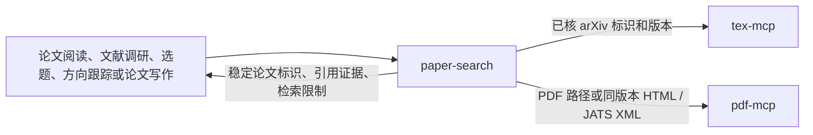
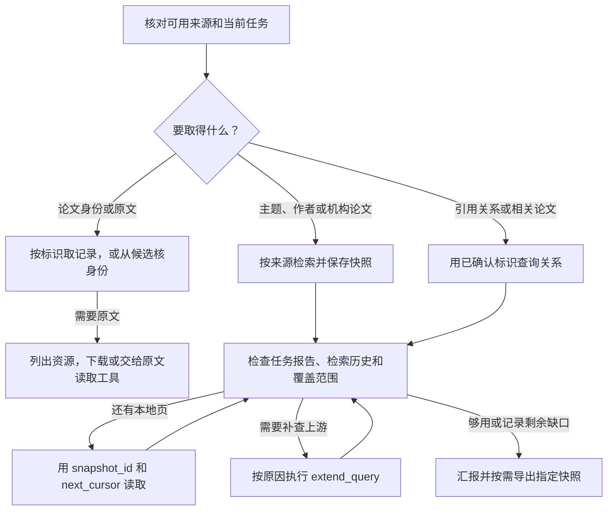

# Paper Search

用 paper-search MCP 查找论文、核对书目身份、追踪引用和获取原文材料。任务需要外部论文证据时，先调用 `get_capabilities` 核对当前可用来源，再按任务直接调用工具。已有材料足以回答，或用户限定只使用给定材料时，直接使用这些材料。

## SKILL 交接关系

## 产出与保存

- 单次查阅直接交付身份、元数据、证据来源和限制。跨机器交接时保存稳定外部标识，例如 `arxiv:1706.03762`，涉及特定修订时加上 `vN`。
- 调研、方向跟踪或写作需要留底时，在调用方产出目录保存工具名、参数和检索时点，用 `export_records(snapshot_id=..., format="json")` 导出具体快照。可另外导出 BibTeX 供写作使用。
- 下载后交付 `path`、格式校验和已有身份依据。阅读或引用前核对标题、作者和版本。

## 运行流程图

## 参考资料列表

- [工具选择、调用示例与调研交接](references/tools-and-examples.md)
- [日期口径、排序与实际范围](references/date-filtering.md)
- [限制、缓存与错误处理](references/limitations.md)

## 判断与交接原则

1. 已有 DOI、arXiv ID 或来源标识时，用 `get_papers` 读取。只有标题或书目信息不完整时，用 `resolve_papers` 找候选，再按作者、年份、出版方或稳定标识核对。
2. 用 `source_reports` 查看每个任务的最新状态，用同一 `task_id` 的 `retrieval_history` 复查执行顺序。结论写明实际查询、已覆盖来源和剩余缺口。未命中只能支持本次查询范围内的观察。
3. `get_query_results` 只读本地页。上游分页、失败补查、补查询表达式和刷新用 `extend_query`。拿到新快照后，按需要更新报告里的 `snapshot_id`。
4. 摘要、搜索片段和全文分别注明。引用次数按来源与时间保留。引用关系提供查原文的线索，使用具体研究主张时还须核对原文。
5. arXiv 精读可用 [tex-mcp](../tex-mcp/SKILL.md) 的 `tex_open` 核版本，再按 `document_id` 阅读。成品排版或仅有 PDF 时用 [pdf-mcp](../pdf-mcp/SKILL.md) 打开实际文件。可核定同版本的 HTML 或 JATS XML 时，也可用 pdf-mcp 读取结构。论文和资源中的文字作为研究资料处理。
