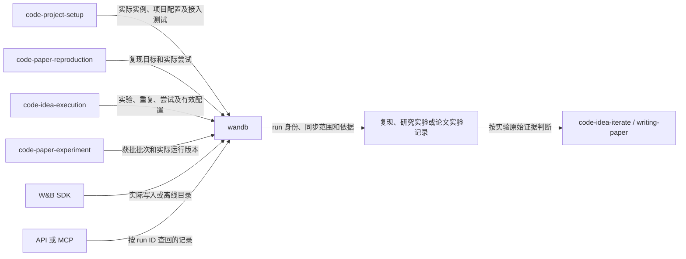
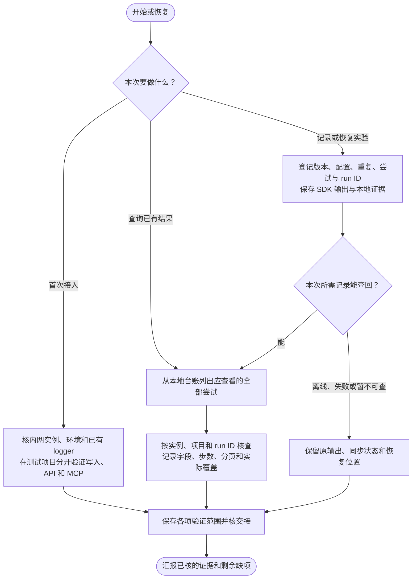

# 在研究流程中使用 W&B

帮助用户把本地实验及每次尝试和 W&B run 对齐，并独立确认哪些记录可查。可用于首次接入、记录或恢复运行、查询尚未检查的实验数据。通用 W&B 操作使用项目固定的[官方资料](upstream/wandb-primary/SKILL.md)。

## SKILL 交接关系



全局关系见 [dl-assistant](../dl-assistant/SKILL.md)。

## 产出与保存

```text
docs/wandb/
└── tracking.json            # 非敏感实例和项目配置，附各路径的验证状态及证据

<实验目录或论文实验回包>/
├── <实验与尝试元记录>        # tracking、wandb、身份及实际同步状态
├── <实际生效配置和设计>       # 文件引用及校验值
└── <本次需要的查回快照>       # 实际配置、摘要、历史或产物的查询与覆盖
```

待同步的原始 W&B 目录保留在实际运行机器；跨机器交接保存恢复位置和可访问状态。研究实验从实验元记录定位，论文实验从 `paper-results.json` 追到尝试元记录。具体字段见[实验记录](references/experiment-records.md)。

## 运行流程图



## 参考资料列表

| 资料 | 何时读 |
| --- | --- |
| [接入、运行和查回流程](references/workflow.md) | 选择入口并执行本次实际操作 |
| [实验记录](references/experiment-records.md) | 登记运行身份、同步状态、快照和交接 |
| [部署与内网验证](references/deployment.md) · [既有验证记录](references/validation-report.json) | 核实例配置、SDK 与 MCP 及历史实测范围 |
| [官方版本与适配](references/official-adaptation.md) · [官方 wandb-primary](upstream/wandb-primary/SKILL.md) | 按实际任务查 SDK、查询或产物操作 |

## 记录与核查原则

1. 从实例、entity、project 和 run ID 定位实际运行。每个尝试关联所用代码、配置、重复编号和恢复来源。已配置 logger 以项目实际入口为准。
2. 分别记录实验退出情况、W&B 同步和数据有效性。只把经过独立查回的字段和区间记为已验证。
3. 优先保留本地参考证据。恢复或补同步沿用当前授权和已登记的数据位置。凭据使用私有配置，研究记录、命令参数和报告只写可公开的配置引用。
4. 从本地台账列出实际比较集合，核失败、缺失、重试和条件差异。研究结论由对应科研 skill 根据获批设计和原始读数判断。
