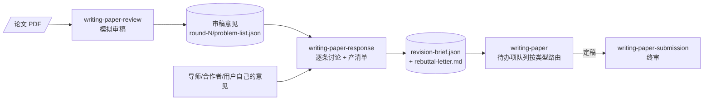
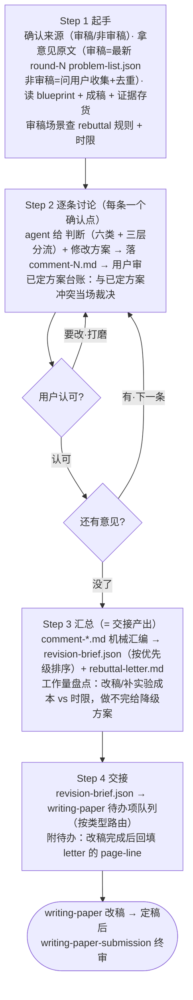

# Writing Paper Response

## 这个 skill 干啥

论文写出来后会收到各种**修改意见**——不只来自审稿人。导师的组会意见、合作者的建议、自己回看发现的问题，本质和审稿意见一样：**对论文的质疑，需要回应**。本 skill 覆盖多种来源：

- **审稿人意见** → 正式 rebuttal（回复给 reviewer / AC，措辞讲究、对抗性辩护）
- **导师 / 合作者 / 用户自己的意见**（组会、讨论、自己回看）→ 内部回应（讨论、采纳、说明，措辞平和）。论文写作层面的润色建议通常 writing-paper 写作期已消化，这里聚焦方法 / 论证 / 实验层的意见。
- **`writing-paper-review` 模拟审稿** → 当真实审稿处理（走 rebuttal 语气）

**逐条讨论制**：对每条意见，agent 给初始判断（六类分类 + 三层分流）+ 修改方案，**和用户一起打磨**（每条一个确认点，认可了下一条），每条单独落 md。全过完汇总成**修改需求清单**（`revision-brief.json`，交 writing-paper 改稿）+ **rebuttal letter**（`rebuttal-letter.md`，交提交 / 导师）。

## 核心心智（最关键）

**审稿人只看得到 PDF（paper 端 storytelling），看不到中期 claims.json。** 所以意见攻击的是**论文成稿**（PDF / `_draft/content/*.md`——reviewer 读的就是它），不是中期脊柱。**真相优先级：成稿 > blueprint**——blueprint 是脊柱/意图层参考（判断改法动不动 contribution 时用），但可能滞后于成稿（写作中交互改所致，writing-paper 的 finalize 目标会誊正）；**两者冲突以正文为准**，并提示用户蓝图滞后。

- **改的是 blueprint.md**（writing-paper 定的论文级脊柱：总论点 + contribution 清单挂 C-ID + 每节意图 + locked_decisions）——re-frame、补澄清、调重点、修措辞。但**改稿动作交给 writing-paper**：response 不直接编辑论文内容，只产**修改需求清单**。
- **不碰中期 claims.json**——它是 iterate 收口后冻结的迭代脊柱，response 彻底脱离。补实验确立的新主张记在 blueprint.md（论文级），不回写中期。
- **不设计实验**——实验设计归 writing-paper（它规划实验是核心能力）。response 只判断「该不该补 + 补的核心目的」，具体设计 + 产 plan + 调 CPE 都交 writing-paper。

> 一句话：**response 处理意见 + 产清单（决策），writing-paper 改稿（执行）。response 不碰论文内容、不碰中期脊柱、不设计实验。**

## 在系统里的位置



**图例**：圆柱体 = skill 间内部流转（审稿意见 / 修改需求清单，不对外暴露）；平行四边形 = 外部成品（论文 PDF）。完整全局图见 `dl-assistant`。

## 边界

**做**：意见分类（六类 + 三层分流）、逐条和用户讨论定方案（含冲突当场裁决）、每条单独落 md、汇总产 revision-brief.json + rebuttal-letter.md、判断该不该补实验（给核心目的，不设计）。

**不做**（交给相邻 skill）：

| 场景 | 用 |
|---|---|
| 写 / 改论文正文（按清单改 blueprint + section）| `writing-paper`（吃 revision-brief.json 进待办项队列，按类型路由到各目标）|
| 设计 + 跑补实验（方法不变）| 设计交 `writing-paper`，跑交 `code-paper-experiment` |
| 投稿前作者自查合规 | `writing-paper-submission` |

> **改方法（机制被质疑）**：rebuttal 时限内改方法做不完——默认走「降 claim / 承认局限 / 给替代证据」（纯改稿 + 回复，进修改需求清单），**不走 execution 全链**。少数情况作者决定 rebuttal 后下一版走全链，才另外导准 spec 给 execution（那是下一轮，不是 rebuttal 期内）。

## 输入材料

- **意见来源 + 原文**：
  - **审稿**（真实 / `writing-paper-review` 模拟）：reviewer comments；模拟审稿场景读**最新一轮** `<论文根>/review/round-N/problem-list.json`（多轮取最大 N；机读契约，人读 problem-清单.md 是派生物别当输入）+ 同轮 `meta-review.md`（「已排除指控」是 rebuttal 防线弹药——被 AC 驳回的攻击点，写回复时可预判）。
  - **非审稿**（组会 / 导师 / 合作者 / 自己回看）：**启动时直接问用户收集意见**——用户本人想到的、导师组会上提的、合作者说的都算；用户逐条口述或贴文本，多条先合并去重。
- **论文成稿**（PDF 或 `_draft/content/*.md`）：reviewer 攻击的对象本身——page-line 定位、引用澄清的原料，与 blueprint 冲突时以它为准。
- **paper storytelling**（`blueprint.md`）：脊柱/意图层参考（判断改法动不动 contribution 时用）。
- **目标会议的 rebuttal 规则**（字数 / 格式 / **时限**）——审稿场景；时限同时是 Step 3 工作量盘点的硬约束。
- **证据存货**（可选但强烈建议）：论文根的实验结果区（CPE 交回的数据包 / ingest-results 产物）——回应优先序阶梯①②层（论文已有 / 已有数据没写进论文）的判断依据，不靠用户记忆；没有就问用户（作者自己清楚），不跨机器读。

**论文根定位**（四级发现规则）：⑴ 用户显式指定 → ⑵ CWD 本身是论文根（含主 tex + `_draft/`）→ ⑶ CWD `papers/` 下唯一候选 → ⑷ 多个或没有 → 问用户。论文根 = `papers/<slug>/`（Overleaf clone）。

启动时确认：**意见来自哪里**（审稿 / 非审稿）？决定回复语气、产物组织（轮次目录）和要不要查 rebuttal 规则。

## 产出与保存

```
<论文根>/response/round-N/       # 审稿来源：回应 review 的 round-N，取同一编号
<论文根>/response/<主题>/         # 非审稿来源：如 response/zuhui-0815/
├── comment-1.md        # 每条意见的处理（关切/分类+分流/根因/修改方案/回复/要不要补）
├── comment-2.md
├── ...
├── revision-brief.json # 修改需求清单（机读契约，交 writing-paper 进待办项队列）
└── rebuttal-letter.md  # rebuttal letter / 内部回应说明（人读）
```

多轮审稿历史保留：新一轮意见开新目录，不覆盖旧的。

## 工作流

**TaskList 跟踪流程**：Step 1 后建任务（起手 / 逐条讨论（每条意见一项子任务）/ 汇总 / 交接）——逐条制，每条过完勾一条。



### Step 1 起手

- **确认意见来源 + 拿意见原文**：
  - 审稿场景：读最新一轮 `problem-list.json`（多轮取最大 N）+ 同轮 `meta-review.md`（已排除指控 = 防线弹药）；查 venue 当年 rebuttal 规则（字数 / 格式 / **时限**，照 `references/rebuttal-writing.md` 的查纪律）。
  - 非审稿场景：直接问用户收集意见（用户本人 / 导师 / 合作者），逐条口述或贴文本，合并去重。
- **论文根定位**（四级发现规则）+ 读 `_draft/blueprint.md` + 成稿。
- **证据存货盘点**：读论文根的实验结果区（CPE 数据包 / ingest-results 产物），列出「已有什么证据」——逐条讨论走阶梯①②层时随手可查。

### Step 2 逐条讨论（每条一个确认点）

对每条意见：agent 给**初始判断 + 修改方案** → 落该条 `comment-N.md` → **用户确认**（认可下一条 / 要改就改）。

**初始判断**：
- **六类分类**：misunderstanding（误解）/ missing evidence（缺证据）/ writing clarity（表达不清）/ novelty concern（创新质疑）/ experiment concern（实验质疑）/ impossible request（不可能要求）
- **三层分流**（顶层分流，决定改稿动作）：**substance**（真站不住，要补实验 / 大改）/ **misread-risk**（写法触发，一句话能澄清）/ **polish**（打磨）。
- **输入是 problem-list.json 时按字段机械分流**：`severity=致命` → 基本锁 substance（必正面改 + 正面刚）；`改进` → 多为 polish / misread-risk 可权衡；**`type=合规` 的条目不走六类讨论**——照 authorkit / venue 硬性要求改，没有策略空间，直接进清单（局部改），跟用户确认一轮即可；**`type=指控成立` 按致命处理**（魔鬼代言人提出、AC 裁决成立的，是最凶的攻击点）。标签是先验，用户可推翻。

**修改方案**（进清单的料）：**策略照 `references/fix-strategy.md`**——回应优先序阶梯（先查已有、再谈补新）+ 六类 × 修改策略 + page-line 定位（每条必做：意见锚点 + 修改落点）。
- **稿件修改**：哪个 section + 落点（锚点 / 图表）、改动类型（re-frame / section 重写 / 局部改 / 补图表 / 补实验项）、具体要求。补实验项只给核心目的（**设计交 writing-paper**）。
- **关闭判据（必填）**：「改成什么样这条意见就算关闭」的可验收条件——随修改方案一起给用户确认。来源三种：review 来的意见**继承** problem-list 的 `close_criterion` 初版（讨论中可修订）；外部意见（导师/合作者/真实审稿人）没有判据，由 agent **随方案起草**——起草动作逼模糊意见具体化（「这段不清楚」必须落成「第 X 段歧义点 Y 消除」），拿不准的当场和用户掰扯明白；taste 级意见允许写成**用户确认型**（「改后该段交用户过目认可」），不强制每条都机械可验。
- **回复文本**：审稿场景 → rebuttal；非审稿 → 平和说明。按 tone preset（见 `references/rebuttal-writing.md`）。
- **要不要补实验**：是 → 补的核心目的；否。

**已定方案台账**：逐条讨论时维护已定方案的落点清单；每条新方案与已定方案**冲突时当场标出、当场和用户裁决**（同一处两个改法、一条要加一条要删）——不攒到汇总。

> 前四类（误解 / 表达 / novelty / 不可能）纯改 storytelling。缺证据 / 实验质疑可能要补——但 response 只给目的，设计交 writing-paper。

### Step 3 汇总（= 交接产出）

所有条过完，把 `comment-*.md` 机械汇编成两个文件：

- **`revision-brief.json`**（交 writing-paper）：按 `writing-paper/references/templates/revision-brief-template.json` schema；items 按 **严重度 × 阶梯层级** 排序（数组顺序即优先级，writing-paper 按序消费）。
- **`rebuttal-letter.md`**（交提交 / 导师）：按 venue 字数预算 + Comment / Response / Changes 三段式；审稿场景顶部给 AC cover letter 综合层（跨 reviewer 一致性权衡——Step 2 台账里裁决过的冲突写进这里）。**Changes 用「section + 锚点（原句 / 图表号）」定位，page-line 栏留空**——改稿后页码必变，page-line 由 writing-paper 改稿完成后回填（见 Step 4）。
- **工作量盘点**（汇总时给用户）：几项纯改稿、几项补实验、各自预估成本；对照 Step 1 确认的时限，做不完的给降级方案（降 claim / 承诺 future work / 砍 polish 项），**用户拍板后清单定稿**。

### Step 4 交接

- `revision-brief.json` → `writing-paper`（进待办项队列，按类型路由：re-frame → design-story、section 重写 / 局部改 → write-section、补图表 → make-visual、补实验项 → design-experiment → CPE → ingest-results）。附一项待办：**改稿完成后回填 `rebuttal-letter.md` 的 Changes page-line**。
- `rebuttal-letter.md` → 按 venue 提交 / 发导师合作者。
- 改稿完成、rebuttal 发出（或定稿）后 → `writing-paper-submission` 终审。

## 逐条 md schema（comment-N.md）

```markdown
# 意见 N（来源：reviewer #2 / 导师 / 合作者 / 用户自己）
- 关切：…（意见原文摘要）
- 锚点：page-line + 原句（意见指的原文位置）
- 分类：misunderstanding / missing evidence / writing clarity / novelty concern / experiment concern / impossible request
- 分流：substance / misread-risk / polish
- 论文根因：claim 不清 / 证据缺 / 定位薄 / 真实局限
- 稿件修改（进 revision-brief.json）：
  - section：…
  - 落点：section + 锚点（page-line 改稿后回填，与 rebuttal 的 Changes 对得上）
  - 改动类型：re-frame / section重写 / 局部改 / 补图表 / 补实验项
  - 具体要求：…
  - 关闭判据：…（必填；来源：继承自 review / 讨论起草 / 用户确认型）
- 回复文本：…（rebuttal / 说明，按 tone preset）
- 要不要补实验：是 → 补的核心目的 / 否
- 冲突记录：与意见 M 的冲突 + 裁决结果（无则略）
```

## references

| reference | 讲什么 | 何时读 |
|---|---|---|
| `references/rebuttal-writing.md` | tone presets / venue 字数预算 / cover letter 综合层 / response letter 结构 / Changes 定位与回填 | Step 2 写回复 + Step 3 汇总 letter |
| `references/fix-strategy.md` | 回应优先序阶梯（每层操作细则）+ 六类确诊/打法/常见错 + 修改方案质量标尺 + page-line 定位 + problem-list 字段消费 + 反模式 | Step 2 逐条讨论 |
| `writing-paper/references/templates/revision-brief-template.json` | 修改需求清单 schema（writing-paper 消费） | Step 3 产清单 |

## 常见错误

- **别把意见当纯口头辩护**——misunderstanding 类要改正文（进清单），不只回复里解释。
- **别直接编辑论文内容**——response 只产修改需求清单，改 blueprint + section 交 writing-paper。
- **别设计实验**——只判断该不该补 + 补的核心目的，设计 + 产 plan + 调 CPE 交 writing-paper。
- **别碰中期 claims.json**——rebuttal 改 blueprint.md（论文级脊柱），中期脊柱收口冻结，不回写。
- **改方法别硬上 execution 全链**——rebuttal 时限内做不完，默认降 claim / 承认局限 / 给替代证据。
- **别对导师 / 合作者用对抗性 rebuttal 语气**——区分来源，按 tone preset 选语气。
- **别承诺补不可能的实验**——impossible request 给替代证据 + 诚实说明限制，或降 claim。
- **每条修改方案别偏离原意见**——核心主张必须直接对应那条质疑。
- **别把 page-line 写死进 rebuttal letter**——改稿后页码必变；letter 用 section + 锚点定位，page-line 改稿完成后回填。
- **合规类条目别走六类讨论**——照 authorkit 改没有策略空间，直接进清单。
- **不要在会话里用 `$...$` LaTeX**——会话符号用 Unicode（横切规范见 `dl-assistant` SKILL.md「横切规范」）。
