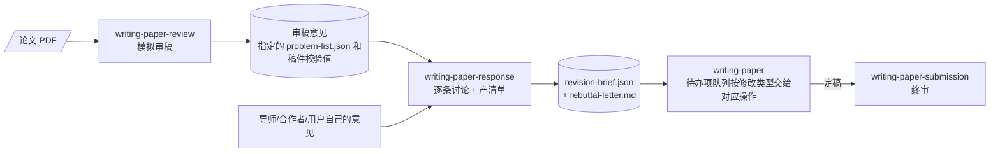
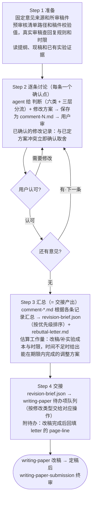

# Writing Paper Response

## 用途

论文写出来后会收到各种**修改意见**——不只来自审稿人。导师的组会意见、合作者的建议、自己回看发现的问题，本质和审稿意见一样：**对论文的质疑，需要回应**。本 skill 覆盖多种来源：

- **审稿人意见** → 正式 rebuttal（正式回复审稿人或 AC，明确说明回应及依据）
- **导师 / 合作者 / 用户自己的意见**（组会、讨论、自己回看）→ 内部回应（讨论、采纳、说明，措辞平和）。论文写作层面的润色建议通常 writing-paper 写作期已消化，这里聚焦方法 / 论证 / 实验层的意见。
- **`writing-paper-review` 模拟审稿** → 当真实审稿处理（走 rebuttal 语气）

**逐条讨论并确认**。对每条意见提出初步分类和修改范围，并给出修改方案，保存为独立的 `comment-N.md`。用户确认当前意见的方案后，再处理下一条。全部确认后汇总为**修改需求清单**（`revision-brief.json`，交 writing-paper 改稿）+ **rebuttal letter**（`rebuttal-letter.md`，交提交 / 导师）。

## 判断修改方案的依据

审稿人依据论文 PDF 提出意见。处理意见时查阅成稿（PDF 或 `_draft/content/*.md`），并用 `blueprint.md` 核对总论点、各项贡献和各节写作意图。**成稿与论文大纲冲突时，以成稿为准**，并提示用户大纲可能需要更新。`writing-paper` 的 `finalize` 操作会同步大纲。

- **由 writing-paper 执行修改**。本 skill 在修改需求清单里说明需要重新组织论证、补充澄清、调整重点或修改措辞的地方。`blueprint.md` 记录总论点、各项贡献及其 C-ID、各节写作意图和 `locked_decisions`。
- **不碰中期 claims.json**——它是 code-idea-iterate 完成研究迭代后冻结的论点记录。补实验确立的新主张记在 blueprint.md（论文级），不回写中期。
- **不设计实验**——实验设计归 writing-paper（它规划实验是核心能力）。response 只判断「该不该补 + 补的核心目的」，具体设计 + 产 plan + 调 CPE 都交 writing-paper。

> 一句话：**response 处理意见 + 产清单（决策），writing-paper 改稿（执行）。response 不碰论文内容、不碰研究迭代阶段的论点记录、不设计实验。**

## 在系统里的位置



**图例**：圆柱体 = skill 间内部流转（审稿意见 / 修改需求清单，不对外暴露）；平行四边形 = 外部成品（论文 PDF）。完整全局图见 `dl-assistant`。

## 边界

**做**：意见分类（六类 + 三层分流）、逐条和用户讨论定方案（含冲突立即确认取舍）、每条保存为独立的 comment-N.md、汇总产 revision-brief.json + rebuttal-letter.md、判断该不该补实验（给核心目的，不设计）。

**不做**（交给相邻 skill）：

| 场景 | 用 |
|---|---|
| 写 / 改论文正文（按清单改 blueprint + section）| `writing-paper`（读取 revision-brief.json，将待办项交给对应的写作操作）|
| 设计 + 跑补实验（方法不变）| 设计交 `writing-paper`，跑交 `code-paper-experiment` |
| 投稿前作者自查合规 | `writing-paper-submission` |

> **改方法（机制被质疑）**：rebuttal 时限内改方法做不完——默认走「缩小主张范围 / 承认局限 / 给替代证据」（纯改稿 + 回复，进修改需求清单），**不走 code-idea-execution 的完整实现和实验流程**。少数情况作者决定 rebuttal 后在下一版执行完整的实现和实验流程，才另行准备研究说明（spec）并交给 code-idea-execution（那是下一轮，不是 rebuttal 期内）。

## 输入材料

- **意见来源 + 原文**：
  - **审稿意见**：真实评审读原始意见与送审稿。内部预审读交接中指定的 `problem-list.json` 和本轮稿件，按文件内 `paper.sha256` 与交接给出的校验值核对。综合意见可查相邻的 `审稿总报告.md`。
  - **非审稿**（组会 / 导师 / 合作者 / 自己回看）：**启动时直接问用户收集意见**——用户本人想到的、导师组会上提的、合作者说的都算；用户逐条口述或贴文本，多条先合并去重。
- **论文成稿**（PDF 或 `_draft/content/*.md`）：reviewer 攻击的对象本身——page-line 定位、引用澄清的原料，与 blueprint 冲突时以它为准。
- **论文大纲**（`blueprint.md`）用于核对总论点、各项贡献和各节写作意图，判断修改是否影响论文贡献。
- **目标会议的 rebuttal 规则**（字数 / 格式 / **时限**）——审稿场景；时限同时是 Step 3 估算工作量的硬约束。
- **已有实验证据**（可选但强烈建议）：论文根的实验结果区（CPE 交回的数据包 / ingest-results 产物）——优先顺序中的前两项（论文已有 / 已有数据没写进论文）的判断依据，不靠用户记忆；没有就问用户（作者自己清楚），不跨机器读。

**论文根定位**（四级发现规则）：⑴ 用户显式指定 → ⑵ CWD 本身是论文根（含主 tex + `_draft/`）→ ⑶ CWD `papers/` 下唯一候选 → ⑷ 多个或没有 → 问用户。论文根 = `papers/<slug>/`（Overleaf clone）。

启动时确认：**意见来自哪里**（审稿 / 非审稿）？决定回复语气、产物组织（轮次目录）和要不要查 rebuttal 规则。

## 产出与保存

```
<论文根>/response/round-N/       # 审稿来源：回应 review 的 round-N，取同一编号
<论文根>/response/<主题>/         # 非审稿来源：如 response/zuhui-0815/
├── comment-1.md        # 每条意见的处理（关切/分类+分流/根因/修改方案/回复/要不要补）
├── comment-2.md
├── ...
├── revision-brief.json # 修改需求清单（机读契约，交 writing-paper 进待办项队列）
└── rebuttal-letter.md  # rebuttal letter / 内部回应说明（人读）
```

多轮审稿历史保留：新一轮意见开新目录，不覆盖旧的。

## 工作流

**TaskList 跟踪流程**：Step 1 后建任务（准备 / 逐条讨论（每条意见一项子任务）/ 汇总 / 交接）——逐条制，每条过完勾一条。



### Step 1 准备

- **确认意见来源 + 拿意见原文**：
  - 内部预审：按 [交接读取指引](references/fix-strategy.md#如何使用-problem-listjson-的字段) 核清单路径、稿件校验值及实际完成范围。若仅知道项目根，列出可能的轮次、模式和稿件版本供确认。真实审稿：核原始意见和送审稿，查目标当年 rebuttal 的字数、格式及截止时间。
  - 非审稿场景：直接问用户收集意见（用户本人 / 导师 / 合作者），逐条口述或贴文本，合并去重。
- **论文根定位**（四级发现规则）+ 读 `_draft/blueprint.md` + 成稿。
- **核对可用的实验证据**：读论文根的实验结果区（CPE 数据包 / ingest-results 产物），列出「已有什么证据」——逐条讨论时用于查证正文和已有数据。

### Step 2 逐条讨论（每条一个确认点）

对每条意见：agent 给**初始判断 + 修改方案** → 将该条保存为 `comment-N.md` → **用户确认**（认可下一条 / 要改就改）。

**初始判断**：
- **六种意见类型**：misunderstanding（误解）/ missing evidence（缺证据）/ writing clarity（表达不清）/ novelty concern（创新质疑）/ experiment concern（实验质疑）/ impossible request（不可能要求）
- **三种修改范围**：**substance**（存在实质问题，需补实验或大幅修改）/ **misread-risk**（表述容易引起误解，可作简短澄清）/ **polish**（润色）。
- **输入是 problem-list.json 时按证据给出初步处理建议**：合读 `finding_status`、`evidence`、`impact` 与 `severity`，再判断修改范围。待核或有分歧的问题先指明核查动作；合规意见核适用的官方要求；核心研究未决交 iterate 判断。

**修改方案**（纳入修改需求清单）：**策略照 `references/fix-strategy.md`**——回应方式的优先顺序（先查正文和已有数据，再考虑补实验）+ 六类 × 修改策略 + page-line 定位（每条必做：意见所指位置和拟修改位置）。
- **稿件修改**：注明章节及原句或图表编号、改动类型（re-frame / section 重写 / 局部改 / 补图表 / 补实验项）、具体要求。补实验项只给核心目的（**设计交 writing-paper**）。
- **关闭判据（确认修改方案时填写）**：结合清单的实际依据、影响和未决项随方案起草，与用户确认。例如先核两组训练预算，再约定稿件需准确说明实际预算以及结论适用条件。仅影响文风时，可写为改后交用户确认。
- **回复文本**：审稿场景 → rebuttal；非审稿 → 平和说明。按回复语气选项（见 `references/rebuttal-writing.md`）。
- **要不要补实验**：是 → 补的核心目的；否。

**已确认的修改记录**：逐条讨论时维护已定方案的落点清单；每条新方案与已定方案**冲突时当场标出、立即与用户确认取舍**（同一处两个改法、一条要加一条要删）——不攒到汇总。

> 前四类（误解 / 表达 / novelty / 不可能）纯改 storytelling。缺证据 / 实验质疑可能要补——但 response 只给目的，设计交 writing-paper。

### Step 3 汇总（= 交接产出）

所有意见逐条确认后，把 `comment-*.md` 根据各条记录汇总成两个文件：

- **`revision-brief.json`**（交 writing-paper）：按 `writing-paper/references/templates/revision-brief-template.json` schema；items 按 **严重度 × 回应方式的优先顺序** 排序（数组顺序即优先级，writing-paper 按顺序处理）。
- **`rebuttal-letter.md`**（交提交 / 导师）：按目标会议或期刊的字数限制 + Comment / Response / Changes 三段式；审稿场景开头给 AC 一段总体说明，交代第 2 步中如何处理不同审稿人意见之间的冲突。**Changes 用「section + 原句或图表编号」定位，page-line 栏留空**——改稿后页码必变，page-line 由 writing-paper 改稿完成后回填（见 Step 4）。
- **估算工作量**（汇总时给用户）：几项纯改稿、几项补实验、各自预估成本；对照 Step 1 确认的时限，时间不足时提出可在期限内完成的调整方案（缩小主张范围 / 承诺 future work / 删减润色项），**用户确认后清单定稿**。

### Step 4 交接

- `revision-brief.json` → `writing-paper`（进待办项队列，按修改类型交给对应操作：re-frame → design-story、section 重写 / 局部改 → write-section、补图表 → make-visual、补实验项 → design-experiment → CPE → ingest-results）。附一项待办：**改稿完成后回填 `rebuttal-letter.md` 的 Changes page-line**。
- `rebuttal-letter.md` → 按 venue 提交 / 发导师合作者。
- 改稿完成、rebuttal 发出（或定稿）后 → `writing-paper-submission` 终审。

## 逐条 md schema（comment-N.md）

```markdown
# 意见 N（来源：reviewer #2 / 导师 / 合作者 / 用户自己）
- 关切：…（意见原文摘要）
- 锚点：page-line + 原句（意见指的原文位置）
- 分类：misunderstanding / missing evidence / writing clarity / novelty concern / experiment concern / impossible request
- 分流：substance / misread-risk / polish
- 论文根因：claim 不清 / 证据缺 / 定位薄 / 真实局限
- 稿件修改（进 revision-brief.json）：
  - section：…
  - 落点：section + 锚点（page-line 改稿后回填，与 rebuttal 的 Changes 对得上）
  - 改动类型：re-frame / section重写 / 局部改 / 补图表 / 补实验项
  - 具体要求：…
  - 关闭判据：…（与用户讨论确认的验收条件）
- 回复文本：…（rebuttal / 说明，按 tone preset）
- 要不要补实验：是 → 补的核心目的 / 否
- 冲突记录：与意见 M 的冲突 + 裁决结果（无则略）
```

## references

| reference | 讲什么 | 何时读 |
|---|---|---|
| `references/rebuttal-writing.md` | 回复语气选项 / 目标会议或期刊的字数限制 / 给 AC 的总体说明 / response letter 结构 / Changes 定位与回填 | Step 2 写回复 + Step 3 汇总 letter |
| `references/fix-strategy.md` | 回应方式的优先顺序（每层操作细则）+ 六类判断依据、处理方法和常见错误 + 修改方案质量标准 + page-line 定位 + problem-list 字段用法 + 常见错误与处理方法 | Step 2 逐条讨论 |
| `writing-paper/references/templates/revision-brief-template.json` | 修改需求清单 schema（供 writing-paper 读取） | Step 3 产清单 |

## 常见错误

- **别把意见当纯口头辩护**——misunderstanding 类要改正文（进清单），不只回复里解释。
- **别直接编辑论文内容**——response 只产修改需求清单，改 blueprint + section 交 writing-paper。
- **别设计实验**——只判断该不该补 + 补的核心目的，设计 + 产 plan + 调 CPE 交 writing-paper。
- **别碰中期 claims.json**——rebuttal 改 blueprint.md（论文总论点和各节安排），研究迭代阶段的论点记录收口冻结，不回写。
- **改方法别硬上 code-idea-execution 的完整实现和实验流程**——rebuttal 时限内做不完，默认缩小主张范围 / 承认局限 / 给替代证据。
- **别对导师 / 合作者用正式回应审稿质疑的语气**——区分来源，按回复语气选项 选语气。
- **别承诺补不可能的实验**——impossible request 给替代证据 + 诚实说明限制，或缩小主张范围。
- **每条修改方案别偏离原意见**——核心主张必须直接对应那条质疑。
- **别把 page-line 写死进 rebuttal letter**——改稿后页码必变；letter 用章节及原句或图表编号定位，page-line 改稿完成后回填。
- **合规类条目别走六类讨论**——照 authorkit 改没有策略空间，直接进清单。
- **不要在会话里用 `$...$` LaTeX**——会话符号用 Unicode（见 `dl-assistant` 的 `SKILL.md`「所有技能共用的规则」）。
