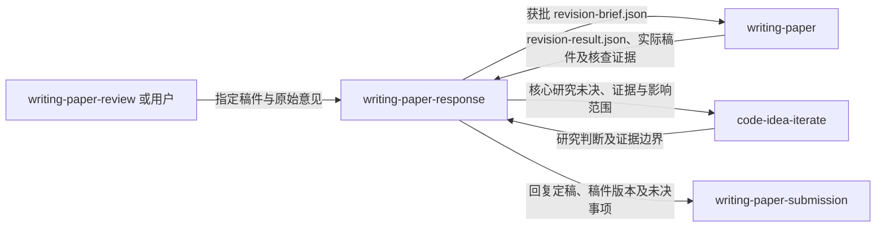
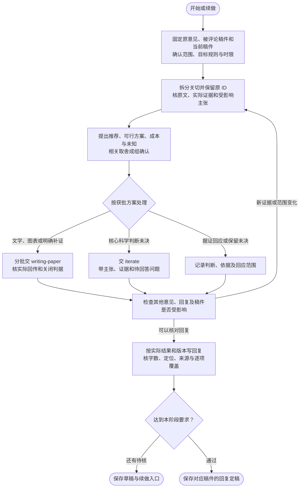

# 核查意见、安排改稿并准备回复

逐项说明对方在问什么、依据支持到哪里、影响哪条主张、准备怎样处理、实际上做到了什么，以及回复中能准确说什么。适用于内部反馈、投稿前预审、会议 rebuttal 和期刊修改回复。

## SKILL 交接关系



全局流程见 [dl-assistant](../dl-assistant/SKILL.md)。

## 产出与保存

沿用论文工程和已有回应目录。新建时可用 `<论文根>/response/<response-id>/`，例如按送审轮次或组会主题命名。有新交接就另存一版。仅处理外部稿件时可用用户指定的目录。

```text
response/<response-id>/
├── response-state.json                # 当前工作记录，含意见、关切、行动和回复
├── materials/                         # 按需保存原意见、被评论稿件和官方规则
├── receipts/<return-id>/              # 按批收取 writing-paper 的回传
│   ├── revision-result.json           # 行动 ID、实际改动、核查和未完成项
│   └── <改后稿件与随包证据>              # 按回传索引保存或引用
└── handoffs/<stage>-<N>/
    ├── response-state.json            # 本次阶段记录快照
    ├── response-map.md                # 原意见与关切、决定和行动的对应
    ├── revision-brief.json            # handoff 阶段给写作端的获批行动
    ├── rebuttal-letter.md             # 回复草稿或已核回复
    └── validation.json                # 输入、范围、就绪项和结构检查
```

## 运行流程图



## 参考资料列表

| 资料 | 何时读 |
| --- | --- |
| [执行流程及示例](references/workflow.md) | 从收意见、确认方案到回传和定稿 |
| [证据核查与处理策略](references/fix-strategy.md) | 判断意见依据、挑选行动、确定关闭判据 |
| [回复写作](references/rebuttal-writing.md) | 核官方要求、组织回复、核字数与定位 |
| [状态字段](references/response-record.md) · [状态模板](references/response-state-template.json) | 保存和恢复工作状态，验证交接 |
| [改稿清单](../writing-paper/references/templates/revision-brief-template.json) · [改稿结果](../writing-paper/references/templates/revision-result-template.json) | 发出批准批次和核对实际回传 |

## 判断与确认

1. 分清稿件写了什么、研究实际做了什么，以及证据支持什么。分别核查原意见、被评论稿件、当前稿件、实际设置与结果。
2. 可以澄清、修改、补明确的证据、据证回应或暂留未决。核心现象、有效性、新颖性、价值或目标条件下的收益仍不明确时，交 iterate 重审。
3. 主会话先查资料并给建议。核心主张变化、争议取舍和新增投入由用户决定。多个关切可共享行动，也可成组确认，保留逐项来源和影响。
4. 区分批准、执行和核查。用实际回传核稿件、改动、证据和关闭判据，再确认完成陈述。回复覆盖不等同于科学问题已解决。
