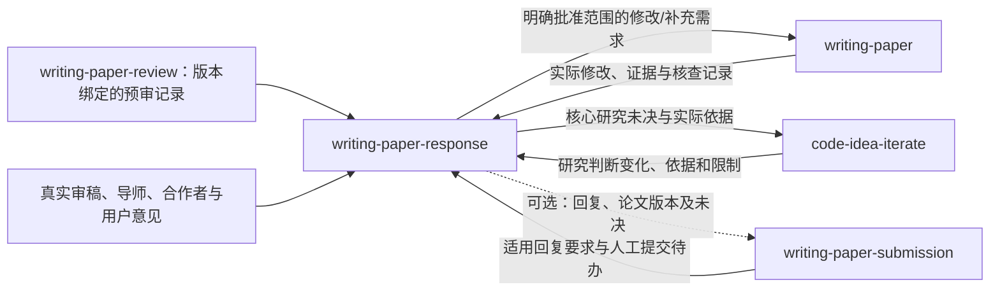

# 核查意见、安排处理并核对回复

每条意见回答：提出了什么关切、依据是否成立、影响哪项认识或主张、下一步做什么、实际完成到哪里、回复能准确说什么。不以消除所有批评、维持原贡献或说服审稿人作为事实标准。

## 职责与协作



全局关系见dl-assistant。response负责意见分析、处理方案和回复记录；不直接改正文或研究命题，不替代实验设计/执行，也不把生成文件视为已经提交或发送。明确授权的对外操作按实际任务处理，写回复本身不新增发送授权。

表达、图表和范围明确的补充需求交writing-paper；核心现象、有效性、新颖性、重要性或目标条件证据未决，按 [研究与写作判断](../dl-assistant/references/research-transition.md) 交iterate设计、execution取证，不能只交写作换措辞。方法是否变化、期限长短和意见类别都不决定科学分工。

## 1. 核输入和版本

优先读取用户指定意见与材料，不重复询问已有信息，不强制Overleaf或固定目录。新回应目录可用response/<唯一标识>/，已有目录不覆盖；每个交接输出用独立目录保留历史。

区分四类来源：被评论的稿件、实际实现/数据/分析、原研究判断、当前稿件与主张。稿件说明作者写了什么，不自动证明实际做了什么；结构说明和研究状态也不能代替证据。冲突先核查，不指定正文或blueprint永远优先。

模拟预审读取确切problem-list路径、schema_version、run_id、mode、paper.sha256、completion和原始来源；不取最大轮次。真实审稿/内部意见保存实际原文与来源，不强迫先补一份模拟review。可按用户指定范围处理部分意见，完整保留其他意见及未检查状态。

按 [记录格式](references/response-record.md) 保存response-state.json及来源路径/校验值。相对路径按记录所在目录解释。旧字段可作为历史输入重新核查，不能补成从来已批准/已验证的新记录。

## 2. 拆关切、核判断

一条原意见可能含多个关切，拆分后保留原ID；相似关切可以共享行动，但不能丢掉来源、差异或逐项回答。维护 [意见与处理结果对应表](references/response-record.md)，分类只供组织，不直接决定真伪和处理方式。

**形成处理方案前自查**：意见理解是否忠实；具体证据与未知是什么；原来相信什么、观察到什么、改变了什么；核心贡献/范围受到什么影响？说明依据与行动影响，不能只勾选。不同来源使用相同事实标准，不因审稿/导师身份决定同意程度。

策略见 [核查与处理](references/fix-strategy.md)。先判断意见与研究结论，再比较行动和成本；可以直接纠错、澄清、不采纳有依据的要求、补充明确证据、返回研究、收窄后重评、延后或停止。无有效替代证据就如实说明不能回答，不必须编一个替代方案。

## 3. 制定与批准行动

agent主动核已有材料并提出推荐、替代办法、影响与成本未知。已授权的普通核查和方案整理连续完成；用户决定核心研究变化、重要取舍、新投入与争议方案，可以成组讨论，不要求每条意见单独点头。

行动分别记录批准与实际执行：proposed/approved/in_progress/completed/verified/blocked/cancelled。批准不表示完成，完成不表示核查通过，意见已回应不表示科学问题已解决。未决可保留，不能因为已讨论或已写回复就关闭。

**交付修改任务前自查**：目标与研究分流正确吗；具体位置/动作/验收条件、依赖、预算和批准范围是否明确；是否与其他方案冲突？需要修正则先处理，只交已就绪的批次，不要求等待全部意见过完。

通过 [revision-brief格式](../writing-paper/references/templates/revision-brief-template.json) 把已批准、可执行行动交writing-paper；核心研究任务单独交iterate。不自动启动或重复运行实验。writing-paper按实际执行回传结果、来源和核查，response再更新记录；不能只回填页码就算完成。

## 4. 追踪跨意见影响

主张、范围、协议、证据或结果变化时，检查其他意见/回复、已批准行动、摘要/结论/图表及原研究判断。记录影响理由、处理状态和依据；同处加删、不同回复互相矛盾等冲突明确登记，不只在最后拼接时发现。

输入变化保留旧记录并重新自查。行动已完成后发现新问题，保留实际完成事实，另记核查失败/新行动，不能覆盖历史假装从未发生。

## 5. 写回复并核实际完成情况

按 [回复写作](references/rebuttal-writing.md) 使用准确、尊重、直接的表达，不预设对抗或让步。原问题、立场/依据、实际改动/限制按真实需要组织；正式格式与材料限制依据适用官方要求，不强制AC cover letter。

回复陈述分开登记：立场、证据陈述、已核查行动、明确的未来计划、限制。只有实际已验证的行动才能作为“已增加/已修改/已验证”的依据；尚未完成不得写成过去事实。来源中的数值、条件和分析须实际可追查，不能编造实验或以future work弥补当前核心缺证。

**回复定稿前自查**：指定范围是否逐项有处理/明确未决；每项事实与完成陈述有实际依据吗；跨回复/稿件是否一致；引用和位置对应哪版稿；适用规则/批准范围/剩余问题真实吗？检查不通过就保留草稿，不能因期限强行标可交付。

```bash
python3 <skill目录>/scripts/check_response.py --record <response-state.json> --output-dir <新的交接目录>
```

脚本核来源快照、意见/关切/行动/回复引用、批准和完成状态、影响/冲突、自查以及所声明覆盖，生成revision-brief、对应表、回复和检查报告。退出0仅为记录检查完成，1为错误，2为用法错误，3为草稿/部分完成；它不能判自然语言是否真实、证据是否足够或科研问题是否解决。

## 交付

输出明确区分plan、handoff、final三个阶段。plan是讨论材料；handoff仅含已批准且可交执行的批次，回复仍可有待做项；final为经过实际核对的回复版本，不等于论文已投稿就绪或对外已发送。未解决问题可以在final回复中诚实说明，不强求接受每项要求或关闭全部科学问题。

需要查询回复要求或核指定材料时，给submission已有来源、实际回复/论文版本及未决；它整理清单与人工待办，平台填写、上传和提交由用户完成。无法核官方规则、实际修改或重要事实时，指出缺什么及影响，可以保存/交付有限草稿。
