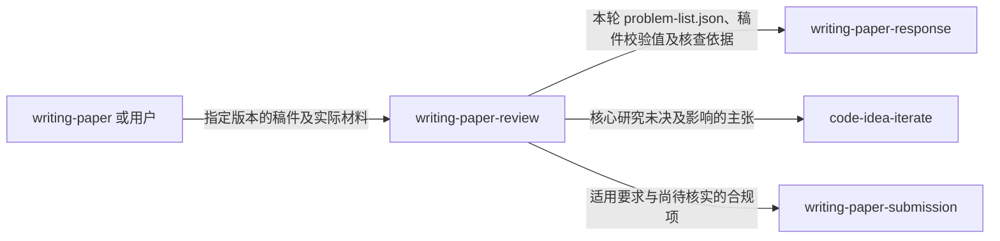
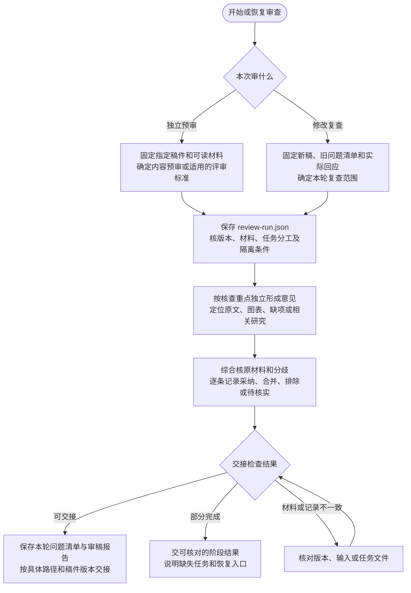

# 根据稿件与证据开展论文预审

帮助作者看清读者会怎样理解论文、哪些贡献有证据、还有哪些问题会影响判断。可以对固定版本的稿件做独立预审，也可以对照指定旧意见检查新稿。成品 PDF 用于核查实际呈现，有明确范围的草稿也可做内容预审。

## SKILL 交接关系



全局流程见 [dl-assistant](../dl-assistant/SKILL.md)。

## 产出与保存

自己的论文用 `<论文根>/review/round-N/`。单独审阅外部稿件用 `docs/writing-paper-review/<slug>/round-N/`。有指定路径时按项目约定保存。同一轮的输入固定，恢复时查该轮已有记录，输入变更或真正再审时开新轮。

```text
round-N/
├── review-run.json         # 版本、材料、范围、评审标准和任务
├── materials/             # 按需固定本轮输入快照，记录实际使用的路径
├── tasks/<task-id>.json    # 各任务的原始结构化意见或综合结果
├── sources/<task-id>/     # 按需保存实际查阅的外部来源快照
├── workflow-result.json   # 编排返回，含各任务状态及失败原因
└── handoffs/rev-<N>/      # 同一轮每次交接另存一版
    ├── problem-list.json  # 供 response 读取的问题、依据及未决项
    ├── problem-清单.md     # 人读问题清单
    ├── 审稿总报告.md       # 贡献理解、综合意见、分歧和复查状态
    ├── validation.json    # 结构检查、任务完成和综合状态
    └── records/
        ├── review-run.json、workflow-result.json  # 本次实际核对的原始记录
        ├── tasks/<task-id>.json                   # 核对一致的任务文件
        ├── materials/<编号>/<文件名>               # 稿件和引用材料的固定副本
        └── prior-problem-list.json                # 复查时固定旧清单，已归档为材料时沿用该副本
```

## 运行流程图



## 参考资料列表

| 资料 | 何时读 |
| --- | --- |
| [执行流程](references/workflow.md) | 从定稿件到核查、综合和交接 |
| [运行和复查的字段](references/run-contract.md) · [问题清单字段和示例](references/problem-list-schema.md) | 写运行记录、生成回包或读其他轮次 |
| [通用评审依据](references/fairness-firewall.md) · [严重程度与综合判断](references/calibration.md) | 形成意见和核查分歧 |
| [计算机视觉](references/conf-cv.md) · [OpenReview 类会议](references/conf-openreview.md) · [图形学和机器人](references/conf-graphics-robotics.md) · [期刊](references/journals.md) | 确认目标当年适用的规则 |
| [单份评审](references/templates/review-template.md) · [综合意见](references/templates/meta-review-template.md) · [合规检查](references/templates/compliance-template.md) · [审稿总报告](references/templates/final-report-template.md) | 写各类产物时 |

## 评审原则

1. 先复述研究问题、已有认识、实际新增、证据范围和意义，再判断贡献。重要意见给出原文、图表、公式、缺项的检查范围或外部来源，以及对论文主张的影响。
2. 分别记录**核实状态**和**影响程度**。范围内找不到关键信息时，可以把缺项写清，再保留对实际研究条件的疑问。确定作者如何处理及何时算解决，由 response 与用户讨论。
3. 按论文类型和争议点安排评审人及核查重点。各任务使用相同的证据标准。只有实际上下文隔离时才称为独立评审。综合意见回原材料核查，保留有依据的分歧。
4. 目标会议或期刊可以后定。采用官方表单时核实年份、领域、轨道和阶段。向用户说明据何形成当前判断、哪些仍未核实，以及结论适用的范围。
