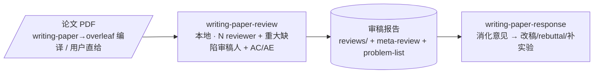
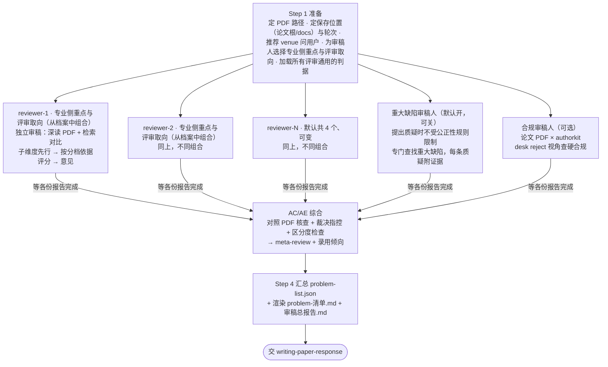

# Writing Paper Review

## 这个 skill 解决什么问题

论文投出去之前，作者很难预判 reviewer 会怎么打、AC 会怎么裁。这个 skill **在投稿前按目标会议或期刊的流程模拟同行评审**：用多个**互不可见的独立审稿子 agent**，各自阅读论文 PDF、按目标会议的评审表单评分并说明依据，再由一个 AC/AE 子 agent 综合成 meta-review 和录用倾向。作者据此在真投之前就看到"被审"的样子。

**真实性靠两件事**：① **独立性**——每个 reviewer 是独立 subagent，看不到彼此、也看不到作者视角（claim tree / manifest / 设计意图），只拿到 PDF 路径自己读，和真实盲审一样；② **视角多样**——每个 reviewer 是通才审稿人，但带不同专长偏向和不同 confidence，像真实审稿团一样意见有分歧。

**只审不改。** 本 skill 只**生成意见**，不动论文。意见生成后交接给 `writing-paper-response`——把意见翻译成可执行修改/rebuttal/补实验，是它的职责（专业的事交给专业的 skill）。流水线：

```
writing-paper-review（被审，出意见）
  → writing-paper-response（消化意见 → 修改需求清单，含补实验目的）
  → writing-paper（清单进 backlog，实验类路由到 design-experiment 产计划包）→ code-paper-experiment（跑）
```

## 在系统里的位置



**图例**：平行四边形 = 外部成品（论文 PDF，用户拿走用）；圆柱体 = skill 间内部流转（审稿报告，review→response）。完整全局图见 `dl-assistant`。

## 边界

**做**：确定论文成品 PDF 的路径（用户给路径，或给 Overleaf 项目名让 agent 下载）；用 Workflow 编排 N 个独立审稿 subagent + 1 个重大缺陷审稿人 +（可选）1 个合规审稿人 + 1 个 AC/AE subagent（按目标会议/期刊真实评审表单，reviewer 各自独立按需阅读 PDF）；产出结构化的每份 review + meta-review + 录用倾向 + 可执行问题清单；将审稿报告保存到文件（含供用户阅读的总报告 `审稿总报告.md`）。**支持两种用法**：审自己的论文（产物进论文根 `review/round-N/`）、独立使用帮别人预审（单篇 PDF 即可，产物落 `docs/writing-paper-review/<slug>/round-N/`）；同一篇多轮审，轮次目录保留历史。

**不做**（交给相邻 skill）：

| 场景                                          | 用                         |
| --------------------------------------------- | -------------------------- |
| 把审稿意见翻译成修改 / rebuttal / 补实验 spec | `writing-paper-response`   |
| 写 / 改论文正文内容                           | `writing-paper`            |
| 投稿前作者自查（合规/匿名/页数/一致性终审）   | `writing-paper-submission` |
| 实际跑补充实验                                | 改稿期：`writing-paper`（修改需求清单进 backlog → design-experiment 规划）→ `code-paper-experiment`；下一版方法迭代才回中期 `code-idea-execution` 全链 |
| 下载 PDF / 编译 / 渲染（提供工具）            | `overleaf-mcp`             |

> 与 `writing-paper-submission` 的分工：submission 是**作者用自己的眼睛**过合规清单（匿名了吗、页数对吗、术语统一吗）；本 skill 是**模拟外部审稿人的眼睛**看论文够不够格中（合规审稿人也只是模拟 editor 第一眼的 desk reject 视角，不替代终审）。两者都在投稿前，但一个是自查、一个是模拟他评。
>
> 与 `writing-paper-response` 的分工：本 skill **产生**审稿意见（模拟被审）；response **消化**审稿意见（无论来自本 skill 的模拟，还是真实 reviewer/导师/合作者）。一个出题，一个答题。

## 输入材料

- **论文最终 PDF**：审稿审的是**成品 PDF**，不是 .md 草稿——和真实 reviewer 一样只看最终呈现。本 skill 的输入本质就是**确定一个本地 PDF 路径**，两种方式（Step 1，agent 向用户确认）：① 用户直接给 PDF 文件路径；② 用户给 **Overleaf 项目名称**，agent 用 `overleaf-mcp` 下载得到路径（为多 skill 协作便利——刚落地完直接报项目名就能接着审，不用手动找 PDF）。
- **目标会议/期刊**：决定加载哪份评审表单、reviewer 评分维度/刻度、录用决策机制。**本 skill 的评审仅使用论文 PDF 和可检索的公开研究，不读取作者内部资料（包括 manifest）**——venue 由 agent 读 PDF 后**推荐 + 问用户确认**得到（见 Step 1）。拿不准 venue 属哪个领域/级别，查 `references/ccf-catalog-v7.pdf`（CCF 第七版目录）。
- **authorkit（可选）**：用户给 authorkit 目录或其自带说明 PDF 的路径时，启用合规审稿人——authorkit 是合规要求的权威来源，比爬网准。

> 审稿人用 pdf-mcp 阅读论文 PDF，也可用 paper-search 检索同领域研究，判断方法的新颖性和基线是否合适。作者的内部论点记录、manifest、设计意图和额外解释均不提供给审稿人。

---

## 工作流

四步：准备 → （Workflow：N reviewer + 重大缺陷审稿人并行审 + AC/AE 综合）→ 保存文件并交接。**Step 2 和 Step 3 在同一个 Workflow 脚本里**——独立审稿任务并行启动，等各份报告完成后由 AC 按固定流程综合。**TaskList 跟踪流程**：Step 1 后建任务（准备 / 审稿编排（N reviewer + 重大缺陷审稿人 + AC）/ 汇总 problem-list / 汇报交接），每步完成即勾。



### Step 1：准备（确定 PDF 路径 + 定评审配置）

1. **确定路径（论文 PDF 输入 + reviewDir 产出保存位置）**（agent 向用户确认）：
    - **① 论文 PDF 路径**（两种）：
        - **A. 用户直接给 PDF 路径**：拿到本地 PDF 文件路径，直接用。
        - **B. 用户给 Overleaf 项目名称**：用 `overleaf-mcp` 下载已编译的成品得到路径（多 skill 协作入口——刚 overleaf 落地完直接报项目名接着审）：

            ```
            overleaf_download_output(project_id=project, compile_id=run, filename="output.pdf")
              → 返回下载到本地的 PDF 路径
            ```

            > 用 `overleaf_projects` 核对项目，`overleaf_compiles` 和 `overleaf_compile_report` 选定已核实的编译记录。需要新编译时按 [Overleaf 编译说明](../overleaf-mcp/SKILL.md) 执行。

        产物记作 `PAPER_PDF_PATH`，后面交给每个 reviewer。
    - **② 产出保存位置 reviewDir（两条分流 + 轮次）**：
        - **自己的论文**（发现规则四级：⑴ 用户显式指定 → ⑵ CWD 本身是论文根[主 tex + `_draft/`] → ⑶ CWD `papers/` 下唯一候选 → ⑷ 多个或没有 → 问用户）→ 落 **`<论文根>/review/round-N/`**——和论文内容物理同地，下游 `writing-paper-response` 路径稳定；视觉相关问题（如图表 spec）可查 `<论文根>/_draft/visuals/manifest.json`。
        - **外部 PDF**（帮同门/朋友预审，没有也不建论文根）→ 落 **`docs/writing-paper-review/<slug>/round-N/`**（slug 从 PDF 标题推或用户起；人会回看的交接文档按归位判据进 docs/）。
        - **轮次**：保存位置下已有 `round-N` → 新一轮 `round-(N+1)/`，**历史轮次保留不覆盖**；每轮都是全新盲审（reviewer 不拿上轮意见，不做跨轮逻辑），`writing-paper-response` 消费**最新一轮**的 problem-list.json。

2. **确认目标 venue（agent 推荐 + 问用户）**：本 skill **不读 manifest 等任何作者视角产物**——venue 这样定：agent 快速翻一下 PDF（主题/方法/领域），**推荐 1-2 个像样的目标 venue**（"这篇像投 CVPR / 或 NeurIPS"），让用户确认或改。拿不准 venue 属哪个领域/什么级别 → 查 `references/ccf-catalog-v7.pdf`。venue 定下后，据此定属于哪一类评审文化（见下方「评审参考」），加载对应 references 文件——它的内容会作为评审表单注入每个 subagent。
3. **确认投稿领域（agent 推荐 + 问用户）**：真实会议投稿要填 subject area / track，**审稿人按领域分配**——模拟必须复现这点：agent 派子 agent **爬 venue 官网当年的 subject area / track 列表**（防瞎编领域名；**爬不到 → 用上一届的 track 列表；再没有 → agent 按领域常识推荐、标清是 fallback**），结合 PDF 主题推荐 1-2 个领域（如 CVPR 的 "3D from multi-view"），用户确认。领域经 args `subjectArea` 注入，reviewer/AC 的背景锚定它（"你是该领域背景的专家"），检索对比也围绕该领域 SOTA。
4. **不预读 PDF 全文喂 reviewer**——审稿人黑盒，自己读。准备阶段只确定 `PAPER_PDF_PATH`（上一步为推荐 venue 翻看 PDF 是 agent 自己用，不算预读给 reviewer），**不把全文读出来塞进 subagent 的 prompt**。每个 reviewer 在自己内部按需翻论文（想看哪页看哪页），这比预切好的全文更拟真，也避免 N 个 subagent 各带一份全文的 token 浪费。
5. **组 reviewer 配置（池化，不固定）**：默认 **4 个审稿人 + 1 个重大缺陷审稿人 + 1 个 AC/AE**。每个 reviewer 带「**专长偏向 × 评审取向**」双分化锚——**偏向和哲学都从池子里选**：agent 按论文类型（理论/系统/应用/数据集文）+ venue 评审文化**推荐 N 个组合并给理由**（如系统文多配实验充分×实用主义，理论文多配理论严谨×理论纯粹），用户确认或改：
    - **偏向池**（档案在 `references/pool/leanings/`）：理论严谨 / 实验充分 / 方法创新 / 应用落地 / 写作表达 / 定位与相关工作
    - **哲学池**（档案在 `references/pool/philosophies/`）：严苛挑剔 / 鼓励创新 / 实用主义 / 理论纯粹 / 怀疑论者 / 细节控

    组合定稿后，**把每个 reviewer 选中的两份档案全文读出来**，经 args `leaningForms` / `philosophyForms` 注入对应 reviewer——档案才是完整的评审侧重点和判断方式（在意什么/怎么审/什么打动/哪些问题会降低评分/打分倾向），标签只是索引。N 个 reviewer 都是同一个模型，单靠偏向会塌缩成雷同意见，加一层哲学强制口味分歧，意见才像真实审稿团那样体现不同的评审判断。问用户是否加减审稿人、换组合、关重大缺陷审稿人。
6. **可选：合规审稿人**——用户提供 authorkit（或其自带说明 PDF）时启用：拿论文 PDF 对照 authorkit 的硬性要求逐项核（页数/版式与字体/匿名/引用格式/checklist 与声明），**desk reject 视角**（editor 拿到论文第一眼查的东西），合规问题进 problem-list。与 `writing-paper-submission` 的分工：这里是模拟外部第一眼，submission 仍是投前终审。
7. **加载所有评审通用的判据**（所有 venue 通用，注入每个 subagent）：读 `references/fairness-firewall.md`（通用评审公正性规则——什么不算拒稿理由）+ `references/calibration.md`（各分档的评分依据 + 打分校准 + AC decision matrix）全文，经 args `firewallForm` / `calibrationForm` 注入 workflow。

### Step 2 + Step 3：Workflow 编排（N reviewer + 重大缺陷审稿人并行审 → AC/AE 综合）

**为什么用 Workflow**：N 个 reviewer 并行审 → 等各份报告完成 → AC/AE 综合，是一条天然的"并行审稿后汇总"确定性流水线。写成 Workflow 脚本（`parallel()` 起 N 个 reviewer，barrier 后交 AC），编排可靠；并用 **`schema` 强制结构化产出**，AC 直接读取结构化结果、Step 4 的问题清单自动汇总，不必解析自由文本。reviewer 数量可变时，并行审稿人数由数组长度决定，天然可扩展。

> 编排确定（脚本固定），但**审稿内容不可复现**（每个 subagent 自由生成）——这正是真实评审：流程一致、意见因人而异。所以不追求结果可复现。

**怎么运行**：编排已落成参数化 workflow 文件 **`workflows/paper-review.js`**（skill 自包含；接收 args，reviewer/重大缺陷审稿人/合规/AC 子 agent 各自审完即保存到文件到 `reviewDir`，返回 `{reviews, meta, accusations, compliance}` 供 Step 4 汇总）。**先读这个文件搞懂编排步骤（并行审稿 → 等各份报告完成 → AC 综合）和 args 参数要求**，再执行——宿主有 Workflow 工具就直接跑（`name: 'paper-review'` + `args`）；没有就主 agent 照脚本逻辑用子 agent 手动复现同一流程，args 各项当 checklist 逐个备齐，子 agent 保存到文件约定不变：

```js
Workflow({
  name: 'paper-review',
  args: {
    pdfPath: '<Step 1 拿到的本地 PDF 绝对路径>',     // 黑盒：reviewer 自己用 pdf-mcp 按需读
    reviewDir: '<Step 1 定的 round-N 目录绝对路径>',  // 子 agent 各自审完即落盘（自己的论文=<论文根>/review/round-N/；外部 PDF=docs/writing-paper-review/<slug>/round-N/）
    venue: '<目标 venue，如 CVPR / TPAMI>',
    subjectArea: '<投稿领域/track——真实会议按领域分配审稿人，reviewer 背景锚定它>',
    venueForm: '<加载的对应 references 文件全文（评审表单）>',
    firewallForm: '<fairness-firewall.md 全文>',     // 横切：reviewer 写 weakness 时过墙
    calibrationForm: '<calibration.md 全文>',        // 横切：刻度锚点 + 打分校准 + AC decision matrix
    reviewerLeanings: ['偏理论严谨', '偏实验充分', '偏应用落地', '偏 novelty/写作'],  // 池化推荐后传入，长度=reviewer 数
    reviewerPhilosophies: ['严苛挑剔', '鼓励创新', '实用主义', '理论纯粹'],           // 和 leaning 组合分化防塌缩
    leaningForms: ['<reviewer-1 偏向档案全文>', '...'],   // 与 leanings 平行——档案才是完整人设
    philosophyForms: ['<哲学档案全文>', '...'],           // 与 philosophies 平行（按取模后 index 对齐）
    enableDevilAdvocate: true,                       // 魔鬼代言人，默认开；用户不要可关
    authorkitPdfPath: '<可选：authorkit 自带说明 PDF 路径——给了就启用合规审稿人>',
    reviewSchema: { /* 按 venueForm 真实维度/刻度实例化，见下 */ },
    metaSchema:   { /* 按 venue 真实录用机制实例化，见下 */ },
  },
})
```

> **为什么参数化文件而非内联**：schema 维度（ICLR `{1,3,5,6,8,10}` / ACL soundness+excitement / 期刊 major-minor）、reviewer 数、表单内容都随 venue 运行时变——编排步骤固定、配置走 args，文件可复用可 review，不用每次重发整段脚本。**schema 仍由 agent 按 venueForm 实例化后经 args 传入**（workflow 里 `reviewSchema`/`metaSchema` 缺省时退化为自由文本，但强烈建议传——AC 和 Step 4 都靠结构化数据）。

**reviewSchema 形状**（按 venue 真实字段替换）：
```
{ summary, strengths[], weaknesses[], questions[],
  scores{ 按 venue 维度：soundness/presentation/contribution/overall，
          ICLR 用 {1,3,5,6,8,10}，ACL 用 soundness+excitement，RSS 用 quality 5 档 },
  confidence }
```
**metaSchema 形状**：
```
{ recommendation( 按 venue 刻度：accept/borderline/reject 或 SA…SR 或 major/minor revision ),
  rationale, major_points[], minor_points[] }
```

**实例（以 ICLR 为例填好的一份）**：
```
reviewSchema = {
  summary: string, strengths: string[], weaknesses: string[], questions: string[],
  scores: { soundness: 1|2|3|4, presentation: 1|2|3|4, contribution: 1|2|3|4,
            overall: 1|3|5|6|8|10 },
  confidence: 1|2|3|4|5 }
metaSchema = {
  recommendation: "strong accept"|"accept"|"weak accept"|"borderline"|"weak reject"|"reject"|"strong reject",
  rationale: string, major_points: string[], minor_points: string[] }
```

**每个 reviewer subagent 拿到**：① 论文 PDF 文件路径（唯一提供的论文材料）；② 目标 venue 的评审表单（references 文件内容）；③ 一个通才审稿人人设 + 一个专长偏向（按 index 取）+ 自定 confidence。它据此**像真审稿人一样工作**——见下两个动作。

**reviewer = 真审稿人，两个动作（真实性关键）**：
- **动作 A｜深读本篇**：用 pdf-mcp（`pdf_open` 固定版本 → `pdf_outline` 定位 → `pdf_search` 跳主表/消融 → `pdf_read` 读文字、排版复杂才 `pdf_render` 兜底）按**可操作量化判据**逐项核，不给空话——baseline 最新年份/数量/是否含 SOTA、related work 新鲜度、实验规模算力；**消融是否避重就轻**（故意不消融最关键组件）、**分析实验有没有 insight**（揭示 why it works 还是只有 main table）、claim 立不立得住、story telling；不开源+回避强 baseline+消融避重就轻三者叠加标 ⚠️ 复现风险。（这套判据对齐 `arxiv-daily-paper` 的第 2 轮量化细评 + 第 3 轮精读判据。）
- **动作 B｜检索对比**：用 `paper-search` 主动检索同领域工作——这是判 **novelty**（搜核心思想/方法看近 1-2 年有没有人做过；"我没见过"不是 novelty 证据，"检索后确认没人做过"才是）、**baseline 公平性**（搜该任务 SOTA，判断作者是不是挑了弱的/老的来比）、**significance**（已有工作覆盖程度及该问题的研究价值）的硬前提。真审稿人从不只看一篇就下 novelty 判断。检索结论写进 strengths/weaknesses/questions，论文标题/结论必须真实来自工具返回、不编造。

**打分纪律（避免评分无依据地集中在中段，硬约束）**：评分应反映问题的严重程度，也应区分表现不同的稿件。
1. **子维度先行**：先按表单逐项打子维度分（各自对 `calibration.md` 各分档的评分依据），overall 由子维度 + 锚点推出——总分须有分项评分和论文定位作为依据。
2. **对比定位发问**：打 overall 前先回答「这篇相对该 venue 典型录用论文和典型拒稿论文，更像哪一边？」，答案写进报告。
3. **完成度计入**：半成品（实验残缺 / 章节未完成 / 图表占位）→ presentation 与 contribution 应在相应分项评分中反映稿件未完成的问题，overall 不许停在中段。

**报告语言**：reviewer / 重大缺陷审稿人 / 合规 / AC 的报告一律用**简体中文**撰写（venue 术语、评分维度名、方法名保留英文原文）。保存到文件结构按 `references/templates/` 下对应模板。

**重大缺陷审稿人（工作流和 `source` 字段中称「魔鬼代言人」，默认启用，第 1 步可关闭）**：与其他审稿人并行工作——**提出质疑时不受公正性规则限制**，唯一任务是尽一切可能找可能构成拒稿理由的重大质疑（novelty 证伪 / 方法根本错误 / 数据泄漏 / baseline 不公平 / claim 过度），**每条必须附证据**（页码或检索结果），宁多勿漏。它只负责指控，**裁决归 AC**：AC 逐条核对（是否符合公正性规则、原文支不支持、检索核不核实），成立 → 进 problem-list 致命类；不成立 → 记为「**已排除指控**」写进 meta-review——这份清单等于记录了可依据原文和检索结果回应的质疑，让你提前知道哪些质疑缺乏证据或不适用。

**通才 + 专长偏向**：每个 reviewer 都是**能审全文的通才**，拿同一份评审表单全面评——但带不同**专长偏向**（Step 1 从偏向池组合）和不同 **confidence**。**不要把 reviewer 切成"方法/实验/写作/significance 各管一段"**——真实 reviewer 都通读全文，只是口味与确信度不同，意见因此自然分歧。用 index 区分偏向，避免 N 份雷同。

**reviewer 只生成意见、不给修改方案**——summary（公平复述）/ strengths / weaknesses / questions（问题清单）。改怎么改是 `writing-paper-response` 的活。

**weakness 纳入问题清单的必填条件（verbatim-quote anti-skim + 可验收条件）**：每条 weakness 必须带 ① **verbatim_quote**——问题所指的逐字原文引用 + 页码（**引不出原文 = 没读**，该条不建档）；② **close_criterion**——「改成什么样这条算关闭」的可验收条件（写不出可验收条件的空泛批评不建档）。question 是发问不是指控，不强制。Step 4 汇总时无 verbatim_quote 的条目**直接丢弃并计数汇报**——门槛由汇总层机器执行，不靠 reviewer 自觉。

> 顺带核对参考文献章节（真实审稿人会做的严谨性检查，写进 weaknesses/questions）：有没有正式会议/期刊论文却以 arXiv 预印本充当正式引用、条目明显格式不齐/缺 venue、引用编号与正文对不上。这是 bib 当场构造的 `needs_human_verify` 机制的在审稿阶段再次核对参考文献的环节（见 `writing-paper/references/craft/bibtex-on-the-fly.md`：标了待人工核对的条目本就指望这里揪出来），别漏看。

**AC/AE（Step 3）按 venue 真实录用机制综合**——手上**既有 N 份审稿意见、又有论文 PDF**，像真实 AC 一样**对照原文核查**（reviewer 说的问题是否成立、是否误读、分歧信谁；borderline 尤其自己翻原文）。此外两个额外动作：① **裁决重大缺陷审稿人的指控**（逐条对照原文 + 公正性规则，成立的进 major points / 致命类，不成立的记「已排除指控」）；② **区分度检查**——若 reviewer 评分挤在同一分段（如全 borderline），必须在 meta-review 里显式回答「为什么这篇不是明显的 accept 或明显的 reject」，给出明确倾向，**不许直接用平均分给出 borderline**：

- **会议**：meta-review + 录用倾向。CVPR/ICCV/ECCV 走 AC triplet、看论证不看分数曲线；NeurIPS/ICLR/AAAI 综合数值 + discussion；SIGGRAPH/RSS 委员会精审。给该 venue 真实刻度的录用倾向（accept/borderline/reject 或 SA…SR）。
- **期刊**：AE 决定信——Accept / **Major Revision** / Minor Revision / Reject（按目标刊刻度），附 major_points + minor_points 编号清单（见 journals.md）。

> ⚠️ 审稿材料的访问范围：reviewer、重大缺陷审稿人和 AC 都**不拿任何作者视角产物**（claim tree / manifest / 设计意图）——绝不把它们拼进任何 prompt。AC 还会读取 `reviews`（二手意见）+ 指控清单，并对照 PDF + 检索交叉核查。

### Step 4：汇报 + 保存到文件 + 交接

reviewer / 重大缺陷审稿人 / 合规 / AC 已在 workflow 里各自保存到文件（审完即落、防中途崩丢，落进 Step 1 定的 `round-N/`）。本步三件事：**① 汇总 `problem-list.json`**——从返回的 `{reviews, meta, accusations, compliance}`（或读盘上各报告文件）抽 weaknesses/questions/major/minor points/成立的指控/合规问题，去重编号写成机读 json；**② 渲染两份人读产物**——`problem-清单.md`（从 json 渲染，json 是唯一真相源）+ **`审稿总报告.md`**（供用户阅读的总报告：结论汇总 + 文件导航，**纯渲染不产生新判断**，结构见 `references/templates/final-report-template.md`）；**③ 向用户汇报 + 交接**。

```
<落点>/round-N/          # 落点 = <论文根>/review/（自己的论文）或 docs/writing-paper-review/<slug>/（外部 PDF）
├── reviews/
│   ├── reviewer-1.md      # 每份结构化 review（模板：references/templates/review-template.md）
│   ├── reviewer-2.md
│   └── ...
├── devil-advocate.md      # 魔鬼代言人指控清单（每条附证据；AC 裁决结果进 meta-review）
├── compliance-review.md   # 可选：合规审稿人报告
├── meta-review.md         # AC/AE 裁决全文（含已排除指控）
├── problem-list.json      # 机读交接契约——response 消费最新一轮（schema：references/problem-list-schema.md）
├── problem-清单.md        # 从 json 渲染的人读版
└── 审稿总报告.md          # 人读入口：结论汇总 + 导航（模板：references/templates/final-report-template.md）
```

`problem-list.json` 是交给 `writing-paper-response` 的接口——**字段 schema 见 `references/problem-list-schema.md`**；因为 review 是结构化的，直接把各 `weaknesses[]`/`questions[]`/`major_points[]` 抽出来去重编号即可，不用解析自由文本。**建档过滤（由程序核对必填条件）**：无 `verbatim_quote` 或 `close_criterion` 的条目不进清单——丢弃并计数，汇报里写明「N 条因缺原文引用/缺可验收条件被丢弃」（这两条是必填字段，schema 见上）。**每条带严重度标签**（`severity`）：对照 `fairness-firewall.md`（七类=改进建议）和 `calibration.md`（致命类）打 `致命` / `改进`——response 据此排优先级（致命必须直接修改或据证回应，改进可权衡）。合规问题按 desk-reject 级别判：页数超/匿名泄露这类直接 `致命`，版式小瑕疵 `改进`。

向用户汇报：目标 venue、各 reviewer 评分一览、重大缺陷审稿人指控成立/排除各几条、meta 录用倾向/决定、问题清单条数（口头汇报的持久化版本就是 `审稿总报告.md`）。再交接：

- **消化意见 → 改稿 / rebuttal / 补实验** → `writing-paper-response`（吃最新一轮 `problem-list.json`；外部 PDF 场景无论文根——把 `审稿总报告.md` + `problem-清单.md` 交用户转达即可）
- 某问题要补实验 → response 判断该不该补（给核心目的），修改需求清单进 `writing-paper` backlog 后由 design-experiment 规划 → `code-paper-experiment` 跑
- 纯合规/一致性自查 → `writing-paper-submission`

## 常见错误

- 不要给 reviewer subagent 看 claim tree / manifest / 作者意图——只给 PDF 路径，否则不是盲审。
- 不要让 reviewer 凭空判 novelty——必须 paper-search 检索确认有没有人做过；"我没见过"不算 novelty 证据。
- 不要在准备阶段预读 PDF 全文喂给 reviewer——给路径让它自己按需翻，更拟真也省 token。
- 不要让 reviewer 互相可见——`parallel()` 里每个 thunk 独立，别把一个的评语拼进另一个的 prompt。
- 不要把 reviewer 切成"各管一段"——他们是通读全文的通才，只是偏向/confidence 不同。
- 不要固定用同一组专业侧重点与评审取向组合——按论文类型 + venue 文化从池里选组合、给理由、用户确认；老用同一组，意见结构可预测、盲区固定。
- 不要把偏向/哲学当一句话标签塞给 reviewer——Step 1 把选中档案的全文经 `leaningForms`/`philosophyForms` 注入；档案才是完整的评审侧重点和判断方式，标签只是索引。
- 不要自创通用 1-5 分——`reviewSchema` 严格用目标 venue 的真实评分维度和刻度（见 references），按 venueForm 实例化后经 args 传入。
- 不要让 reviewer 拿不致命的问题当 fatal flaw 压分——写 weakness 必须过通用评审公正性规则（`fairness-firewall.md` 七类只算改进建议，不降大分）；致命类（`calibration.md`：novelty 证伪 / 过度声称 / 方法根本错 / RW 脱节）才降大分，且低分必须在 weakness 里有对应硬伤。
- 不要直接拍 overall——先打子维度、再按各分档的评分依据推 overall；完成度计入子维度，半成品（实验残缺/章节未完）不许停在中段安全分。
- 不要全堆 borderline——评分挤在同一分段时 AC 必须显式回答「为什么不是明显的 accept 或明显的 reject」，给出明确倾向。
- 不要让报告写成英文——reviewer / 重大缺陷审稿人 / 合规 / AC 的报告一律简体中文（术语保留英文）。
- 不要让 N 个 reviewer 塌缩成雷同意见——单靠专长偏向不够（同模型口味趋同），必须配「评审取向」双分化锚。
- 不要让重大缺陷审稿人的指控直接进 problem-list——它只负责指控，AC 裁决后才入清单；不成立的记「已排除指控」写进 meta-review。
- 不要让无 verbatim_quote / 无 close_criterion 的条目进 problem-list——引不出原文 = 没读，给不出可验收条件 = 空泛批评；Step 4 丢弃并计数汇报，门槛靠汇总层执行不靠 reviewer 自觉。
- 不要让 reviewer 给修改方案——只生成意见（批评 + 问题），改怎么改是 `writing-paper-response` 的活。
- 不要用合规审稿人替代 submission 终审——它只模拟 editor 第一眼的 desk reject 视角，投前终审归 `writing-paper-submission`。
- 不要在本 skill 里改论文——只审不改。
- 不要把 Step 2/3 拆成无编排的零散 Agent 调用——**先读 skill 自带 `workflows/paper-review.js` 搞懂编排步骤**（并行审稿 → 等各份报告完成 → AC 综合 + args 参数要求），再按它启动子 agent 编排（宿主有 Workflow 工具就直接跑，没有就主 agent 手动复现同一流程），schema 经 args 传入保证结构化产出。
- 不要主会话代保存到文件——子 agent 各自审完即保存到文件（`reviewDir` 经 args 传入）；主会话只汇总 problem-list，中途崩了已保存到文件的还在。
- 不要忘了问投稿领域——真实审稿按领域分配审稿人，`subjectArea` 不定，reviewer 背景就没锚。
- 不要混淆会议和期刊的产出——会议出录用倾向，期刊出 major/minor revision 决定信。
- 不要覆盖历史轮次——同一篇再审，新一轮落 `round-(N+1)/`；每轮都是全新盲审（reviewer 不拿上轮意见），历史轮次保留。
- 不要把外部 PDF 的产物丢到 PDF 旁边的临时位置——帮别人预审落 `docs/writing-paper-review/<slug>/round-N/`。
- 不要审 .md 草稿——审已编译的最终 PDF（reviewer 看到的就是成品）。
- 不要在会话里用 `$...$` LaTeX——会话符号用 Unicode（横切规范见 `dl-assistant` SKILL.md「横切规范」）。

---

## references（venue 评审表单 + 所有评审通用的判据 + 报告模板）

**所有评审通用的判据**（所有 venue 一并加载注入，不随 venue 变）：

| references 文件 | 装什么 | 注入谁 |
|---|---|---|
| `references/fairness-firewall.md` | 通用评审公正性规则——什么**不算**拒稿理由（七类缺陷但不致命）| reviewer（写 weakness 过墙）|
| `references/calibration.md` | 各分档的评分依据 + 打分校准（致命 vs 扣分）+ AC decision matrix + 区分度检查 | reviewer（打分校准）+ AC（综合决策）|
| `references/problem-list-schema.md` | `problem-list.json` 字段 schema（review→response 交接契约）| Step 4 汇总保存到文件 |

> 把公正性规则和评分指引一起提供给评审角色。前者说明哪些问题不足以成为拒稿理由，后者说明各个分档的依据、哪些问题可能导致拒稿，以及 AC 如何综合评审。

**报告模板**（子 agent 保存到文件结构；workflow prompt 已内嵌同样骨架，模板是权威结构文档——每节带「指引」说明写什么、怎么写才合格）：

| references 文件 | 装什么 |
|---|---|
| `references/templates/review-template.md` | 单份 review 报告结构（评分总表[子维度先行+锚点依据] + 对比定位 + summary/strengths/weaknesses[四件套]/questions + 检索结论 + 参考文献核对） |
| `references/templates/meta-review-template.md` | meta-review 结构（录用倾向 + 立场地图 + 核查裁决[误读/分歧/指控] + 已排除指控 + 区分度检查 + rationale + major/minor points[四件套]） |
| `references/templates/compliance-template.md` | 合规审稿人报告结构（对照总表[authorkit 原文摘录] + 问题详情[severity 判据] + 未见异常项） |
| `references/templates/final-report-template.md` | 审稿总报告结构（供用户阅读的总报告：评审配置 + 录用倾向 + 评分一览 + 共识分歧 + 致命问题 + 已排除指控 + 文件索引 + 交接） |

**专业侧重点与评审取向档案池**（Step 1 组合用；选中档案全文经 `leaningForms`/`philosophyForms` 注入对应 reviewer）：

| 目录 | 装什么 |
|---|---|
| `references/pool/leanings/` | 6 份专长偏向档案（理论严谨/实验充分/方法创新/应用落地/写作表达/定位与相关工作）——每份：在意什么/怎么审/什么打动/哪些问题会降低评分/weakness 风格 |
| `references/pool/philosophies/` | 6 份评审取向档案（严苛挑剔/鼓励创新/实用主义/理论纯粹/怀疑论者/细节控）——每份：世界观/打分倾向/原谅与绝不原谅/措辞风格 |

> 加新档案 = 往对应目录丢一个文件 + Step 1 池子清单加一行——workflow 与注入逻辑不用动。

**venue 评审表单**（目标 venue 决定加载哪份——加载的内容作为 `VENUE_FORM` 注入每个 subagent。会议按三类评审文化分，期刊单列）：

| references 文件                        | 覆盖 venue                                                 | 评审文化                                                                            |
| -------------------------------------- | ---------------------------------------------------------- | ----------------------------------------------------------------------------------- |
| `references/conf-openreview.md`        | ICLR / NeurIPS / AAAI / CoRL / ACL / EMNLP                 | 结构化子维度 + 数值 overall + rebuttal/discussion（ACL 特殊：Soundness+Excitement） |
| `references/conf-cv.md`                | CVPR / ICCV / ECCV                                         | 以书面评审意见为主，AC triplet 拍板，不看分数曲线，禁 LLM                                       |
| `references/conf-graphics-robotics.md` | SIGGRAPH(+Asia) / ACM MM / RSS / ICRA / IROS               | 精审派，多审、强调 impact、rebuttal 严格                                            |
| `references/journals.md`               | TPAMI / IJCV / TOG / JMLR / TIP / TVCG / TMM / T-RO / IJRR | 修订循环派，AE 把关，Major/Minor Revision 多轮                                      |
| `references/ccf-catalog-v7.pdf`        | CCF 第七版完整目录（2025）                                 | 不是评审表单——Step 1 确认 venue 属哪个领域/什么级别时查它                           |

> CCF 第七版（2025）的 A 类是起点，但以**领域公认顶会/顶刊**为准——ECCV/EMNLP/ICRA 虽 CCF B、RSS/CoRL/T-RO/IJRR 未进 CCF，但都是 DL/机器人真实投稿目标，一并覆盖。
