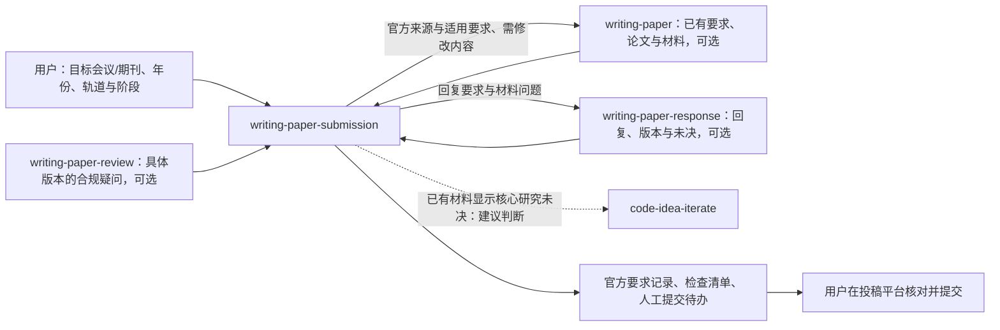

# 官方投稿要求与人工提交准备

帮助用户知道：官方要求什么、哪些适用、现有材料核到了哪里、还需准备什么，以及本人需要在投稿平台做什么。可以只查询要求，不必已有论文或进入定稿阶段。保留skill名称，不自动登录、填写在线表单、上传、勾选声明或提交。

## 在系统中的位置



全局关系见dl-assistant。论文修改交writing-paper，回复处理交response；如已有证据表明核心研究未决，按 [研究与写作判断](../dl-assistant/references/research-transition.md) 说明影响并建议iterate判断，不为准备材料默认补实验或重做研究审查。

## 1. 明确本次范围

优先沿用用户或现有材料中的目标、年份、轨道、论文类型、提交阶段及指定检查范围；有影响适用性的歧义才问。阶段可以是摘要登记、初投、返修/作者回复、最终稿或其他实际阶段，不用“匿名/恢复身份”概括所有差异。

三种任务可独立完成：查询官方要求、核对指定材料、准备人工提交待办。没有PDF、源码、日志或项目目录不阻塞查询要求，不强迫建立Overleaf、编译、安装工具或补全整套流程。

**开始前自查**：本次目标和阶段足以判断适用性吗；已知信息与待核实分别是什么；用户要查询还是也要核材料？有未知可先查共同要求，但不能冒充特定轨道/阶段已确认。

## 2. 查官方来源，逐项提取

使用可用的网页检索/读取工具，按 [官方来源核查规则](references/official-guidelines.md) 阅读实际页面、模板说明和公告。需要工具时查其当前接口，不把工具名或抓取方式固定为必经路径。

已有venue-contract或官方材料记录可复用，但核来源、年份/轨道/阶段及是否有更新；它们不是永远正确的唯一事实来源。官方要求缺失或过期时，本skill可以直接查证，不必回写作初始化才能继续。

每项要求有稳定ID，保存准确含义、官方出处与位置、适用条件、核查时间、明确的未知/冲突。区分“必须、禁止、建议、允许、有条件适用”，不要把示例当强制规定。截止时间保存原文、时区及完整日期；缺时区/时间就待核实，不默认AoE或午夜。

## 3. 整理清单与人工待办

按 [报告模板](references/report-template.md) 输出三个部分，可在同一submission-guide.md中，避免重复维护：

1. **官方要求记录**：来源、适用范围、要求及未知/冲突。
2. **检查清单**：每项标符合/不符合/待核实/不适用，附实际依据；无材料时如实待检查，不能填符合。
3. **人工提交待办**：要准备的文件、需用户确认的信息/声明、需在平台完成的步骤及官方链接。只列实际已知步骤；账号内信息或受限页面看不到就说明，不编造字段名或操作顺序。

区分材料已起草、事实已核、用户已确认、文件已准备与平台已提交。生成指引不等于填好了表单；用户负责登录、作者信息核对、勾选声明、上传和最终提交。可以帮助解释声明和起草建议答案，不替用户断言未知事实或作承诺，不要求对已确认内容重复确认。

**整理检查内容前自查**：每条要求是否有实际官方依据，强制性和条件是否准确，检查方法能否核该要求，哪些必须由用户在平台确认？来源冲突或访问不到时保留待核实，不把历史规则当本次事实。

## 4. 按需核已有材料

仅对用户指定或任务明确涉及的材料检查，先记录文件路径、版本/校验值和范围。PDF可以独立核；日志缺失就不认证构建/交叉引用，不强迫补源码。不能用旧日志说明新PDF正确，不能从源码中的注释/占位直接推断实际PDF泄露。

按实际要求选择页数、匿名、图表可读性、声明、补充材料、文件类型/大小等检查。只看了部分页就记录页码，没渲染不写视觉检查通过；camera-ready不自动要求metadata作者非空或全文删除Anonymous。科学边界见 [研究条件规则](../dl-assistant/references/research-conditions.md)。

可选工具：

```bash
bash <skill目录>/scripts/submission-check.sh --pdf <PDF> --checks pages,fonts,metadata
```

脚本只提供文件观察和声明规则下的有限比较，不决定平台接受、匿名合规或整体就绪。用法与范围见 [辅助检查](references/material-checks.md)。无需材料检查时不调用。

填写/修改材料不是查询要求的必经步骤；需要改正文或正式材料时交对应写作任务，实际修改后重核受影响项目，不在此自动修改或压缩文件。

## 5. 变化、保存与交接

默认docs/submission-guide/<实际日期>-<标识>/，或用户指定位置；已有论文记录可放其submission/下的唯一轮次。保留历史来源和结果，不固定覆盖readiness-report.md。

规则、文件或提交阶段变化时，记录哪些检查失效：页数依据、身份规则、实际PDF、回复/补充材料等按依赖重核；不要求无关内容全部重查。最终材料包可选列文件用途、路径/校验值、关联要求和检查状态，不因文件齐全推断已上传。

**交付前自查**：官方来源与本次适用范围清楚吗；符合/不符合是否有证据；未查、冲突和受限信息是否保留；材料版本是否仍是所查版本；人工待办能否照着完成？需要修正则先修正，有限查询成果可带未知交付。

三处自查在同一报告保存简短“判断—实际依据/来源—未知—对下一步影响”，可用clear/limited/needs_revision标明。影响某条确定性结论的needs_revision先修正或改为待核实，不把它写成已符合；有限查询和未决可以正常交付，不增加逐项用户审批。自查不是独立核查。

最后汇报“已查清什么、哪些仍待核实、现有材料检查到哪里、需要用户做什么”。不强制全局Go/No-Go，不把规则查询或脚本退出0写成已提交、已确认录用资格或科学内容认证。
