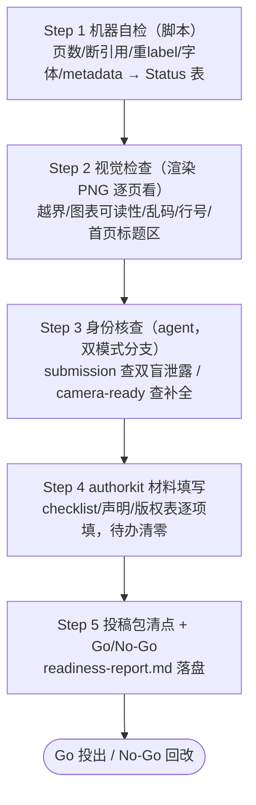

# Writing Paper Submission

## 这个 skill 解决什么问题

论文定稿到真正投出（或提交 camera-ready）之间，有一段终审——它不产生新内容，只回答：**这篇论文投出去会不会因为客观问题 desk reject / 提交失败，该填的材料填了没有，该带的投稿包带齐了没有。**

合规要求（页数/模板/匿名规则/特殊章节）是**写作期**的事——`writing-paper` 的 op-1 已把它们冻进 `_draft/venue-contract.md`，写作全程对照。事后才查的代价是伤内容（正文写超了再砍、章节缺了再补）。所以本 skill **不重新爬 venue 要求、不重审内容质量**，只做四件只能最后做的事：

1. **机器自检**——页数/断引用/重 label/字体嵌入/metadata，客观项脚本跑出确定 pass/fail;
2. **视觉检查**——把 PDF 渲染成图逐页看：overfull 越界、图糊字小、乱码豆腐块这类"编译不报错但辣眼睛"的问题，只有眼睛能查；
3. **身份核查**——submission 查双盲泄露（藏好了吗）,camera-ready 反向查补全（作者/致谢补回来了吗）;
4. **authorkit 材料 + 投稿包**——checklist/声明/版权表逐项填，投稿包逐项清，全过才建议 Go。

**机器与 agent 的分工**：PDF/log 客观项脚本跑（agent 看不到字体嵌没嵌、metadata 字段，脚本看得到）;tex 源与页面的判断归 agent——grep 分不清 authorkit 里的注释、匿名占位和自定义命令，匿名是不是泄露只能读懂再判。

**两种模式**:`submission`（投稿前）和 `camera-ready`（录用后定稿）。检查方向相反：submission 查"身份藏好了吗",camera-ready 查"身份补回来了吗"；页数口径也常不同（camera-ready 通常 +1 页且要求含致谢）。启动时先与用户确认模式。

**与 writing-paper op-8 finalize 的分工**:finalize 是**论文侧收尾**（编译绿/页数软合规/强制章节/authorkit 材料注册为待办），发生在写作收尾；本 skill 是**投稿侧终审**（成品机器自检 + 材料真填 + 打包 + Go/No-Go)，发生在真要投的前一刻。finalize 注册待办，本 skill 清零待办，不重复劳动。

## 在系统里的位置


**图例**：矩形 = skill；平行四边形 = 外部成品（就绪报告/投稿包，用户拿走投稿）。完整全局图见 `dl-assistant`。

## 边界

**做**：机器自检（脚本客观项）、PDF 视觉检查（渲染看图）、身份核查（双盲泄露 / camera-ready 补全）、authorkit 材料填写（checklist/声明/版权表）、投稿包清点、Go/No-Go 建议。

**不做**（交给相邻 skill）：

| 场景 | 用 |
|---|---|
| 还在写/改某个 section 的内容 | `writing-paper` |
| 回应审稿人 rebuttal / 导师 / 合作者意见 | `writing-paper-response` |
| 模拟外部审稿（黑盒评判中不中） | `writing-paper-review` |
| LaTeX 编译失败、PDF 修复 | local 模式本地修（见 writing-paper `latex-landing.md`）；overleaf 模式 `overleaf-mcp` |
| venue 当年规格/格式契约缺失或过期 | `writing-paper` op-1（venue-contract.md 是唯一真相源） |
| 发现 claim 缺实验要补 | `writing-paper`（design-experiment）→ `code-paper-experiment` |

## 输入材料

- **论文根**:`<论文根>` = Overleaf clone 根（含主 tex + `_draft/`,`review/`、`response/` 同级）。四级发现规则：用户指定 → CWD 本身是 → CWD `papers/` 下唯一候选 → 问用户。
- **venue-contract.md**(`<论文根>/_draft/venue-contract.md`)——**唯一检查基准**：页数口径与上限（submission / camera-ready 分别）、匿名规则、强制章节、authorkit 材料清单、补充材料规则、提交系统要求。**没有或过期 → 回 `writing-paper` op-1 补，本 skill 不自己爬 venue。**
- **`_draft/config.json`**：拿主 tex 文件名 + `compile_mode`（local / overleaf）——决定成品 PDF 和 log 从哪拿。
- **成品 PDF + log**（机器自检要 log 查断引用/重 label）按 `compile_mode` 分支：`local` → 直接读 `_draft/build/<主tex>.pdf` + `<主tex>.log`（没有就在论文根本地编译，命令见 writing-paper `references/craft/latex-landing.md`）；`overleaf` → overleaf-mcp 先编译成功拿到 PDF + output.log。
- **tex 源**：论文根目录，布局随 authorkit——**别假设 `tex/` 子目录**，先 Glob 找主 tex。
- **paper-state.json 待办项**:authorkit 材料的待办注册在这里，Step 4 逐项清零。
- **模式**:submission / camera-ready，启动时与用户确认。

## 产出与保存

```
<论文根>/submission/
└── readiness-report.md     # submission 模式终审报告
<论文根>/camera-ready/
└── readiness-report.md     # camera-ready 模式终审报告（两模式分开落，不互覆）
```

材料填写直接改 authorkit 里的材料本体（checklist.tex / 表单等），每项的答案与确认情况记进报告对应节。

## 核心纪律

- **venue-contract 是唯一基准**——所有检查对照它；发现它与官网当年要求矛盾 → 标出来找用户，别自己另查一套。
- **只终审，不写内容**——发现内容问题（缺实验/章节要重写）路由回 `writing-paper`，这里不修。
- **机器查客观，agent 查判断**——脚本 Status 表的 FAIL 直接进阻塞项不用复核；tex/页面判断 agent 做，宁可逐页看也不用 grep 一刀切。
- **声明承诺归人**——原创性声明、版权转让、代码开源承诺这类材料，agent 起草、**用户逐条确认**后才算填好；agent 不替用户做任何承诺。
- **Go/No-Go 归人**——报告给结论建议，最终投不投用户定；Blocking 未清一律不建议 Go。
- **camera-ready 是反向检查**——submission 查"藏好",camera-ready 查"补全"，别拿一套清单查两遍。

---

## 工作流

五步：机器自检 → 视觉检查 → 身份核查 → 材料填写 → 投稿包 + Go/No-Go。**TaskList 跟踪**：建五个任务，每步完成即勾。用户可指定范围（只跑机器自检 / 只填材料 / 全部）。



### Step 1：机器自检（脚本）

调本 skill 的 `scripts/submission-check.sh`，一次跑完客观项，输出 markdown Status 表：

```
bash <本skill目录>/scripts/submission-check.sh \
  --pdf <成品PDF> --log <output.log> \
  --page-limit <venue-contract 的页数上限> \
  --main-pages <正文页数> \        # venue 口径只算正文时传；从 PDF 定位 refs 起始页算
  --double-blind                   # submission 模式且双盲 venue；camera-ready 模式换成 --camera-ready
```

检查项（缺对应输入则该项 SKIP，不报错）：

| 检查项 | 来源 | 查什么 | 对照 |
|---|---|---|---|
| 页数 | pdfinfo | 正文页数（传了 `--main-pages`）或总页数 | venue-contract 的口径与上限；口径只算正文却没传 `--main-pages` 会假 FAIL |
| 断引用 | output.log | Citation/Reference undefined | 应 0 |
| 重 label | output.log | multiply defined（编译器自己报的，比 grep tex 准） | 应 0 |
| 字体嵌入 | pdffonts | emb 全 yes（未嵌提交系统/审稿人端可能显示乱） | 全嵌 |
| metadata | pdfinfo | Author 身份字段（Title 非空只提示 INFO——hyperref 默认写 pdftitle，标题不是身份信息） | submission+双盲：Author 应空；camera-ready：空则 WARN（作者信息应补回） |

> 工具依赖：`pdfinfo` + `pdffonts` 是 poppler（macOS: `brew install poppler`)。脚本检测工具、缺失标 SKIP + 提示装。

Status 表原样进 Step 5 报告。FAIL 直接进阻塞项，不用 agent 再判断。

### Step 2：视觉检查（渲染 PNG 逐页看）

**编译不报错 ≠ 页面没问题。** 用 `pdf_open` 打开成品 PDF，再用 `pdf_render` 分批渲染成 PNG,agent 逐页看：

- **必看页**：首页（标题区/版心）、每个含图表的页、参考文献起始页（顺便确认正文页数，回填 Step 1 的 `--main-pages`)、末页；图表多就全渲染分批看。
- **查什么**:
  - **越界**——文字/公式/表格/图超出页边或栏宽（overfull 的视觉确认，比 log warning 直接）;
  - **图表**——分辨率模糊、图中文字过小（打印不可读）、caption 被截断、表格跨页断裂难看；
  - **乱码**——缺字形的豆腐块、特殊符号渲染失败；
  - **行号/页码**——venue-contract 要求行号（如初投稿）时确认存在；camera-ready 时确认按 venue 要求移除；
  - **首页标题区**——作者块长什么样（Step 3 的输入）。

发现的问题带页码记录，进报告。

### Step 3：身份核查（agent，双模式分支）

tex 源在论文根、布局随 authorkit——先 Glob 找主 tex 和作者信息所在文件，别假设目录结构。

**submission 模式（双盲 venue)：查藏好没**

- **作者信息**:`\author` 应是匿名占位（Anonymous / 模板自带占位）。**authorkit 陷阱**：注释掉的 `\author`、`\iffalse` 块、模板自带匿名占位都不算泄露——**读懂再判，别见 `\author` 就报**。
- **隐蔽泄露点**:`\thanks` / 致谢节 / 自定义命令里的真名、真名 GitHub/项目页链接、数据集路径含用户名、自引写法（"we showed in [1]" 应改成匿名化写法）、supplementary 里的泄露。
- 配合 Step 2 的首页视觉确认。

**camera-ready 模式：查补全没**

- 作者/单位/邮箱按 venue-contract 格式补回，匿名占位清理；
- 全文搜 "Anonymous" 字样清零（正文/metadata/链接）;
- acknowledgment / 基金致谢加入（双盲期删掉的）;
- 真名 GitHub/项目页链接恢复；
- 双盲期匿名化的自引恢复正常写法。

### Step 4：authorkit 材料填写

venue-contract 的材料清单 + paper-state.json 待办项就是任务列表，逐项：

1. **找到材料本体**——authorkit 里的 checklist.tex / 在线表单 / PDF 表单；
2. **读材料的每个问题**，按论文实际内容起草回答；
3. **声明承诺类**（原创性/版权转让/代码开源/伦理声明）——agent 起草建议答案，**用户逐条确认后才填**;
4. **事实类**（页数/图表数/数据集使用情况）——agent 可直接填，填完在报告里列出答案供复核；
5. **填完一项**，勾掉 paper-state.json 对应待办。

在线表单（OpenReview 等网页里的勾选项）agent 填不了的，生成**填写指引**（每个问题 + 建议答案）写进报告，用户照着填。

### Step 5：投稿包清点 + Go/No-Go 报告

对照 venue-contract 清点投稿包（主 PDF / 源码 zip / 补充材料 / 提交系统单独上传项 / 大小上限），汇总五步产出落盘 readiness-report.md。

## 输出：就绪报告

```markdown
# 投稿就绪报告（模式：submission / camera-ready）
## 1. 范围（venue / 模式 / 论文根 / 检查文件 / 编译状态）
## 2. 结论（Go / No-Go / 修复后 Go——建议，最终决定归用户）
## 3. 机器自检（Step 1 Status 表原样）
## 4. 视觉检查发现（页码 + 问题 + 严重程度）
## 5. 身份核查结果（按模式的清单逐项 pass/fail + 证据位置）
## 6. authorkit 材料（逐项：状态 / 答案 / 用户确认情况 / 在线表单填写指引）
## 7. 阻塞性问题（| 问题 | 位置 | 修复建议 | 路由 |）
## 8. 投稿包清单（| 项 | venue-contract 要求 | 状态 |）
## 9. 下一步
```

严重性：`Blocking`（不能提交 / desk reject / 匿名破坏 / 材料缺失）/ `Major`（显著影响 review 或终稿质量）/ `Minor`（局部）。

## 路由规则

| 问题 | Route |
|---|---|
| 编译失败、PDF 修复 | local 模式本地修（见 writing-paper `latex-landing.md`）；overleaf 模式 `overleaf-mcp` |
| 内容重写、章节要补 | `writing-paper` |
| 实验证据不足、需补实验 | `writing-paper`（design-experiment）→ `code-paper-experiment` |
| 回应外部意见（reviewer/导师/合作者） | `writing-paper-response` |
| 外部视角模拟审稿 | `writing-paper-review` |
| venue-contract 缺失/过期/与官网矛盾 | `writing-paper` op-1 补契约 |

## scripts

| 路径 | 讲什么 | 什么时候用 |
|---|---|---|
| `scripts/submission-check.sh` | 机器自检（页数/断引用/重 label/字体嵌入/metadata,submission 与 camera-ready 双模式，输出 markdown Status 表） | Step 1 调一次 |

## 常见错误

- **别自己重爬 venue 要求**——venue-contract.md 是唯一基准，没有/过期就回 `writing-paper` op-1 补，别另搞一套真相源。
- **别用 grep 判匿名泄露**——authorkit 的注释/匿名占位/自定义命令会造成大量误报漏报，读 tex 读懂再判。
- **别只信编译成功**——overfull 越界、图糊、乱码编译都不报错，Step 2 必须渲染出来看。
- **页数先看口径**——venue 只限正文时务必传 `--main-pages`，拿总页数对上限是假 FAIL。
- **别替用户承诺**——声明/版权/开源承诺类材料，用户逐条确认后才算填好。
- **camera-ready 别拿 submission 清单查**——方向相反：一个查藏好，一个查补全。
- **别给 Go 却留着 Blocking**——Blocking 未清一律 No-Go 或修复后 Go。
- **机器自检依赖先编译成功**——没 PDF + log，Step 1 前先编：`compile_mode: local` 走本地 latexmk（产物在 `_draft/build/`），`overleaf` 才用 overleaf-mcp；别不看 config.json 就默认远端编一遍。
- **别在会话里用 `$...$` LaTeX**——会话符号用 Unicode（横切规范见 `dl-assistant` SKILL.md「横切规范」)。
