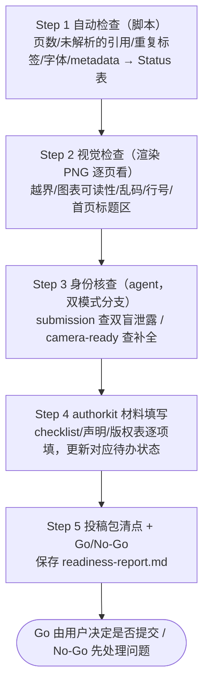

# Writing Paper Submission

## 用途

在提交前核对成品 PDF、投稿材料和上传文件，确认是否有可能导致直接退稿或提交失败的客观问题。

页数、模板、匿名规则和必需章节等要求，由 `writing-paper` 的 op-1 在写作阶段记录到 `_draft/venue-contract.md`，供写作和终审使用。提交前检查以该文件为准。提交前复核集中在四项工作。

1. **自动检查**。脚本检查页数、未解析的引用、重复定义的标签、字体嵌入情况和 PDF 元数据，并输出各项结果。
2. **视觉检查**。渲染 PDF 页面并查看排版是否越界、图表是否清晰、文字是否过小，以及是否有方框或乱码。
3. **身份核查**。双盲投稿时查找可能暴露身份的信息。提交终稿时核对作者信息和致谢是否恢复。
4. **材料填写与文件清点**。逐项完成检查清单、声明和版权表，清点提交文件。检查通过后才建议 Go。

脚本负责 PDF 和编译日志中的客观检查。助手阅读 LaTeX 源文件并查看 PDF 页面，判断作者信息是否实际出现。模板注释、匿名占位和自定义命令需要结合上下文核对。

启动时与用户确认使用 `submission`（投稿前）还是 `camera-ready`（录用后提交终稿）模式。两种模式的身份检查和页数计算规则可能不同。终稿通常允许多一页，并要求包含致谢。

`writing-paper` 的 op-8 `finalize` 在写作结束时确认编译成功、初步核对页数和必需章节，并登记投稿材料待办。本 skill 在提交前核对成品，逐项填写材料、清点提交文件并给出 Go/No-Go 建议。

## 在系统里的位置


**图例**：矩形 = skill；平行四边形 = 外部成品（就绪报告/投稿包，用户拿走投稿）。完整全局图见 `dl-assistant`。

## 边界

**做**：自动检查（脚本客观项）、PDF 视觉检查（渲染并查看页面）、身份核查（双盲泄露 / camera-ready 补全）、authorkit 材料填写（checklist/声明/版权表）、投稿包清点、Go/No-Go 建议。

**不做**（交给相邻 skill）：

| 场景 | 用 |
|---|---|
| 还在写/改某个 section 的内容 | `writing-paper` |
| 回应审稿人 rebuttal / 导师 / 合作者意见 | `writing-paper-response` |
| 模拟外部审稿（按目标会议或期刊规则评审论文） | `writing-paper-review` |
| LaTeX 编译失败、PDF 修复 | local 模式本地修（见 writing-paper `latex-landing.md`）；overleaf 模式 `overleaf-mcp` |
| 当年的投稿要求缺失或过期 | `writing-paper` op-1（检查以 venue-contract.md 为准） |
| 发现 claim 缺实验要补 | `writing-paper`（design-experiment）→ `code-paper-experiment` |

## 输入材料

- **论文根**:`<论文根>` = Overleaf clone 根（含主 tex + `_draft/`,`review/`、`response/` 同级）。四级发现规则：用户指定 → CWD 本身是 → CWD `papers/` 下唯一候选 → 问用户。
- **venue-contract.md**(`<论文根>/_draft/venue-contract.md`)——**唯一检查基准**：页数口径与上限（submission / camera-ready 分别）、匿名规则、强制章节、authorkit 材料清单、补充材料规则、提交系统要求。**没有或过期 → 回 `writing-paper` op-1 补，本 skill 以更新后的 venue-contract.md 为准。**
- **`_draft/config.json`**：拿主 tex 文件名 + `compile_mode`（local / overleaf）——决定成品 PDF 和 log 从哪拿。
- **成品 PDF + log**（自动检查要 log 查未解析的引用/重复定义的标签）按 `compile_mode` 分支：`local` → 直接读 `_draft/build/<主tex>.pdf` + `<主tex>.log`（没有就在论文根本地编译，命令见 writing-paper `references/craft/latex-landing.md`）；`overleaf` → overleaf-mcp 先编译成功拿到 PDF + output.log。
- **tex 源**：论文根目录，布局随 authorkit——**别假设 `tex/` 子目录**，先 Glob 找主 tex。
- **paper-state.json 待办项**:authorkit 材料的待办注册在这里，Step 4 逐项完成并更新待办状态。
- **模式**:submission / camera-ready，启动时与用户确认。

## 产出与保存

```
<论文根>/submission/
└── readiness-report.md     # submission 模式终审报告
<论文根>/camera-ready/
└── readiness-report.md     # camera-ready 模式终审报告（两模式分开落，不互覆）
```

直接在 authorkit 的 checklist.tex 或表单等材料中填写，并将每项答案及确认情况记入报告。

## 检查要求

- **检查以 `venue-contract.md` 为准**。发现它与官网当年要求不一致时，指出具体差异并请用户确认。
- **只终审，不写内容**——发现内容问题（缺实验/章节要重写）交给 `writing-paper`，这里不修。
- **脚本检查客观项目，助手核对源码与页面**。脚本 Status 表中的 FAIL 直接记为阻塞项。需要人工判断时，结合 LaTeX 源码和 PDF 的实际显示逐页核对。
- **声明和承诺须经用户确认**——原创性声明、版权转让、代码开源承诺这类材料，agent 起草、**用户逐条确认**后才算填好；agent 不替用户做任何承诺。
- **最终由用户决定是否提交**。报告给出建议，有未解决的 Blocking 项时不得建议 Go。
- **分别检查两种模式的身份信息**——投稿时核对匿名要求，提交终稿时核对作者信息和致谢是否恢复。

---

## 工作流

五步：自动检查 → 视觉检查 → 身份核查 → 材料填写 → 投稿包 + Go/No-Go。**TaskList 跟踪**：建五个任务，每步完成即勾。用户可指定范围（只跑自动检查 / 只填材料 / 全部）。



### Step 1：自动检查（脚本）

调本 skill 的 `scripts/submission-check.sh`，一次跑完客观项，输出 markdown Status 表：

```
bash <本skill目录>/scripts/submission-check.sh \
  --pdf <成品PDF> --log <output.log> \
  --page-limit <venue-contract 的页数上限> \
  --main-pages <正文页数> \        # venue 口径只算正文时传；从 PDF 定位 refs 起始页算
  --double-blind                   # submission 模式且双盲 venue；camera-ready 模式换成 --camera-ready
```

检查项（缺对应输入则该项 SKIP，不报错）：

| 检查项 | 来源 | 查什么 | 对照 |
|---|---|---|---|
| 页数 | pdfinfo | 正文页数（传了 `--main-pages`）或总页数 | venue-contract 的口径与上限；口径只算正文却没传 `--main-pages` 会因总页数和正文上限比较而误报 FAIL |
| 未解析的引用 | output.log | Citation/Reference undefined | 应 0 |
| 重复定义的标签 | output.log | multiply defined（以编译日志为依据） | 应 0 |
| 字体嵌入 | pdffonts | emb 全 yes（未嵌入字体时，提交系统或审稿人的设备上可能显示异常） | 全嵌 |
| metadata | pdfinfo | Author 身份字段（Title 非空只提示 INFO——hyperref 默认写 pdftitle，标题不是身份信息） | submission+双盲：Author 应空；camera-ready：空则 WARN（作者信息应补回） |

> 工具依赖：`pdfinfo` + `pdffonts` 是 poppler（macOS: `brew install poppler`)。脚本检测工具、缺失标 SKIP + 提示装。

Status 表原样进 Step 5 报告。FAIL 直接进阻塞项，不用 agent 再判断。

### Step 2：视觉检查（渲染 PNG 逐页看）

**编译成功后仍需检查实际页面显示。** 用 `pdf_open` 打开成品 PDF，再用 `pdf_render` 分批渲染成 PNG,agent 逐页看：

- **必看页**：首页（标题区/版心）、每个含图表的页、参考文献起始页（顺便确认正文页数，回填 Step 1 的 `--main-pages`)、末页；图表多就全渲染分批看。
- **查什么**:
  - **越界**——文字/公式/表格/图超出页边或栏宽（overfull 的视觉确认，比 log warning 直接）;
  - **图表**——分辨率模糊、图中文字过小（打印不可读）、caption 被截断、表格跨页断开，影响阅读；
  - **乱码**——缺字形导致的方框、特殊符号渲染失败；
  - **行号/页码**——venue-contract 要求行号（如初投稿）时确认存在；camera-ready 时确认按 venue 要求移除；
  - **首页标题区**——作者信息区域实际显示的内容（Step 3 的输入）。

发现的问题带页码记录，进报告。

### Step 3：身份核查（agent，双模式分支）

tex 源在论文根、布局随 authorkit——先 Glob 找主 tex 和作者信息所在文件，别假设目录结构。

**submission 模式（双盲 venue)：核对匿名要求**

- **作者信息**:`\author` 应是匿名占位（Anonymous / 模板自带占位）。**核对模板中的作者信息**：注释掉的 `\author`、`\iffalse` 块、模板自带匿名占位都不算泄露——**结合 LaTeX 源码和 PDF 实际显示判断是否泄露身份**。
- **隐蔽泄露点**:`\thanks` / 致谢节 / 自定义命令里的真名、真名 GitHub/项目页链接、数据集路径含用户名、自引写法（"we showed in [1]" 应改成匿名化写法）、supplementary 里的泄露。
- 配合 Step 2 的首页视觉确认。

**camera-ready 模式：核对作者信息和致谢是否恢复**

- 作者/单位/邮箱按 venue-contract 格式补回，匿名占位清理；
- 全文搜 "Anonymous" 并清除用于匿名的占位文本（正文/metadata/链接）;
- acknowledgment / 基金致谢加入（双盲期删掉的）;
- 真名 GitHub/项目页链接恢复；
- 双盲期匿名化的自引恢复正常写法。

### Step 4：authorkit 材料填写

venue-contract 的材料清单 + paper-state.json 待办项就是任务列表，逐项：

1. **找到需要填写的文件或表单**——authorkit 里的 checklist.tex / 在线表单 / PDF 表单；
2. **读材料的每个问题**，按论文实际内容起草回答；
3. **声明承诺类**（原创性/版权转让/代码开源/伦理声明）——agent 起草建议答案，**用户逐条确认后才填**;
4. **事实类**（页数/图表数/数据集使用情况）——agent 可直接填，填完在报告里列出答案供复核；
5. **填完一项**，将 paper-state.json 中对应待办标为完成。

在线表单（OpenReview 等网页里的勾选项）agent 填不了的，生成**填写指引**（每个问题 + 建议答案）写进报告，供用户填写。

### Step 5：投稿包清点 + Go/No-Go 报告

对照 venue-contract 清点投稿包（主 PDF / 源码 zip / 补充材料 / 提交系统单独上传项 / 大小上限），将五步的检查结果汇总并保存到 readiness-report.md。

## 输出：就绪报告

```markdown
# 投稿就绪报告（模式：submission / camera-ready）
## 1. 范围（venue / 模式 / 论文根 / 检查文件 / 编译状态）
## 2. 结论（Go / No-Go / 修复后 Go——建议，最终决定归用户）
## 3. 机器自检（Step 1 Status 表原样）
## 4. 视觉检查发现（页码 + 问题 + 严重程度）
## 5. 身份核查结果（按模式的清单逐项 pass/fail + 证据位置）
## 6. authorkit 材料（逐项：状态 / 答案 / 用户确认情况 / 在线表单填写指引）
## 7. 阻塞性问题（| 问题 | 位置 | 修复建议 | 路由 |）
## 8. 投稿包清单（| 项 | venue-contract 要求 | 状态 |）
## 9. 下一步
```

严重性：`Blocking`（不能提交 / desk reject / 匿名破坏 / 材料缺失）/ `Major`（显著影响 review 或终稿质量）/ `Minor`（局部）。

## 发现问题后交给谁处理

| 问题 | 处理方式 |
|---|---|
| 编译失败、PDF 修复 | local 模式本地修（见 writing-paper `latex-landing.md`）；overleaf 模式 `overleaf-mcp` |
| 内容重写、章节要补 | `writing-paper` |
| 实验证据不足、需补实验 | `writing-paper`（design-experiment）→ `code-paper-experiment` |
| 回应外部意见（reviewer/导师/合作者） | `writing-paper-response` |
| 外部视角模拟审稿 | `writing-paper-review` |
| venue-contract 缺失/过期/与官网矛盾 | `writing-paper` op-1 补充或更新投稿要求 |

## scripts

| 路径 | 讲什么 | 什么时候用 |
|---|---|---|
| `scripts/submission-check.sh` | 自动检查（页数/未解析的引用/重复定义的标签/字体嵌入/metadata,submission 与 camera-ready 双模式，输出 markdown Status 表） | Step 1 调一次 |

## 常见错误

- **以现有投稿要求文件为准**——venue-contract.md 是唯一基准，没有/过期就回 `writing-paper` op-1 补，以更新后的文件为准。
- **别用 grep 判匿名泄露**——authorkit 的注释/匿名占位/自定义命令会造成大量误报漏报，结合 LaTeX 源码和 PDF 实际显示判断。
- **别只信编译成功**——排版越界、图表模糊或字符显示异常仍可能出现在编译成功的 PDF 中，第 2 步必须渲染并查看页面。
- **页数先看口径**——venue 只限正文时务必传 `--main-pages`，用总页数对照正文上限会误报 FAIL。
- **别替用户承诺**——声明/版权/开源承诺类材料，用户逐条确认后才算填好。
- **camera-ready 别拿 submission 清单查**——投稿需核对匿名要求，终稿需核对作者信息和致谢是否恢复。
- **别给 Go 却留着 Blocking**——Blocking 未清一律 No-Go 或修复后 Go。
- **自动检查依赖先编译成功**——没 PDF + log，Step 1 前先编：`compile_mode: local` 走本地 latexmk（产物在 `_draft/build/`），`overleaf` 才用 overleaf-mcp；别不看 config.json 就默认远端编一遍。
- **别在会话里用 `$...$` LaTeX**——会话符号用 Unicode（见 `dl-assistant` 的 `SKILL.md`「所有技能共用的规则」)。
