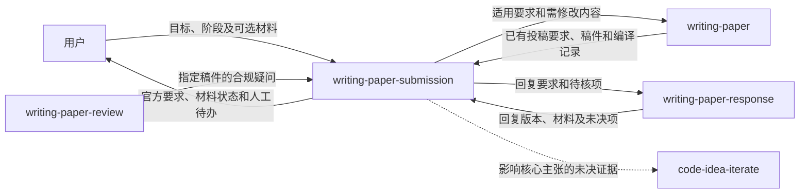
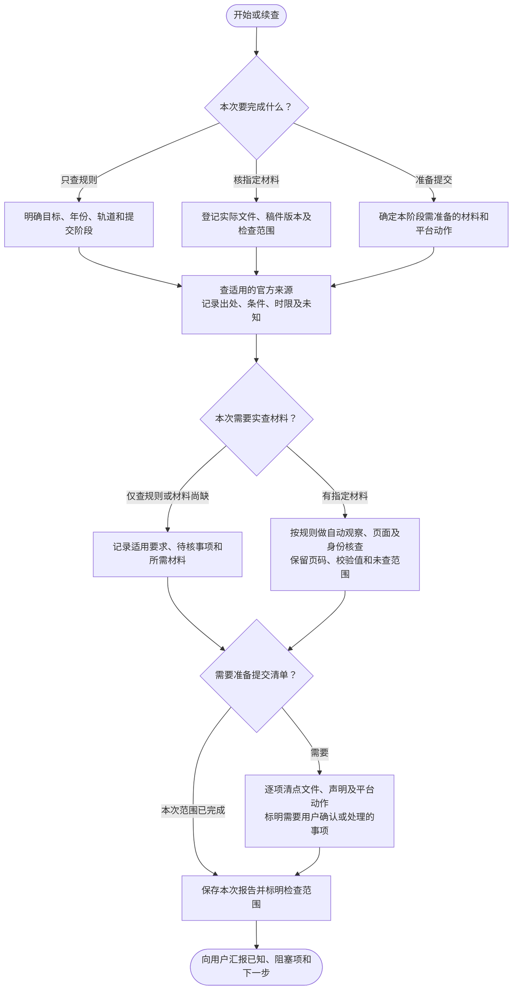

# 核对投稿要求并准备提交材料

帮助用户确定本次适用的要求、现有材料检查到哪里、还需要准备什么，以及要在投稿平台确认哪些事项。可单独查规则、核指定材料，或准备完整的提交清单。

## SKILL 交接关系



全局关系见 [dl-assistant](../dl-assistant/SKILL.md)。

## 产出与保存

仅查要求或独立核材料可存到 `docs/submission-guide/<日期>-<标识>/`。已有论文可在 `<论文根>/submission/<阶段>-<轮次>/` 保存，或沿用用户指定路径。阶段、规则或材料变化时保留原报告。

```text
<本次记录目录>/
├── submission-guide.md           # 官方要求、已核材料和人工待办
├── checks/                        # 按需保存自动检查及实际构建证据
│   ├── material-checks.json       # 脚本观察、材料身份、比较条件和限制
│   └── build-record.json          # 需核当前 PDF 的构建日志时，保存对应构建记录
└── renders/                       # 按需保存查过的页图和问题区域
```

完整终审可在同一报告里给出是否建议提交、阻塞项与核查依据。

## 运行流程图



## 参考资料列表

| 资料 | 何时读 |
| --- | --- |
| [执行流程](references/workflow.md) | 确认范围、核材料、整理人工提交步骤 |
| [官方来源核查](references/official-guidelines.md) | 查适用规定、处理来源冲突、核截止时间 |
| [材料检查工具](references/material-checks.md) | 查页数、字体、元数据和构建日志 |
| [报告模板](references/report-template.md) | 保存要求、证据、阻塞及人工待办 |

## 判断原则

1. 官方要求按实际年份、轨道、论文类型和提交阶段核实。已有 `venue-contract` 适合作为来源索引，用到时核其适用范围和更新情况。
2. 只在本次材料和实际检查范围内给结论。用固定的 PDF、日志和文件摘要记录证据。无法访问、缺材料、仅看部分页面及来源分歧均明确记入报告。
3. 区分文件已准备、事实已查、答案已确认和平台已提交。可起草离线材料与建议答案。作者信息、声明和承诺由用户确认，平台填写、上传和最终提交由用户完成。
4. 把需要改正文的事项交 writing-paper，把需要处理的回复交 writing-paper-response。已有材料暴露核心研究未决时，指出涉及的主张与证据，再交 iterate 判断。
