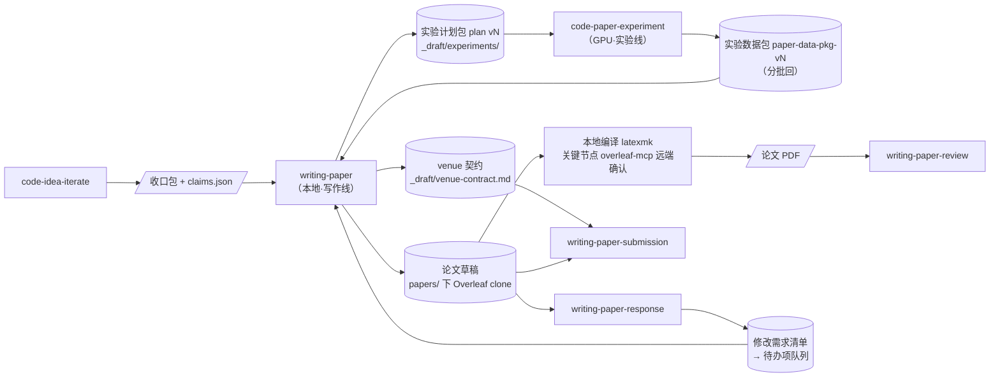
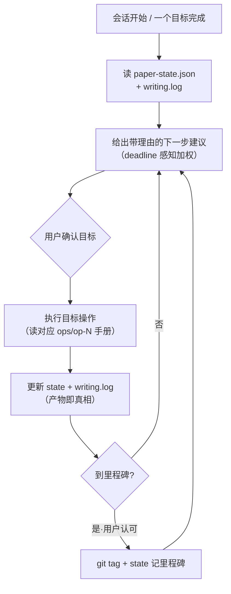

# Writing Paper

## 解决什么问题

科研项目经 `code-idea-execution`/`iterate` 收口后，把锁定方法 + 实验数据写成**可投稿的成品论文**。

写论文不是一条能一次走完的流水线：故事线会重塑、实验会写着写着才发现要补、数据分批到、章节翻来覆去改。所以本 skill 不做线性流程，做**目标驱动的长伴**：论文工程的全部真相落在状态骨干里，任何时候都可以对任何章节、任何图表、任何一批数据调用对应的目标操作；每完成一个目标，agent 读状态给出带理由的下一步建议，用户确认后继续。

跑在**本地**，数据/代码在 GPU 服务器——需要时找用户弄到本地（不绑 ssh/scp，不管怎么传）。

**论文根 = `<方向根>/papers/<slug>/`（一个 Overleaf git clone）**：agent 通常在**方向工作目录根**运行；用户先在 Overleaf 从会议 author kit 建项目，把**项目官方 git 链接**（Overleaf 项目菜单提供）给 agent → agent clone 到方向根的 `papers/` 下（slug 默认 = Overleaf 项目名）。论文根按四级发现：① 用户显式指定 → ② CWD 本身是论文根（含主 tex + `_draft/`）→ ③ CWD `papers/` 下唯一候选 → ④ 多个或没有 → 问用户。**多篇论文并行 = `papers/` 下多个独立 clone**，工作区物理隔离。论文根是 git 仓库，agent 在里面 fetch/commit/push。写作循环**本地编译**（`latexmk`，本地验证高频走本地）；`overleaf-mcp` 只在**关键节点同步**时用（里程碑/用户要求/协作需要：push + 远端编译确认 + 渲染回归）。

## 边界

**做**：起手（venue 契约 + 环境）→ 蓝图（活文档）→ 实验规划（版本化批次）→ 逐节写/改（WYSIWYG）→ 图表产出（示意图/数据可视化）→ 数据回填 → 质量门 → 定稿交接。

**不做**（交给相邻 skill）：

| 场景                            | 用                                                                                                 |
| ------------------------------- | -------------------------------------------------------------------------------------------------- |
| 跑论文级实验（产最终说明+报告） | `code-paper-experiment`（CPE 侧产最终说明+报告+增量写结果，是 CPE 的单独 effort，本 skill 只消费） |
| LaTeX 编译/渲染/产物            | 本地 `latexmk`/`pdftoppm`（写作循环默认）；`overleaf-mcp` 只在关键节点同步用（远端编译确认，by-name 引用）                    |
| 文献检索（当场取 bib 元数据）   | `paper-search` MCP（by-name 引用）                                                                 |
| 示意图终稿（PPT 重绘导出 PDF） | 用户（agent 用 HTML 产草稿并迭代到用户满意；终稿永远用户 PPT 画）                                  |
| 黑盒盲审                        | `writing-paper-review`                                                                             |
| rebuttal（产修改需求清单）      | `writing-paper-response`                                                                           |
| 投稿前终审 + authorkit 材料填写 | `writing-paper-submission`                                                                         |

## 在系统里的位置



### 机器角色（单 GPU 解耦）

| 机器                                 | 上面有啥                                    | writing-paper 怎么拿       |
| ------------------------------------ | ------------------------------------------- | -------------------------- |
| **本地**（论文根 = `papers/` 下的 Overleaf clone） | writing-paper 自己跑；产草稿 + PDF          | 直接                       |
| **GPU 服务器**                       | 收口包 + claims.json + 中期 repo + 实验数据 | 找用户弄到本地（不绑传输） |

## 产出与保存

```
<方向根>/papers/<slug>/（论文根 = Overleaf git clone；根目录只有 LaTeX 该有的，干净）
├── <主 tex>.tex                # authorkit 主文件——名字随 kit（main.tex / egpaper_final.tex / <conf><year>.tex…），op-1 探明后记进 config.json；只做 \input，不堆正文
├── *.sty / *.cls / *.bst 等     # authorkit 自带（pre-existing，不动）
├── sections/*.tex              # 每节一个文件（死纪律：主 tex 不堆正文）
├── tables/<id>.tex             # 数据表单独成文件，正文 \input（脚本重生成只碰小文件）
├── figures/                    # 图输出（svg/pdf）——编译用；示意图终稿用户放这
├── refs.bib                    # bib（当场构造非正式条目；正式格式收尾用户修）
└── _draft/                     # skill 作者工作区（.gitignore，不推 Overleaf、不编译）
    ├── config.json             # 起手 config（材料/项目/会议/服务器路径）
    ├── paper-state.json        # 状态骨干（机读，全部真相；schema 见 templates/paper-state-template.json）
    ├── venue-contract.md       # venue 契约（页限/匿名/强制章节/图表规范——写作全程的约束）
    ├── venue-contract.json     # 契约的硬合规项机读子集（页限/匿名/引用风格/强制章节——检查脚本读它；形状指标不进）
    ├── blueprint.md            # 活蓝图（人读；故事线重塑就改它，不是一次写完）
    ├── content/                # 各节 .md 源
    ├── experiments/            # plan-v1.md（人读）+ plan-v1.json（机读）/ v2…（版本化实验计划包）+ 收到的数据包
    ├── references.json         # 引用清单（cite_key + handle + role: core|supporting + claim + section + needs_human_verify）
    ├── visuals/                # 图表资产台账 manifest.json + 每个资产 <id>.md（spec）
    ├── scripts/                # plot_<名>.py（当场写）
    └── writing.log             # 会话日志（追加，续跑用）
```

三个组织纪律：

- **状态骨干三件套**：`paper-state.json`（机读全部真相：节状态/图表状态/数据批次/待办项/页数消耗/里程碑）+ `blueprint.md`（人读活蓝图）+ `venue-contract.md`（合规约束）。产物即真相——每个目标干完必须更新 state。
- **文件切分纪律**：section 一文件、数据表一文件。由脚本/数据生成的内容单独成文件，手写的随正文——重生成不碰散文，协作冲突面最小。纯文字小表（符号表、两行对比）可内联。
- **布局以 kit 为准**：主 tex 文件名与目录结构以 op-1 探 authorkit 的结果为准（记进 config.json）；kit 有明确规定时按 kit 来，纪律给模板让路。authorkit 自带的填充 tex/pdf 本身就是 venue 的详细写作规范，op-1 读它并进 `venue-contract.md`。
- **视觉 spec（`_draft/visuals/`）不进正文**：figure 占位（方框+caption+label）/ 表骨架（booktabs，数字留 `--`）随正文本地验证落位；真图真数字由 make-visual / ingest-results 按台账替换。

## 核心纪律

1. **产物即真相，状态即真相**——`paper-state.json` 是论文工程的唯一机读真相源。任何目标干完立即更新；续跑读 state + writing.log 恢复，不靠记忆。
2. **确认点（硬停顿）**——蓝图定稿与重塑、实验计划每批、每节方案、每节审 PDF、每节图表意图清单、每张图预览拍板、填真、压缩逐项拍板、meaning-risk 润色、里程碑——停下等用户拍板。
3. **编译常绿**——本地编译绿了才 commit；Overleaf 同步必须远端也编译绿才算完。编译红了先修红再继续，不许带错推进；失败只带 log 尾部错误摘要进上下文（上下文卫生）。
4. **协作同步纪律**——每次会话开始、每次 Overleaf 同步前 `git fetch` + 整合（rebase/merge）；push 被拒就 fetch→整合→push 循环重试；本地提交切小、push 集中在关键节点；**同一处冲突即停交用户**，只自动合并不重叠改动。Overleaf 网页端会自动 commit，协作方高频写时提醒用户错峰。
5. **里程碑快照**——用户认可的节点（初稿齐、数据回填完、review 改完……）打 git tag + state 记里程碑。写论文反复改，回到上一轮好状态是刚需。
6. **页数软约束**——蓝图记 venue 页限 + 参考分配（量级感知，不做逐节硬预算）；写作期**写全不预砍**（觉得可砍/可挪 appendix 的内容登记 `compress_candidates` 进 state），每次本地验证报当前页数（信息不是警告）；砍/挪/精简统一在 finalize 压缩工序，agent 产方案、**用户逐项拍板**。压缩禁区：teaser/pipeline 等核心图尺寸、图内字号。
7. **合规前移**——venue 契约在起手产出，写作全程是约束（页限/匿名/强制章节/图表规范）；契约生成时自动把合规尾巴（limitations 节、ethics 声明、checklist、匿名仓库）注册成待办项。
8. **label/\ref 纪律**——节/图/表全带 `\label`，正文引用一律 `\ref`，禁止手写 "Figure 3" 式裸编号。落地检查、audit、submission 三层都查。
9. **写后自审派子 agent**（fresh eyes）——写正文的 agent 不自审（确认偏误）。子 agent 必须 general-purpose，禁 Explore。
10. **数据图绝不用生成式 AI**（造假红线）——只用确定性代码当场写脚本（seaborn/matplotlib），加载 paper palette，导出 svg+pdf。
11. **reference 注入 prompt**——写某节时把该节指南的选择逻辑+自查清单、三层 craft 关键原则、已写节摘要、符号表直接注入写作 prompt，不靠 agent 自己翻文件。
12. **TaskList 跟目标走**——每个确认的目标建/更新任务，进度可见；不起手建死一张全流程清单（目标是动态来的）。

## 上游接缝

- **iterate 收口包 + claims.json**（从零写材料）：总论点 + 创新点清单 + 故事线骨架 + refuted/abandoned + Roadmap 终态 → init-setup 读入、design-story 消费。
- **修改需求清单**（改稿材料）：`writing-paper-response` 产或用户直接给，schema 见 `references/templates/revision-brief-template.json` → 进待办项队列，按类型路由到各目标（见运行模型）。
- **CPE 契约**：plan 版本化（`_draft/experiments/plan-vN.md` 人读 + `plan-vN.json` 机读——CPE 消费的单一读取源，schema 见 `references/templates/paper-experiment-plan-template.json`）；CPE 按批回**实验数据包**（`experiments-actual.json` + `results.json` + `pkg-meta.json`，schema 见 `code-paper-experiment/references/templates/data-pkg-schema.json`）→ ingest-results 按批回填。
- **review**：黑盒，只消费成品 PDF，不读本 skill 任何内部产物。
- **submission**：消费本 skill 产的 `venue-contract.md` + `_draft/config.json` + 成品 PDF；写作时约束已前移，submission 只查只能最后查的 + 填 authorkit 材料。

## 运行模型（目标驱动）

### 状态骨干

`paper-state.json`（schema：`references/templates/paper-state-template.json`）跟踪：venue（含 deadline、页限）、blueprint_version、**每节状态**（planned/drafting/drafted/needs-data/needs-revision/locked + 页数参考与消耗 + 节摘要）、**数据依赖**（哪节/哪个 claim/哪张表在等哪个实验）、**实验批次**（plan vN 状态）、**待办项队列**、**压缩候选**（写作期登记的可砍/可挪内容，压缩工序用）、**里程碑**。图表资产台账在 `_draft/visuals/manifest.json`。

### 待办项队列（五个来源）

1. **蓝图初始化**——design-story 首次定稿，生成各节写作项 + 首图项。
2. **venue 契约**——强制章节/声明/checklist/匿名仓库等合规尾巴，契约产出时自动注册。
3. **用户口述**——随时直接提，进队列。
4. **review/response 清单**——修改需求清单逐项进队列（re-frame → design-story；section重写/局部改 → write-section；补图表 → make-visual；补实验 → design-experiment → CPE → ingest-results）。
5. **数据到达**——一批 CPE 数据到，生成该批的 ingest 项 + 受影响的回填项。

### 目标菜单（八个目标）

| 目标              | 干什么                                                    | 手册                                       |
| ----------------- | --------------------------------------------------------- | ------------------------------------------ |
| init-setup        | 一次性起手：访谈、venue 契约、Overleaf clone、`_draft/`   | `references/ops/op-1-init-setup.md`        |
| design-story      | 蓝图初建或重塑（活文档；重塑自动生成波及节修订项）        | `references/ops/op-2-design-story.md`      |
| write-section     | 写/重写/局部改任意一节（注入已写节摘要 + 符号表）         | `references/ops/op-3-write-section.md`     |
| design-experiment | 规划或追加一批实验 → plan-vN 给 CPE                       | `references/ops/op-4-design-experiment.md` |
| ingest-results    | 消费一批 CPE 数据：写结果、产数据图、填表、回填数字       | `references/ops/op-5-ingest-results.md`    |
| make-visual       | 单个图表详细设计+产出（示意图 HTML；数据可视化脚本；预览图拍板）     | `references/ops/op-6-make-visual.md`       |
| audit             | 质量门：一致性/诚实性/润色 + 合规 + label/\ref + 读者测试 | `references/ops/op-7-audit.md`             |
| finalize          | 定稿：用户交付物替换、页数定稿、manifest、交接            | `references/ops/op-8-finalize.md`          |

### 建议机制

每完成一个目标（或每次会话开始），agent 读 state → 给出**带理由的下一步建议**，用户确认或自由输入别的目标。建议按状态推出，例如：「Method 改过，Intro 动机段可能脱节——建议 write-section intro」「plan-v2 的数据到了，实验节主表还空着——建议 ingest-results」「venue 要求 limitations 节，还没写——建议 write-section limitations」。

**deadline 感知**：state 记了 deadline 时，建议按 must/should/nice 加权；临近截稿主动给砍量方案（哪些挪 appendix、哪些 nice-to-have 放弃）。



## references 文件列表

**`references/ops/`（八份操作手册——跑哪个目标读哪个）**：见上方目标菜单表。

**`references/sections/`（写哪个 section 读哪个，按角色分派）**：`blueprint-design`（蓝图 schema：人读叙事在前 + 节清单四步程序 + 活文档规则）、`related-work-writing` / `introduction-writing` / `method-writing`（含符号体系构建）/ `abstract-writing` / `conclusion-writing`（五节指南，refs_v2 实证产物，自带全节自查 checklist）、`experiment-writing-setup` / `experiment-writing-results`（实验章两层：不依赖数据的实验信息 / 依赖数据的结果分析）、`appendix-writing`。这些是**角色指南**——非默认节（Background/Preliminaries 等）按蓝图角色标注借最近角色（见 op-3）。

**`references/craft/`（横切工艺）**：`visual-design`（图表意图登记 + 示例锚定 + 分类路由 + palette/语义色）、`numerical-display`（数据可视化工艺）、`schematic-figure`（示意图 HTML+CSS+SVG 绘制工艺：图标三级来源/真实样本/预览迭代）、`bibtex-on-the-fly`（当场 bib + 引用 role）、`latex-landing`（论文根=papers/ 下 Overleaf clone + 本地编译验证 + 关键节点 Overleaf 同步 + 探模板 + label/\ref 纪律）、`section-self-audit`（写后自审 + 全文润色 子 agent 协议；audit fan-out 编排在 op-7）、`self-check`（audit 一致性 lens 清单——纯内容一致性）、`sentence-craft`（句段层）+ `word-craft`（字词层）+ `anti-ai-patterns`（AI 禁止模式）、`venue-specs`（官网入口 + 时区规范 + 图尺寸）、`visual-aesthetic-review`（渲染检查）。

**`references/templates/`**：`paper-state-template.json`（状态骨干 schema）、`paper-experiment-plan-template.md`（实验计划包人读区）+ `.json`（机读 schema）、`revision-brief-template.json`（修改需求清单 schema）、`visuals-manifest-template.json`（图表资产台账 schema）。

**检查脚本**（`scripts/`，skill 预置的确定性检查）：`run_checks.py <论文根> all` 总入口——label/\ref + 裸编号、引用完整性（cite↔bib + references.json 登记与 section 一致性）、AI 腔 + 自我削弱表达硬正则、数字诚实 gate（canonical-values.json 白名单）、venue 硬合规（venue-contract.json）。audit（op-7）与 finalize（op-8）调用；有 FAIL exit 非零。

**绘图脚本**：agent 当场写（`_draft/scripts/plot_<名>.py`），skill 不预置绘图脚本。

## 常见错误

- 不要把目标菜单当线性流程走——顺序是建议不是规则；真实写作里重写 Method 后回改 Intro 是常态。
- 不要让 blueprint.md 脱节——故事线实质变更必须回 design-story 重塑；write-section 造成实质 drift 时当场标「蓝图脱节」并建议重塑；audit 每次核蓝图↔成稿一致性。
- 不要一次定死全部实验——plan v1 只装长周期必做项让 CPE 早跑；写作中冒出的实验需求记进 state，攒成 v2/v3。
- 不要等「最终数据包」——数据按批到、按批 ingest；没有「等全部跑完」这个状态。
- 不要各节独立作战——写任何一节必须注入已写节摘要 + 符号表 + 蓝图；术语、符号、数字跨节一致。
- 不要把 guideline 攒到最后查——venue 契约起手就产，页数每次本地验证报，合规尾巴第一天就在队列里。
- 不要每节都 push Overleaf——写作循环走本地编译验证；Overleaf 同步只在关键节点（里程碑/用户要求/协作需要）。每节都 push 会把远端编译 log、同步噪音灌进上下文，agent 漂移。
- 不要各写各的色——palette 锁定后渲染色卡给用户看图确认，全部图用 palette 的 HEX。
- 不要防御性写作——局限一个不少（诚实性红线不动），但写成边界声明不写成道歉；优势满强度主张、摘要引言明说；故事围绕核心优势锚组织，打不赢的维度不设为主战场（语言层见 `word-craft` 原则 4，弱结果决策程序见 `experiment-writing-results`，锚定见 `blueprint-design`）。
- 不要手写 "Figure 3"——一律 `\ref`；节/图/表/公式全带 `\label`。
- 不要把正文堆进主 tex——主文件名随 authorkit（不一定是 main.tex），section 一文件、数据表一文件，主 tex 只做 `\input`。
- 不要 commit/push 编译红的版本——本地编译常绿是死纪律；同步节点远端也必须绿。
- 不要在协作冲突时硬解——同一处冲突即停交用户。
- 不要让 agent 用生图模型产图——示意图统一 HTML+CSS+SVG 手绘（文字精确、确定性迭代）；数据可视化只确定性代码（造假红线）。

## 操作详情（八目标）

跑哪个目标读哪个手册；本表只给触发时机与确认点。

1. **init-setup**（一次性；改稿场景已有论文根则跳过 clone）：访谈收集材料 → 爬官网**日程与政策**产 `venue-contract.md` 初版（deadline 时区双写，确认点：换算说明）→ Overleaf 官方 git 链接 clone 到 `papers/` 下（确认点）→ 建 `_draft/` → **探 authorkit**（格式规范的权威来源：读自带填充 tex 的写作规范进契约定稿 + 主 tex 名记进 config + 注册合规待办项）→ 选题复盘（仅从零写）→ 初始化 `paper-state.json`。详见 `references/ops/op-1-init-setup.md`。
2. **design-story**（初建或重塑）：读收口包/成稿 → **故事线（连贯散文，人读核心）** + 总论点 + contribution 清单（白话 + 对账字段）→ **定节清单（四步程序：拆任务→装箱三判据→venue 对标→定稿，非默认七节照抄）** + 每节叙事任务（带角色标注）+ 页数参考（软约束）+ **首图（teaser）信息意图** → 确认点：蓝图逐项过（含节清单）。重塑时对比新旧蓝图，自动生成受波及节的修订项进队列。详见 `references/ops/op-2-design-story.md`。
3. **write-section**（写/重写/局部改）：八子步循环——方案（确认点）→ 写 .md+bib → 子 agent 自审 → 初稿本地验证 → 交互改（确认点）→ 图表意图登记（确认点）→ 加轻占位 → final 本地验证。注入已写节摘要+符号表+页数参考+venue 契约。定稿后更新节摘要进 state。详见 `references/ops/op-3-write-section.md`。
4. **design-experiment**（首批或追加）：claim×攻击面矩阵推导实验套件（防空洞防冗余，含定性维度）→ 标依赖拓扑（**配置未冻结主表不开跑**；decides_config 先行；无依赖并行）→ 独立查漏（reviewer 预演）→ 产 plan-vN（确认点：矩阵+依赖+成本逐项过；配置冻结另设确认点）。详见 `references/ops/op-4-design-experiment.md`。
5. **ingest-results**（一批数据到）：验收 → 按 CPE 实际对齐 → 写结果/分析 → 子 agent 自审 → 产数据图/填表 → 回填 Intro/Abstract 数字 → canonical 值核查 → 本地验证（确认点：填真满意）。详见 `references/ops/op-5-ingest-results.md`。
6. **make-visual**（单个资产：详细设计+产出）：示例锚定（问用户要参考图优先，没有搜同 venue 论文）→ 对着真材料详细设计 → 示意图写 HTML 渲预览迭代 / 数据可视化写脚本出快稿 → **确认点：用户看图拍板** → 落地替换占位。示意图 agent 只产草稿，终稿用户 PPT 重绘。详见 `references/ops/op-6-make-visual.md`。
7. **audit**（可反复跑）：fan-out 三 lens（一致性/诚实性/润色）+ 蓝图↔成稿一致性 + venue 合规 + label/\ref + **十分钟读者测试**（只读 title/abstract/intro/Figure 1/caption 能否讲全故事）。确认点：meaning-risk 改动。详见 `references/ops/op-7-audit.md`。
8. **finalize**（定稿）：锁内容（audit）+ 竣工 blueprint → 用户交付（示意图 PPT 终稿 + 正式 bib，确认点）→ 替换 + Overleaf 同步（远端绿）→ **压缩工序**（最终版面上一次到位：图按 priority 判挪/不挪，teaser/pipeline 不可挪；确认点：逐项拍板）→ 全局版式回归（压缩后）→ 汇报 + 里程碑 + 交接包清点 → review/submission。详见 `references/ops/op-8-finalize.md`。
