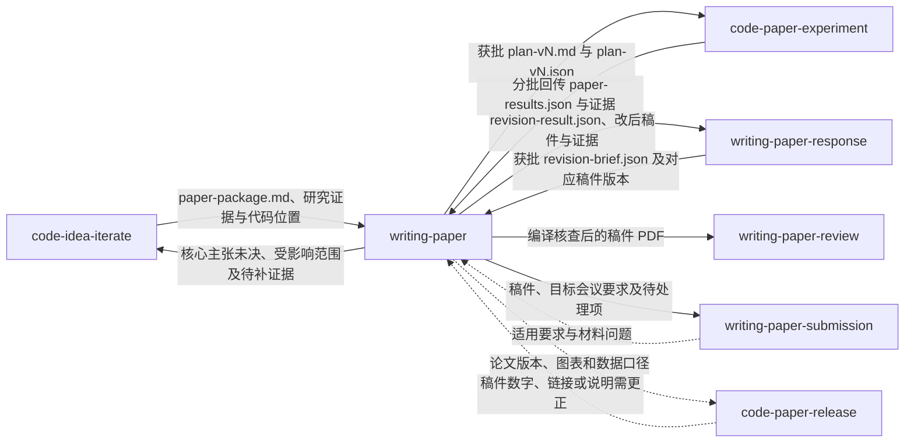
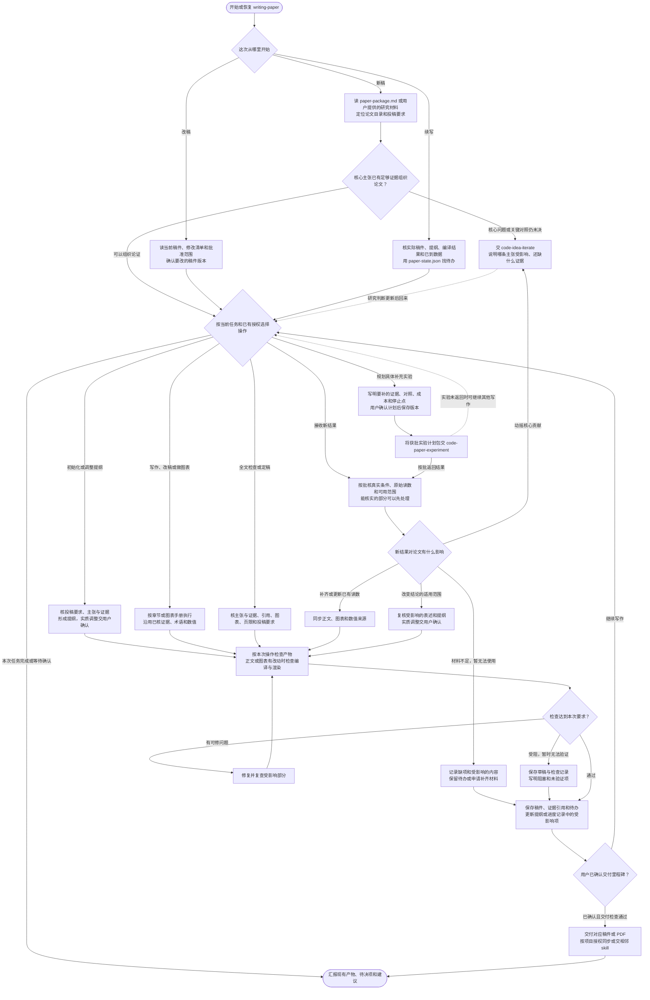

# 根据研究证据撰写论文

论文说明研究了什么、原有认识是什么、实际证据增加或改变了什么认识，以及为什么值得报告。方法、现象、反例和适用边界都可以成为贡献。每项主张用实际可查的证据表述，说明条件及最重要的未决解释。

本 skill 可按当前任务起草论文、改现稿、作图、规划补充实验、回填已取得的结果或定稿。根据已有稿件和用户授权选择操作。

## SKILL 交接关系



新稿优先读用户给的材料或 `docs/research/paper-package.md`，沿其中的引用核对应研究轮次、命题、代码和实验。已有现稿时核用户指定的编辑范围和版本。跨机器交接按 [dl-assistant 共用规则](../dl-assistant/SKILL.md#所有技能共用的规则)记录材料位置和版本。

## 产出与保存

沿用已有论文工程。新建时可采用下列布局。主 TeX 文件和格式以项目实际使用的 author kit 为准。本地 LaTeX 工程可直接开展写作；接入 Overleaf 时使用已确认的项目链接，并按实际授权同步。

```text
<论文根>/
├── <主文件>.tex、模板文件      # 初始化时核主文件、宏包与参考文献样式
├── sections/                 # 正文，按需逐节建立
├── tables/                   # 按需存由数据或脚本生成的可重建表格
├── figures/                  # 最终或待审图表文件
├── refs.bib                  # 使用项目实际参考文献文件
└── _draft/                   # 写作记录，按各操作需要创建
    ├── config.json           # 初始化时记工程、来源、编辑方式和构建入口
    ├── paper-state.json      # 进度、实验依赖和待办索引
    ├── venue-contract.md     # 适用的投稿要求、来源和待核事项
    ├── venue-contract.json   # 由检查脚本读取的硬性要求
    ├── blueprint.md          # 提纲、主要贡献和论证安排
    ├── content/              # 采用 Markdown 草稿时存正文源稿
    ├── experiments/
    │   ├── plan-vN.md、plan-vN.json                 # 同版的审阅文件与机读计划
    │   └── <batch-id>/handoffs/rev-<N>/
    │       ├── paper-results.json                    # 本次回包入口
    │       ├── plan-vN.json、run-spec.json            # 随包收到的计划与执行规格快照
    │       └── <随包证据>                            # 保留原相对路径及外部证据引用
    ├── revisions/            # 分回应和回传批次保存 revision-result.json 与稿件、核查证据
    ├── references.json       # 引用登记，使用引用时核论文身份和出处
    ├── canonical-values.json # 导入结果或正文使用实测数字时登记数字来源
    ├── visuals/              # 图表计划、逐图说明和 manifest.json
    ├── scripts/              # 按需保存绘图和数据处理脚本
    ├── build/                # 实际编译输出位置，按项目配置
    └── writing.log           # 关键操作、检查结果及续做入口
```

`paper-state.json` 用于查进度。研究主张回原证据查，稿件状态回实际 TeX、图表和编译结果查。记录哪些文件需要保存、备份或分享，构建缓存按项目约定处理。续写时先核当前正文的编辑来源及合作者修改。需要转写 Markdown 时，先确认各节源文件与 TeX 的映射。

## 运行流程图



## 参考资料列表

| 操作 | 什么时候读 |
| --- | --- |
| [初始化](references/ops/op-1-init-setup.md) | 首次核论文根、材料、投稿要求和编译环境 |
| [组织论文论证](references/ops/op-2-design-story.md) | 建立提纲，或证据、主张和章节安排发生变化 |
| [写作或修改章节](references/ops/op-3-write-section.md) | 按授权范围写作，沿用已有术语、符号和章间依赖 |
| [规划论文实验](references/ops/op-4-design-experiment.md) | 确定需要的补充证据、实验依赖、预计投入及批准范围 |
| [接收实验数据](references/ops/op-5-ingest-results.md) | 按批核对实测结果、判断论证影响并回填 |
| [图表制作](references/ops/op-6-make-visual.md) | 设计示意图、用可复现脚本绘制数据图，或制作预览 |
| [全文检查](references/ops/op-7-audit.md) | 核主张、证据、格式、引用和读者理解 |
| [定稿交接](references/ops/op-8-finalize.md) | 整理最终稿件、处理重要取舍和交接 |
| [LaTeX 与同步](references/craft/latex-landing.md)、[目标会议要求](references/craft/venue-specs.md) | 需要确定编译、渲染、官方格式来源和实际同步方式时 |
| [论文进度模板](references/templates/paper-state-template.json)、[修改清单模板](references/templates/revision-brief-template.json)、[图表台账模板](references/templates/visuals-manifest-template.json) | 写入对应记录时 |

章节写法按提纲标注的实际职责，从 `references/sections/` 选对应指南。引用、语言、图表与编译细则按操作手册链接读取。全文检查用 `python3 <skill目录>/scripts/run_checks.py <论文根> all`，回看哪些检查实际执行、哪些受阻及具体输出。

## 写作与交接原则

1. **先核论文主张。** 从研究材料提取科学问题、已有认识、实际新增、核心证据、替代解释与适用边界。新稿核心判断未决时将问题和证据缺口交 iterate，由研究环节决定如何取证。已有授权的局部改稿可按当前范围做；发现会改变核心主张的证据，保留已完成工作并交回重审。
2. **区分研究未决与明确的论文补充实验。** 已确认论证需要一项具体比较时，由写作侧形成带版本的 `plan-vN.md` 和 `plan-vN.json`，逐项写要支持的主张、目标设置、公平条件、依赖、投入及停止点。用户确认后交 CPE。核心现象、机制或适用范围本身仍待研究时，交 iterate 明确下一项取证。
3. **结果按批核实再写。** 对照获批计划与 `paper-results.json` 中的实际执行、测量和结果。逐项核实际条件、原始来源、重复或缺失和偏差。能使用的部分按范围回填；未完成部分保留待办。数字改动同步正文和图表；科学范围变化重审受影响的叙述及提纲；核心贡献动摇时交回 iterate。数据图保留脚本和实际数据出处。
4. **在实质决定处确认。** 需要确认的包括核心主张或提纲变化、新实验投入、影响原意的改稿、重要删减与正式交付。已获批的局部写作、图表修改及验证可连贯完成。按需处理协作冲突，保留用户修改。远端写入、同步和标签遵循实际授权。
5. **按真实工具链核交付。** 本地有工具时按工程配置编译并检查渲染和页数。必要时使用已配置的 Overleaf，按实际环境记录编译和 PDF 身份。验证受阻可保存草稿及未核项。里程碑交付前分别说明内容证据、编译、视觉和投稿材料的实际检查结果。
