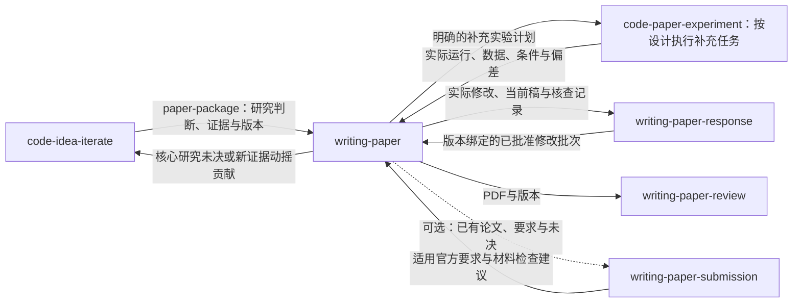

# 根据研究证据撰写论文

论文要解释：研究了什么明确问题、原有认识是什么、实际证据新增或改变了什么认识、为什么值得报告。贡献可以是方法、理论、现象、反例、适用边界、数据或评测问题，不要求性能占优、新模块或固定贡献数量。表达应准确清楚；不能通过重新选择评价维度、缩小范围或加强措辞代替研究判断。

## 在系统中的位置

全局关系及横切规范见 dl-assistant。研究与写作分工按 [五项研究判断](../dl-assistant/references/research-transition.md)，规模与配置按 [研究条件规则](../dl-assistant/references/research-conditions.md)。目标规模下核心结论仍未知时，由 iterate 设计、execution 取证；不能因为实验规模较大就归为普通论文补实验。

## 官方要求与人工提交

用户只想查投稿要求或准备平台待办时用writing-paper-submission，无需已有论文。它可提供带来源与适用条件的要求记录，写作时按当前任务复用/更新；实际登录、填写、上传和提交由用户完成，不将材料准备当已提交。

## 输入与恢复

优先用户指定的论文根、材料及编辑范围；否则结合当前目录和已有文件定位，有多个无法区分的候选才询问。可以编辑现有本地 LaTeX 项目，不强制 Overleaf、固定目录或从初始化重新执行。

- 新稿：读取 `ideas/paper-package.md` 或内容等价的研究材料，核当前问题、知识贡献、证据/条件、相关工作、五项判断及用户决定。缺模板不等于缺研究；缺核心依据则明确未决，不能补造。
- 改稿：读现稿、修改需求及依据，只改批准范围。新版 revision-brief核具体回应记录、批准、依赖、稿件版本和唯一action ID，避免重复执行；完成后回传实际产物与核查给response。旧字段可接收，但“补实验”先判断是明确补充任务还是核心研究未决。
- 续写：核实际文件、代码/数据来源版本、编译结果、运行中任务与工作记录。状态文件是进度索引，不是科学事实来源；不能只按其中的 locked/supported 恢复结论。

## 关键动作前的自查

详细要求及记录模板见 [研究依据、变化影响与自查](references/research-records.md)。在现有结构说明、结果接收记录或交接报告中保存“判断—依据—未知—行动影响”，不新增逐项审批。

1. **确定论文结构前**：问题、已有认识、新增知识、重要性、核心证据及反证是否清楚；五项写作判断是否仍成立。核心未决先返回研究，不能先拟贡献再找证据。
2. **写入新结果前**：实际条件、原设计/事后分析、数据有效性、全部相关尝试、比较和不确定性是否可解释；结果究竟改变什么。数字可解析不等于科学有效。
3. **最终交接前**：主要主张均有来源与范围，变化影响已处理，关键缺口未隐藏；文件检查、编译、视觉检查、研究判断分别报告。

状态为 clear / limited / needs_revision；影响目标行动的 needs_revision 先处理，不带缺陷标就绪。有限探索、部分接收或保存草稿允许有未知，明确不能推断什么。自查不是独立核查，脚本不能认证科研质量。

## 工作文件及保存

尊重现有布局；新项目可使用以下安排，文件名与模板不一致时记录实际路径：

- `sections/`、`tables/`、`figures/`、主 LaTeX 文件及参考文献：论文内容与编译所需文件。
- `_draft/config.json`：实际主文件、编辑来源、构建方式、备份和已授权同步范围，不存认证令牌。
- `_draft/paper-state.json`：进度、来源版本、待办、研究未决与受影响内容。
- `_draft/blueprint.md`：研究问题、新增知识及论文结构说明；保留旧文件名兼容引用。
- `_draft/evidence-map.md`：核心主张与证据对应表；`change-<唯一标识>.md`：重要变化及影响。
- `_draft/experiments/`、`references.json`、`canonical-values.json`、`visuals/`、绘图源码及日志：可恢复的研究与写作记录。

不把 `_draft/` 一律当缓存忽略。编译产物可忽略，必要记录应按项目约定提交、备份或存于独立工作记录仓库；敏感记录不直接推到共享远端。说明实际保存方案及未备份风险。已有 ignore/历史不自动重写。

正文以现有 LaTeX 为默认编辑来源；需要 Markdown 草稿时在 config 中明确每节的编辑来源与转换关系。收到外部修改先比较，不能用旧草稿覆盖新 LaTeX。每次只修改相关内容，保留用户和合作者改动。

## 八个可按需调用的操作

| 操作 ID | 内容 | 手册 |
| --- | --- | --- |
| init-setup | 核材料、投稿要求、编辑与保存环境 | [初始化](references/ops/op-1-init-setup.md) |
| design-story | 明确新增知识，组织论文论证与章节 | [论文结构](references/ops/op-2-design-story.md) |
| write-section | 写新章节或按范围修改 | [章节写作](references/ops/op-3-write-section.md) |
| design-experiment | 规划已有研究判断所需的明确补充实验 | [补充实验](references/ops/op-4-design-experiment.md) |
| ingest-results | 核实际结果、研究影响并更新论文 | [接收结果](references/ops/op-5-ingest-results.md) |
| make-visual | 根据方法或真实数据制作图表 | [图表制作](references/ops/op-6-make-visual.md) |
| audit | 检查证据、内容一致性、引用、格式及表达 | [全文检查](references/ops/op-7-audit.md) |
| finalize | 整理可交付版本与未解决事项 | [定稿交接](references/ops/op-8-finalize.md) |

不将菜单当线性流程。完成操作后给出有依据的下一步建议；已有授权内连续执行，不在每段、每张图或每次编译后强制停顿。研究主张/方向变化、重要内容取舍、新资源投入、未授权的远端写入需确认具体结果或计划；用户已给的批准持续有效。

已使用 W&B 的项目按 [共同记录约定](../wandb/references/experiment-records.md) 读取内网实验；MCP 供查证，写入前自查核实际 run 集合、条件、指标/step/选择、重复/失败和覆盖限制。canonical-values 与图表来源保留必要查询/分析快照、校验值、实例/run 全身份及精确产物版本，不能只存网页或可变 best/latest。服务不可达时使用已取得且核查的快照并说明范围，未取得的数据不填进论文；不在写作侧另建可改变研究判断的 W&B 状态。

## 论文实验数据接口

新版CPE用唯一批次、批准plan/run-spec快照、共享execution状态和声明产物执行。按实际操作与重复设计接收，不要求full-scale、多seed、mean±std或success；精确对账、原始来源与有限复算结果仍需结合数据/科学意义核查。完整/部分/失败记录均可按范围接收，核心未决返回iterate。

## 检查、同步与交付

脚本入口：`python3 <skill目录>/scripts/run_checks.py <论文根> all`。退出 0 表示已执行的检查未发现硬错误，1 为错误，2 为用法错误，3 为缺材料或未覆盖导致无法完成检查。WARN 为需结合语境判断的建议；SKIP 不是验证通过。禁止把脚本输出转写成论文科学内容已认证。

本地编译、日志与渲染检查使用实际工具链；无法编译可继续已有授权的内容草拟并保存，但不得称 PDF 已验证。允许保存清楚标识的未通过工作快照，避免丢失工作；交付版本另行确认。版本提交、tag 和远端同步按授权执行，不默认 commit/push。

Overleaf 仅在实际使用时按 [LaTeX 与同步规则](references/craft/latex-landing.md) 操作。并发修改先比较再整合；不覆盖用户改动，不无限重试，也不因写作授权推导已批准对外同步。

正文与附录的取舍从组织结构时持续考虑，按论证必要性、页限和可读性调整；重要内容删除/移动由用户决定，排版细修可在授权内完成。不无条件保护首图或架构图的尺寸/位置。

## 参考资料

章节指南在 `references/sections/`；语言、引用、图表、编译与版式检查在 `references/craft/`。按当前任务读取，不一次加载全部。具体工具接口先查对应工具说明；文件中的旧操作 ID 和路径用于兼容，不代表仍执行旧规则。
