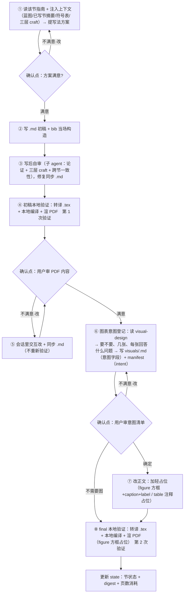

# 目标 3：write-section（写/重写/局部改任意一节）

## 何时用

写新节、重写旧节、局部改任意一节，都用本操作。执行单元是 backlog 里的 write-section 项（来源：蓝图初始化/用户/review-response/蓝图重塑波及）。

**起草顺序只是推荐不是规则**：定位节 → Introduction →（铺垫节，若有）→ Method → Experiment（先写不依赖数据的部分）→ Conclusion → Abstract + Appendix（随各节沉淀）——按蓝图的实际节清单裁剪。推荐顺序来自内容依赖；真实写作里 Method 改了回头改 Intro 是常态，任何时刻可以对任何节调本操作。

## 读哪些（写哪节读哪）

- `references/sections/<节>-writing.md`（该节论证层指南：选择逻辑 + do/dont + 全节自查 checklist）。**按角色分派**：指南是角色指南——节名有对应角色指南的照读；非默认节（Background/Preliminaries 等）没有专属指南，按蓝图的角色标注借最近角色（铺垫节借 `related-work-writing` 的锚定纪律 + `method-writing` 的符号纪律），方案子步里讲清借了什么、怎么用（确认点兜底）。**experiment 特例**：不依赖数据的部分读 `experiment-writing-setup.md`；结果/分析等有数据再读 `experiment-writing-results.md`（通常在 ingest-results 里写）。
- `_draft/blueprint.md`（该节叙事任务 + contribution/C-ID + 页数参考 + 三位一体）。
- **`paper-state.json` 的已写节 digest**（核心论点句/术语/符号/关键数字/图表清单）——**不要各节独立作战**：写任何一节必须注入已写节摘要，术语、符号、数字跨节一致。
- **符号表**（`_draft/content/notation.md`，Method 定稿后存在；写 Method 时构建，写后续节时遵守）。
- **三层 craft（跨节通用，每节都要注入 + 自审）**：`references/craft/sentence-craft.md` + `references/craft/word-craft.md` + `references/craft/anti-ai-patterns.md`。
- `references/craft/bibtex-on-the-fly.md`（bib 当场构造 + 引用 role）。
- `references/craft/section-self-audit.md`（自审子 agent 协议）。
- `references/craft/latex-landing.md`（本地编译 + 关键节点 Overleaf 同步 + label/\ref 纪律）。
- `references/craft/visual-design.md`（图表意图登记 + 分类路由 + palette）。
- `_draft/venue-contract.md`（该节相关合规项：匿名写法、强制章节要求等）。

## 每节八子步循环

1. **① 方案（确认点）**：读该节论证指南 + 从蓝图拿这节的叙事任务与页数参考（量级，不硬卡） + **注入上下文**（已写节 digest、符号表、venue 契约相关项、三层 craft 关键原则）→ 提 2-3 个写法方案（**按叙事任务写全**——写作期不预砍；方案里觉得可砍/可挪 appendix 的内容照写，只登记进 state 的 `compress_candidates`）。用户选/讨论。
2. **② 写初稿 + bib**：写 `_draft/content/<节>.md`，只文字，不渲染真图。每条引用 `paper-search` 取元数据当场构造 bib 落根 `refs.bib`，标 role（core/supporting）。**Method 节**：先按 `method-writing.md` 的符号体系构建节建/更新符号表，再写正文；训练细节（超参/优化器/schedule）不写进 Method，归实验节 setup。
3. **③ 写后自审（子 agent，general-purpose 禁 Explore）**：派未参与写作的子 agent，跑该节论证 checklist + 三层 craft + **跨节一致性**（术语/符号/gap/named-abstraction/contribution 跟蓝图 + 已写节 digest）+ **引用覆盖** + 公式检查（Method：下标/维度/与符号表一致）。不过回 ②，修复同步 .md。
4. **④ 初稿本地验证（第 1 次）**：按 `latex-landing.md` Step E——转译该节 `.tex` → 本地 `latexmk` 编译（**红了先修红**，只带错误摘要进上下文）→ grep label/\ref → `pdftoppm` 渲该节 PDF → 报当前页数 → 本地 commit（切小）。**不 push、不调 overleaf-mcp**。
5. **⑤ 用户审 PDF 内容（确认点）→ 不满意改**：会话里交互改 + 同步 .md（不重新验证，定稿后 ⑧ 统一验）→ 回审；满意 → ⑥。
6. **⑥ 图表意图登记（确认点）**：文字定稿后，读 `visual-design.md`，逐 claim 判断这节要不要图/表、几张、每张**回答什么问题**（支撑哪个 claim、key takeaway 几条）、放哪 → 写 `_draft/visuals/<id>.md`（只填意图字段）+ manifest 条目（status=intent）→ 用户审**意图清单**（要不要这几张、各自回答什么——文字层面可判断）。**不做详细设计**——布局/结构/元素留到产出时刻对着真材料做（make-visual / ingest-results，见 `visual-design.md`）。palette 未锁时先锁：渲染色卡图（含语义色小套）给用户看图确认，确认才锁。该节不需要任何图/表 → 跳过 ⑥⑦，直接 ⑧。
7. **⑦ 改正文加轻占位**：figure——通用方框 + caption 初稿（三段式）+ `\label{fig:<id>}`；table——注释占位（`% TODO: tab-<id> 结构待数据到达后定`）+ caption 初稿 + `\label{tab:<id>}`，**不锁 booktabs 结构**（结构对着真数据定；例外：数据本就在手，可直接定结构落 `tables/<id>.tex` 骨架，正文 `\input`）。
8. **⑧ final 本地验证（第 2 次）**：同 ④ 流程——转译 + 本地编译 + 渲 PDF（figure 位置是方框占位）+ 本地 commit。

## 产出

`_draft/content/<节>.md`、根 `refs.bib`、`sections/<节>.tex`（+ `tables/<id>.tex`）、`_draft/visuals/<id>.md` + manifest 条目。

## 状态更新

节 status（drafting→drafted；等数据的置 needs-data 并登记数据依赖）；digest 更新（本节论点句/术语/符号/关键数字/图表 label）；page_used；写作中冒出的实验需求记 `experiments.new_needs`；**觉得可砍/可挪 appendix 的内容记 `compress_candidates`（只登记不砍——砍/挪是压缩工序里用户拍板的事）**；backlog 对应项关单。writing.log 记一节。

## 确认点

每节三个：① 方案、⑤ 审 PDF 内容、⑥ 审图表意图清单。每节两次本地验证（④ 初稿、⑧ final）；Overleaf 同步不绑节，只在关键节点（里程碑/用户要求/协作需要，见 `latex-landing.md`）。

## 蓝图脱节规则

⑤ 用户交互改可能让成稿偏离蓝图。行文级 drift 不回蓝图；**实质 drift**（贡献变了、故事线变了）当场标「蓝图脱节」，建议回 design-story 重塑——不许攒着。

## 修订项怎么路由（review-response / 用户口述清单）

| 类型          | 路由                                                        |
| ------------- | ----------------------------------------------------------- |
| `re-frame`    | design-story 重塑先行，波及节自动生成修订项                 |
| `section重写` | 本操作走完整八子步                                          |
| `局部改`      | 本操作定点改（② 只动相关段落，③④ 照跑）                     |
| `补图表`      | ⑥ 意图登记 → make-visual 产出                           |
| `补实验项`    | 记 new_needs → design-experiment 产 plan-vN → CPE → ingest-results |

处理原则：re-frame 优先；每项对应一条触发意见（追溯用）；改完跑 ③ 自审（含跨节一致性）；重写/重塑波及其他节的，对受影响节做一致性 sweep（status 置 needs-revision 进队列）。

**关闭判据锁范围（review-response 来源的修订项）**：清单项带 `关闭判据` 时——① **编辑范围被判据锁死**：做满足判据的最小编辑，不顺势重写整节、不动无关段落（连带重写会引入新问题还破坏已确认内容）；② 改完**对着判据自查**「这条关闭了吗」，并在汇报里给出判据 → 证据（改在哪、改成了什么）的对应；③ **未关闭不勾 backlog**——判据没满足时要么继续改，要么回 response/用户重新裁决（判据本身定错了也是常事，别硬凑）。

## 易错点

- **三层 craft + 已写节摘要 + 符号表，每节注入**——别只注入论证层（跟随差根因）；别各节独立作战。
- **图表意图登记在文字定稿后（⑥）**——文字没定就登记图表意图，意图不准；详细设计一律留到产出时刻（make-visual / ingest-results），对着真材料做。
- **不渲染真图**——这步只意图登记 + 轻占位；真图真数字由 make-visual / ingest-results 按 manifest 替换。
- **experiment 节没数据时只写 setup**——结果/分析等数据（ingest-results）。
- **训练细节归实验节 setup**——Method 只讲方法本身。
- **自审是子 agent**（fresh eyes），不是写正文的 agent 自审。
- **本地验证后报页数**——页数每次可见（信息不是警告），别攒到定稿才看。
- **写作期不预砍**——初稿写全是正常状态；觉得可砍/可挪的内容登记 `compress_candidates`，砍/挪判断留给压缩工序的用户拍板。
