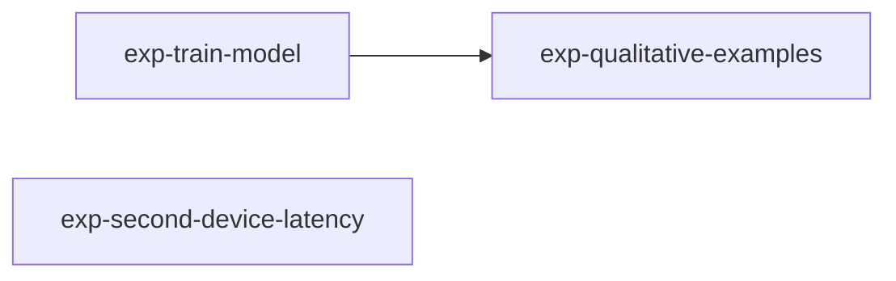

# 论文补充实验计划 · plan-vN

将本文件保存为 `_draft/experiments/plan-vN.md`，与同版本的[机读计划](paper-experiment-plan-template.json)成对交审。编写和交接见[实验计划手册](../ops/op-4-design-experiment.md)。

## 批次范围与批准

- **批次身份**　[与 JSON 相同的 batch_id、plan_version。]

- **来源**　[提纲或修改清单的版本，相关研究轮次、实际证据和代码位置。]
- **这批要补的证据**　[明确哪项比较仍缺、已有证据为何不足，以及本批完成后能回答什么。]
- **投入与停止点**　[资源与估算依据、期望回包时间、遇到哪些缺项或达到什么上限时停止。]
- **批准**　[实际决定、批准版本、涵盖的实验和资源。未批准时记待确认。]

## 主张与证据覆盖

| 论文主张或待核条件 | 已有证据及边界 | 本批补什么及实验 ID | 仍待解决的问题 |
| --- | --- | --- | --- |
| [对应主张或条件] | [证据位置、实际条件、能说明什么] | [实验 ID、这项结果用于判断什么] | [缺的对照或明确排除的范围] |

## 执行依赖

用图标出真正要等待的结果或已确认配置。依赖与 JSON 的 `depends_on` 对齐。下图示意从主实验 checkpoint 取定性样本，同时运行独立的外部条件比较。

## 逐实验卡片

### [exp-id] · [实验名称]

- **问题和用途**　[要回答什么，对应论文主张、原研究命题或实验前提。]
- **实际计划**　[待用代码及配置、模型或权重、数据及划分、控制条件、测量和重复。]
- **判据与解释**　[从哪些读数判断、依据在哪里。说明支持、削弱、无法区分或失配时各能说明什么。]
- **依赖和资源**　[依赖的实验或已核材料、预计投入、停止点及所需回包产物。]
- **执行优先级**　[按现有机读字段填写 `required` 或 `optional`，并说明为何。]
- **预计论文位置**　[对应小节、表格、图或附录。写入 `paper_locations`，收到结果后按可用范围复核。]

## 交审前核对

检查主张是否有对应证据，实际条件是否保留，重复和统计是否能回答问题，失败或偏差怎样处理，是否存在重复计算。写明核查发现、处理后的方案和仍需确认的事项。

配套 JSON 提供 `edge-vision` 的两项计时计划。它只安排目标设备和第二台设备的配置比较。上图的定性样本仅用于示意有依赖时的画法。[同一案例的部分结果回包](../ops/op-5-ingest-results.md#示例--回填目标设备比较保留第二台设备待办)
