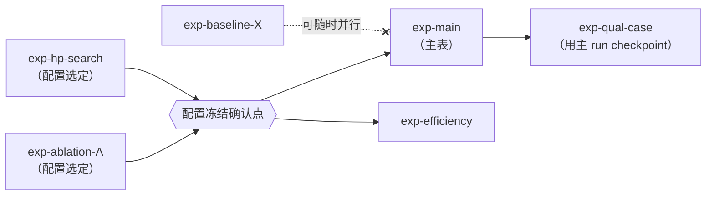

# 实验计划包（`_draft/experiments/plan-vN.md`）人读区

实验计划包的**人读区**——`writing-paper` 的 op-4-design-experiment 产，**用户在确认点逐项由用户确认时读的就是这份**。**机读区（experiments[] 等全部字段）在 `paper-experiment-plan-template.json`**，产物落同名 `plan-vN.json`——CPE 消费的单一读取源是 json；本 md 只装给人看的总览与设计记录。流程 / 用户确认 / CPE 交接契约见 `references/ops/op-4-design-experiment.md`。

> **版本化递增**：`plan-v1.md` / `plan-v1.json` 只装**长周期必做项**（写作启动就必须排上 GPU 的实验；配置未冻结则配置选定批优先）；写作中新增的实验需求不改动旧版，攒一批成 `plan-vN+1` 追加交接。

## 批次说明

[这批是什么：v1 首批 / vN 追加 / 配置冻结后主表批。来源：蓝图初始化 / new_needs 哪几条（逐条列）/ 修改清单哪几项。
为什么装这些、不装那些（写作中才会浮现的需求不硬猜；什么留给了下一批）。
总成本估计 + **deadline 倒推**：这批必须几号前开跑、几号前数据必须回到 writing-paper。]

## 验证覆盖矩阵

claim × 攻击面，哪格由哪个 exp_id 填——防空洞（某 contribution 没实验撑）防冗余（多实验重复证明同一格）。**故意留空的格写理由**（如「C2 泛化格留空：单数据集方法，跨数据集非 claim」），别让读者猜：

| contribution | 主性能 | 组件 | 机制 | 泛化 | 效率 | 公平 | 定性 |
|---|---|---|---|---|---|---|---|
| C1 | exp-main | exp-ablation-A | exp-analysis-attn | —（留空理由） | exp-efficiency | exp-main（同预算） | exp-qual-case |
| C2 | … | | | | | | |

## 依赖拓扑

这批实验的依赖图（谁等谁、谁和谁并行——CPE 按 json 的 `depends_on` 排程，这里给人看形状）：

- **配置未冻结，主表不开跑**——`decides_config: true` 的实验（组件消融/超参选定）先跑，配置冻结确认点（用户确认）后主表批才开跑。
- **一次实验多处消费**：组件消融（全量+多 seed 正规协议）既是配置决策依据又是论文消融表；超参搜索进附录敏感性分析。
- **test peeking 红线**：配置决策只用 validation split。

## 逐实验卡片

[每个实验一个二级标题，人话写清——逐项请用户确认时查阅此节；字段的机读编码在 json，这里不贴 yaml/json]

### exp-main（主表）

- **为什么跑**：[回答什么论文问题；挂哪个 contribution / 矩阵哪格]
- **怎么跑**：[config 变动，人话讲——数据集、baseline 集合、预算；不贴原始配置]
- **预期信号**：[什么结果支持 claim / 什么结果否定；**bar 的依据**（同类工作典型幅度 + claim 强度匹配）；否定信号 → 回 design-story 重审]
- **公平性**：[main/comparison 必填——baseline 同条件清单；官方报告数字 vs 自复现；不弱化]
- **成本与排期**：[预计 GPU-hours；deadline 倒推开跑死线]
- **数据回来填哪**：[主表 Table 1 / Intro-Abstract 数字回填位——一处实验多处消费写全]
- **依赖**：[depends_on 哪些；是否配置冻结后才能跑]

### exp-ablation-A（组件消融·配置选定）

- …（同结构；decides_config 的实验在标题后标「配置选定」）

## 独立查漏记录

[reviewer 预演的结果：查了什么（baseline 强度 / efficiency 有无 / seed 数与方差 / 失败分析 / 定性展示），发现什么缺口、怎么补的；没缺口也写一句]
